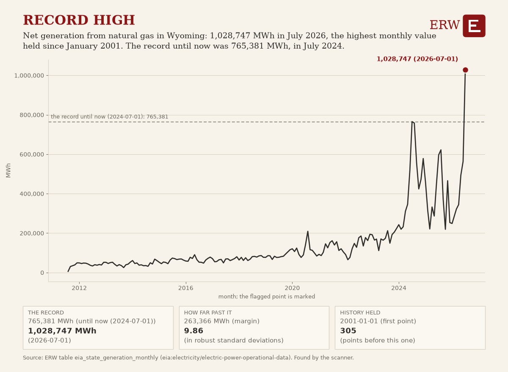

# ERW's Energy Digest, 2026-10-13

ERW's weekday brief of energy news for the 24 hours to 2026-10-13 15:36 UTC, from 259 scored stories.

## Top of the industry

1. **NTT in final talks to build $6.3bn data center for Anthropic in Japan, report says** (datacenter power)  
   Massive AI data center capex; major power demand commitment in final negotiation stages. $6.3bn; parties: NTT; Anthropic. Sources: [Data Center Dynamics](https://www.datacenterdynamics.com/en/news/ntt-to-build-63bn-data-center-for-anthropic-in-japan-report/), [Reuters](https://news.google.com/rss/articles/CBMi0AFBVV95cUxNaDNpQmc0SlhGM0F0cjVrUU1PUVBoWGlFeWNjTU12RFlLWGQwN2xnM3JjNGktZ1V4Qi1OWmR6czVEM09TOHdCOFBfeG9OM083MFdwRFFkOEFDckUzTnNYVlJDaExGT09ERzdfR0NKSzkwUXJrbDByZk4tQjV1VFNBSTd6SFJ6TUI4dDdDa0d6OGNIMVJSNnY3QjlYSEJ2UGdlMHkzYXFoNmFLdU5nX2NpR1Nwck9NRDVRRFRfN1NibjhMMjVVWHdINGIwVG5MbFBk?oc=5)
2. **About 30% of US Gulf oil production shut in response to Isaias** (oil)  
   Major US oil production outage from hurricane impacts market supply and prices. Sources: [Reuters](https://news.google.com/rss/articles/CBMipwFBVV95cUxOSkZwYlVMOFA1RXZIZ2NOZEp3eUktY2NnZTQwME5wdEk3czA0ZGIzdGU0S05sVmJfa2UzVjFscjZIczk0a1Rqa0dDWnY5YTJwN1FNejlhVlpfdDRYdVp2eDlSNkRyTGNLVmlOc01IUTJKSHBxZkZYUENmeHc3RS1kQktWbU5uV0tsMV94Wi1Ba3dIRkVzM3E3T1cwRDFRM1RCbmtMa1BVTQ?oc=5)
3. **DayOne secures $3.67bn in funding for Malaysia expansion** (datacenter power)  
   Major AI data center financing; significant power infrastructure capex commitment. $3.67bn; parties: DayOne. Sources: [Data Center Dynamics](https://www.datacenterdynamics.com/en/news/dayone-secures-367bn-in-funding-for-malaysia-expansion/), [Reuters](https://news.google.com/rss/articles/CBMiywFBVV95cUxPWWRmYjlzSTlGMXlOUVVxVVBtTWRTaGYyakswT2ZseWtfbDUwbzZ6dUgzbkRLM2hfdGxGZzQwZzJYdk0yeEczMmJfTkZlMk9VMlJDaWxjWDJIS2EwdHNWdTdveU9SSFBsRDRnZVItc0JuSzN4MXBxYUhUSkNNRklmRHN0YjZiU1l4UjdRTGpOSG55eWEyQzNuN29GYlFUbWNnUWNlWG5WdUNTRm8ydzd4TmpkR1I3amV5RmM3d2xyU0hKTC1wZGp3V3Bibw?oc=5)
4. **Land & Expand tracks North America's data center pipeline as power, infrastructure and community demands grow** (datacenter power)  
   Gigawatt-scale AI campuses across Texas, Canada, and US require massive new power and grid infrastructure. Sources: [Data Center Frontier](https://www.datacenterfrontier.com/hyperscale/article/55408812/land-expand-north-americas-data-center-pipeline-expands-under-pressure)
5. **Brookfield's Teskey sees no slowdown in AI infrastructure build** (datacenter power)  
   Major infrastructure investor signals continued massive capex for AI power demand. parties: Brookfield. Sources: [Bloomberg.com](https://news.google.com/rss/articles/CBMitAFBVV95cUxQQXRBZ2RJU0Z2SkJYNWZOcHk3NmZURkhRT1NxVm54S01QNUJtUTFqc2hJRnJTUkttblBWU2JSbWkteWxHZFpvZ1ZIY2c3S3dMajhyNFdGcklvRlJvS3hSYU5kTXl3VUNCWV8yamJmYW8yX2Uwc1NfT1ZzTWhwM2J0RzVfYzhVdDgybnJ0UTNIbEwzWjRpdmFSbGJKVGpicXhwWV9jWmw2cmVTanEwRVRRSGZtWjE?oc=5)
6. **VivoPower starts construction at 42MW Mo i Rana data center in Norway** (datacenter power)  
   Major AI data center build-out; 2.2GW portfolio spin-off signals massive power demand growth. 2,200 MW; parties: VivoPower. Sources: [Data Center Dynamics](https://www.datacenterdynamics.com/en/news/vivopower-starts-construction-at-42mw-mo-i-rana-data-center-in-norway/)
7. **Saudi Arabia fends off more attacks; airport attacks pressure Trump on US role in Yemen** (geopolitics)  
   Houthi attacks on Saudi infrastructure threaten regional oil and energy supply stability. parties: Saudi Arabia. Sources: [Bloomberg.com](https://news.google.com/rss/articles/CBMiswFBVV95cUxQUkhLUDV0eDRFTFU5RV9ySWQ3T01GalhxdW5lNFJSSDVsemRmeF85TjFKMi0xZWdmWUVrcWk3aXpra1Y0UWlSMnEycDdVbVBsNFVxNklyckJCYm9KeTVGekJJbGtERXpLSmkyNkd2R0J2ZTR1cExYX29LOGM3YjVQU2FNUkF6MlN6bkw2M0hfNWlONUEzSEtaQnJVOWFhVFFRRTljdjRnaEJiYzFrMHY4X1JlWQ?oc=5), [Bloomberg.com](https://news.google.com/rss/articles/CBMitAFBVV95cUxNU2hXZVp5UFh3blFZQ1lvNTZMTlFFVEtqUEhNT0NqMy1GSjJrdnFDcHFQdFRZR0d0cEYzRzI4aGZfaExaRmVXeGdDSE5WSkFYVWQ5UGpzczlHUXA1SmJQdURnN3B5by1BN1lvTUJScVE3amQ4N3dKY00tZEhRbzhhZHdOM3RhbVpMNHpGcTdocHIyYkc5WDR3UTVMQkEyeGNsX0ktcVpiTXBuTFBGTFlRSkZFZ0U?oc=5)
8. **Saudi Arabia intercepts new Houthi attacks as conflict continues** (geopolitics)  
   Ongoing Middle East conflict threatens oil and LNG supply routes. parties: Saudi Arabia; Houthis. Sources: [Bloomberg.com](https://news.google.com/rss/articles/CBMitAFBVV95cUxNMmFPdkk2bElFdDJEQ3l3NWdMWGwzSEEyNWVLb0pHajNQSGlQMDdHblpDX2pSVzZoRG96MzU5TzA2clhlWWxHcGxQUkh4UmlRbkJBelRkZks1dlQxOWhQZFpMNVRDano4MWpSQ0N2c1dndksyYk1wUU40MVcwMFQ3Q0dhaUVubjlrUjR0Z01NY2ZJZ1ZncFo5TXkzbzVLRFpkdnJYSDdvcWlpclV0eVJZb2R2blc?oc=5), [Reuters](https://news.google.com/rss/articles/CBMiygFBVV95cUxOdFZXdXoyS25SWEFjcG8tR1NrRmhxcUEtMjZHV3BESHFtb0FPSE1ldjVGdERDRjZScHhJbzIteGhOVUtDcUdZMDdKVUI0c0lpSF9nUmlKVC1WMDdqWGlaMWZfU1JJeHhsOVRaWkpmMFJLNXBPZFBnLXJ6MGxmOWRRcWp4QksyMzdSSjRXdl9lMGZROUFFdUZNRUYydFhZbWU2MkIwNFNoX05qY2o1WWtBTkpvbExXRHozaFVmR1FOMGpSWllyb1p3RW1B?oc=5)
9. **Energy Secretary Wright issues emergency order for mid-Atlantic grid ahead of stressed conditions** (grid conditions)  
   Emergency grid stabilization order signals acute power supply stress in major US region. parties: DOE. Sources: [DOE newsroom](https://www.energy.gov/articles/energy-secretary-secures-mid-atlantic-grid-ahead-anticipated-stressed-system-conditions)
10. **Brent settles above $106 amid Middle East tensions and Russia-Ukraine energy truce uncertainty** (oil)  
   Oil price surge reflects geopolitical supply risks affecting global energy markets. $106. Sources: [Rigzone](https://www.rigzone.com/news/wire/brent_tops_106_as_supply_risks_intensify-12-oct-2026-184830-article/?rss=true)

## By sector

**Power**

- Saudi Arabia plans to raise East-West oil pipeline capacity to 10 million barrels per day (transmission): Major infrastructure expansion to bypass Hormuz; doubles current 5.8 million bpd capacity. [OilPrice.com](https://oilprice.com/Latest-Energy-News/World-News/Saudi-Arabia-Plans-Massive-Expansion-of-Oil-Pipeline-to-Bypass-Hormuz.html)
- FERC approves PJM's data center registry and rejects plan to curtail power to them (grid conditions): Grid operator decision on datacenter power management affects reliability and demand response. [Reuters](https://news.google.com/rss/articles/CBMixwFBVV95cUxNelMwdWdXcXc1aU5DLXExOVlIdWc4ZXU1Q0FXelg1MUFMcHhEa0FHYzRwWEhpZ3ZVZk1pMmlSU2JZTFRxcUkxTnFyeTNXdERBQWUxXzd0dVo5UVRnQXR3bVpaSFVLOHRuc0ZmNXlZeVprbEVHSW5sbnB1NjRQMDFUMmNYYUI3em1EYUplZVBBclBLdE1mck1DY18yNXZNb3JaQzRySjNybDZrbVdRRVlPaFo3U1VBaTVzNVFIWHE1SjBtM1VtRTQ4?oc=5)
- VEIR raises $110 million Series C for superconducting power delivery technology for AI data centers (datacenter power): Capital for novel power delivery tech targeting AI datacenter efficiency and density. [Data Center Dynamics](https://www.datacenterdynamics.com/en/product-news/veir-raises-110-million-series-c-to-accelerate-commercialization-of-superconducting-power-delivery-technology-for-ai-data-centers/)

**Oil and gas**

- Oil climbs as fighting flares in Middle East and Ukraine (oil): Geopolitical tensions drive oil price movements affecting global energy supply. [WSJ](https://news.google.com/rss/articles/CBMinAFBVV95cUxPT2VNZDJQX0Z6SW1YbzFBdHlvYmtlVzdPZEcxRjRwWjVDZWJsRUNfdENWUWFjT29TVmdPSVVFc0JfVTQ2ZDZZUV9GTU05N3BBTWxwd0NOZE0zQlRzOFVyYWhoWWNyT3ZQejlzWGxQLVpiTXRPdjJKMk1lYXNMZTRkX19TMDJxZkpJU2xObzJ6SlpUbFdBNThySFhvMEs?oc=5)
- TotalEnergies declares FID on Absheron gas and condensate full-field development (gas): Major gas project FID; significant capital commitment and production [JPT Homepage](https://news.google.com/rss/articles/CBMiogFBVV95cUxOMXlRVkdZWnhyRVdMMFVDdllBb2lBWE83NzVsSkpsSkxXWnZ5ZmQtUzB2d0wtU09Td2M0a0RhbnhBanZCUjBPMEdiN2pCMFJZQUFralk4MXFGM0hibHQ3Y090WHlZNHY3a2tlaWtJQmxHUFd3VHpzSWdrWVdMSzZHY3A2Q3Q4X2ptTUlNVERMQjhhSXg2YUpNdDhZcndpengzbVE?oc=5)
- Wood Mackenzie says Middle East conflict derailed South Asia LNG demand growth (lng): Middle East war and Hormuz closure cut off critical Qatari and UAE LNG supplies to South Asia. [LNG Prime](https://lngprime.com/asia/wood-mackenzie-south-asia-lng-demand-growth-derailed-due-to-middle-east-conflict/198352/)

**Nuclear and renewables**

- Poland's Ministry of Energy, PEJ and PGE sign agreement on second nuclear power plant (nuclear): Major European nuclear expansion project moves forward with formal cooperation framework [World Nuclear News](https://www.world-nuclear-news.org/articles/agreement-signed-on-second-polish-nuclear-power-plant)
- Fraunhofer ISE tests high-temperature heat pumps as an alternative to fossil fuels in industrial heat (renewables): Breakthrough in heat pump technology offers pathway to replace coal in industrial applications. [OilPrice.com](https://oilprice.com/Energy/Energy-General/Heat-Pumps-Are-Coming-for-Coals-Industrial-Heat-Market.html)
- Qcells aims to build a large factory for next-generation tandem solar (renewables): Major solar manufacturer plans production facility for higher-efficiency tandem solar cells. [Canary Media](https://www.canarymedia.com/articles/solar/qcells-aims-to-build-worlds-first-big-factory-for-next-gen-tandem-solar)

**Policy**

- EU looking at oil and gas windfall profit tax as energy prices soar (policy): Potential EU tax policy on energy producers amid price volatility affects industry economics. [Reuters](https://news.google.com/rss/articles/CBMirgFBVV95cUxNRkFnZHlycnVIT0dJR21Nd1NXQ215NHNYZGp5WHM5Rk9MeEdBbktzUFhMSmZyWHRUS2o3Vkl6MWdGTVhmeVB4NUxPNG0zeHVSNU0yY2otd2Z0REhpWmhscGxzN3B4RW1CYlJYZmFhUnpucDBYMGJfMHdpSWx3YWtsTlFWc1lzVktYcDZvZXhYU1d1dEF4TklNekJ0cHk0ZVZsUE1aQU5JSVZXbWNLd3c?oc=5)
- IMF flags risks to global economy from AI market correction, war and debt (policy): Macroeconomic headwinds including AI correction could affect energy investment and demand growth. [Reuters](https://news.google.com/rss/articles/CBMiswFBVV95cUxOTXc4YzNuVFU1U2dtSjE1SG9xRUIxZTRtMU1xdXNodDkxMTRGaE9yQTJIVVVoeVJjdnFsbi0yeUJ6a09ZbGJ0Z3N5V1NiV1RGZlVDekptcUVqcTVtNGRsdDNpZkd1akEyN2hybUx5aFlXM05pZENOVFdfTXI3XzBxaGRMZ0NVcFFRVXZRbHlZYUNleHhiTTJ1UTN0dXJ6U0h2V3ZoWGdqOWp5SmdCMjFab1doZw?oc=5)
- Trump defends decision to allow Russian diesel exports amid criticism and unconfirmed energy cease-fire claims (policy): US policy allowing Russian diesel exports faces criticism as Ukraine reports continued Russian strikes [OilPrice.com](https://oilprice.com/Energy/Energy-General/Trump-Defends-Russian-Diesel-Deal-as-Energy-Ceasefire-Claims-Unravel.html)
- Colorado Underground Injection Control (UIC) Program; Class VI Primacy (EPA final rule, policy action): Colorado can permit and enforce geologic carbon sequestration wells, likely speeding project permitting in the state. [EPA](https://www.federalregister.gov/documents/2026/10/13/2026-20846/colorado-underground-injection-control-uic-program-class-vi-primacy)
- Notice of Availability of the Proposed Notice of Sale for the Cook Inlet Outer Continental Shelf Oil and Gas One Big Beautiful Bill Act Lease Sale 2 (Interior notice, policy action): Next step toward a mandated Cook Inlet offshore oil and gas lease sale, with state and local review. [Interior](https://www.federalregister.gov/documents/2026/10/13/2026-20892/notice-of-availability-of-the-proposed-notice-of-sale-for-the-cook-inlet-outer-continental-shelf-oil)

**Capital and companies**

- Dangote refinery extends $1.6 billion IPO by two weeks to add more nations (company): Major African refinery profitability and capital raise signals strong oil demand. [Bloomberg.com](https://news.google.com/rss/articles/CBMiswFBVV95cUxQODg3V0Z4ZnRUcGNDa2JiUEhib3dJeDZkVHlXTFEzNUR4WlFhYnY4V2FydUNXWVFLMWk3Z1JaMTVTVVJyNFdPd3pZM2NMcnlBTmZCYldhNnFIVk1QNUxZc0Z1SVJ0cm9LVlNRMzlEVkZYNnNjRUpyM1QxcVV1VzZrd2dhdmlPNHBPQUduTlFlZUJRcHMxQzVybGMtaUZIeHB0TFFQdGpNb09QM1JKc2NBTUcwOA?oc=5)
- TotalEnergies and KKR expand US power joint venture with $1.2B enterprise value (deal): Significant renewable energy deal with major counterparties and capital commitment. [Hart Energy](https://news.google.com/rss/articles/CBMipgFBVV95cUxONXhYdW84TFBCNmlfQ1RCVFEwb2ZQNGh1TzBmSW8xRUtmVElXb0NPc3RLaTBjWS04VWQzN3hKVENUOGxkX0RZOW1WQW1NX0IxQ3FIcHFXUlY4dmJMcDlqVDdReXVlNkxGS0twX2JKdVByeTZZTE8zTXc2cm1IR2hGOEp5ZXVzMDVWYVVnNWdGYXVWUjFDTUVhalpiSUMtV2ZOOFF1RzBn?oc=5)
- BP expects up to $4.5B in impairments for Q3 and sees refining margin triple (company): Major oil major reports strong refining margins and debt progress but signals future asset writedowns. [Reuters](https://news.google.com/rss/articles/CBMirgFBVV95cUxNT0Vzam9PQWZSUjJ1ampUeU9BcVBmQjJPUHJ2ZHkxT3pEcmRManlDTVBtS0N1LTJWV1lwR1FHMHFhZGJOWUVFN2U2eE5RRmlaVEVIRVlYdFhjS0RBdkxlVDJMV2pnOUVNLW4xbGVaYlpIV1VVVWhrSVJFT2YyWDdBOTV3eEwycXR6eDdCUW9raVYwNXZOQUU2YmtTM0pWekVfX2FDUlFNWGI2WEdQZHc?oc=5)

## AI and power

- Chemical firm proposes 500 MW data center site in Maharashtra, India, with $3.3bn planned (datacenter power): Major AI data center investment signals growing power demand in India. [Data Center Dynamics](https://www.datacenterdynamics.com/en/news/chemical-firm-turns-data-center-operator-proposes-500mw-site-in-maharashtra-india/)
- Oracle trucks in gas to support operations at Utah and Texas data centers, report says (datacenter power): Major cloud provider using on-site generation to meet AI data center power needs. [Data Center Dynamics](https://www.datacenterdynamics.com/en/news/oracle-trucks-in-gas-to-support-operations-at-utah-and-texas-data-centers-report/)
- Microsoft unveils Azure Maia 300, which it calls its primary inference system (datacenter power): New AI chip deployment across geographies drives power demand for cloud infrastructure. [Data Center Dynamics](https://www.datacenterdynamics.com/en/news/microsoft-unveils-azure-maia-300-says-chip-will-be-its-primary-inference-system/)
- Scaleway to build AMD-powered AI supercomputer in Sweden (datacenter power): New AI compute infrastructure; significant power demand for cloud services. [Reuters](https://news.google.com/rss/articles/CBMirgFBVV95cUxPZVFlaGxodDhwTlJlRDBueTJ5UEZWYmtSVV8zejBPbGZ6NWZnV3FYaEczYkh4XzFMOXNuRGpnN0ZUV1VOb1dCYW5paVZXSE9ia3VTbU5kaDk4ZXdFNmw2Mk1FZ3BqUmswdmlNVHZSYk9kRHdjWnpOOFEwVGhjQW84SkcxMlJHWkY2c3A0SnZsN0RGWFczTG9uS1ZTMGprbjRsZXZ4aE10MFl2UmNBMVE?oc=5)
- WSJ: 'phantom' data centers demand more from the power grid than they need (datacenter power): Data centers overstate power needs, straining grid planning and capacity allocation. [WSJ](https://news.google.com/rss/articles/CBMiwAFBVV95cUxPQ3d4c0hBaVZQdmVuT3NFRXlyeXpPRjlER2wyZG1lUUwxa2tpTVVmamNKb2kySk5Yb1F4RGQ3bU9OclVMNng5V3g3bDFBU05NX0RtWl9WWUFTYTdvdzgxUXJtbU1iZFB6emIwbi1DQi1YT1BIVDJ0M09PRTEteVR0VnpYc2VXcXJhRjRGcE1rVDRYWWdQZ3dpUFBGcDhOMVJFLXJ1SGdnNExHdnhDMWJCR2Q3M3lYdDZBTHpxc3dFQms?oc=5)

## ERW's Numbers Today

Day-ahead power on 2026-10-12 was dearest at NYISO's N.Y.C., 53.30 USD/MWh, and cheapest at SPP's SPPSOUTH_HUB, 4.12. The highest real-time price was 129.57 USD/MWh at LONGIL (NYISO) in the interval starting 2026-10-12 17:30 local. MISO has no day-ahead data in the warehouse for the day and PJM has no price table; the latest fuel closes, on 2026-10-06, were 3.03 USD/MMBtu for Henry Hub, 96.24 USD/bbl for WTI and 125.44 USD/bbl for Brent.

**Day-ahead average, yesterday, main hub** (mean of the 24 hourly prices of the operating day):

| ISO | Hub or zone | Operating day | Average USD/MWh | Table |
|---|---|---|---|---|
| ERCOT | HB_NORTH | 2026-10-12 | 30.10 | [1] |
| CAISO | TH_SP15_GEN-APND | 2026-10-12 | 42.17 | [1] |
| NYISO | N.Y.C. | 2026-10-12 | 53.30 | [2] |
| MISO | INDIANA.HUB | 2026-10-12 | not in the warehouse (0 of 24 hours) | [1] |
| SPP | SPPSOUTH_HUB | 2026-10-12 | 4.12 | [1] |
| ISO-NE | .H.INTERNAL_HUB | 2026-10-12 | 46.62 | [3] |
| PJM | | | no PJM price table (no API key) | |

**Highest real-time price, yesterday:** 129.57 USD/MWh at LONGIL (NYISO), interval starting 2026-10-12 17:30 local (2026-10-12 21:30 UTC), PT15M `lmp_rtm_15m_mean` (a 15-minute mean of 5-minute prices) [4].

**Latest fuel spot closes** (EIA, trading dates):

- Henry Hub natural gas: 3.03 USD/MMBtu on 2026-10-06 [5]
- WTI Cushing crude: 96.24 USD/bbl on 2026-10-06 [5]
- Brent crude: 125.44 USD/bbl on 2026-10-06 [5]

Tables: [1] `iso_dam_hub_prices` (caiso:PRC_LMP, ercot:NP4-190-CD, miso:da_expost_lmp, spp:DA-LMP-SL); [2] `nyiso_dam_zone_prices` (nyiso:damlbmp); [3] `isone_dam_zone_prices` (isone:da_lmp_hourly); [4] `nyiso_rtm_zone_prices` (nyiso:realtime); real-time tables read: iso_rtm_hub_prices, isone_rtm_zone_prices, isone_rtm_zone_prices_hourly, nyiso_rtm_zone_prices; [5] `eia_fuel_spot_prices` (eia:natural-gas/pri/fut, eia:petroleum/pri/spt).

## ERW's Chart of the Day

Net generation from natural gas in Wyoming: 1,028,747 MWh in July 2026, the highest monthly value held since January 2001. The record until now was 765,381 MWh, in July 2024.

Table `eia_state_generation_monthly`, series `entity=eia:generation:WY:NG, variable=net_generation, freq=P1M`: [the table and its download](/data#eia_state_generation_monthly). Chosen by rule, not by a person or a model: the strongest flag of the day's scan that no Digest has shown (rule: record; 9.86 robust standard deviations past its threshold). [How the chart is chosen](/data/methods/automated_analysis_scanner).

## ERW's Fun Fact

The lowest daily Henry Hub natural gas spot price in EIA's series, which starts on 1997-01-07, was 1.05 USD/MMBtu on 1998-12-04. The latest close, 3.03 on 2026-10-06, is about 2.9 times it.

Sources: `eia_fuel_spot_prices` (U.S. Energy Information Administration (EIA)).

ERW

---

[How this is made.](/about#digest)

<!-- Generated by warehouse/news/brief.py at 2026-10-13 15:36 UTC; run log warehouse/output/logs/news_brief_20261013T153652Z.log; model claude-sonnet-5-5; story data warehouse/output/news_stories.csv. -->
