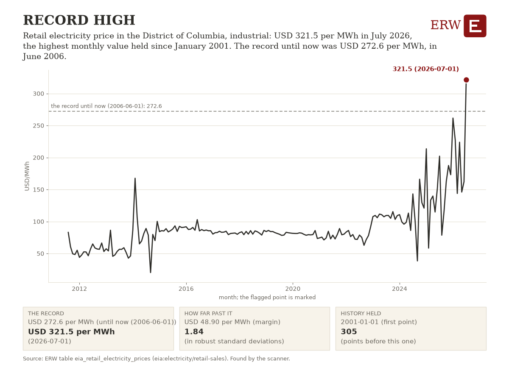

# ERW's Energy Digest, 2026-10-14

ERW's weekday brief of energy news for the 24 hours to 2026-10-14 16:18 UTC, from 243 scored stories.

## Top of the industry

1. **Google signs 20-year PPA with AEP for 702 MW Wyoming fuel cell project** (ppa)  
   Major datacenter power deal: 702MW fuel cell capacity under long-term contract. 702 MW; $4 billion; parties: Google; AEP; Bloom Energy. Sources: [Data Center Dynamics](https://www.datacenterdynamics.com/en/news/google-signs-20-year-ppa-with-aep-for-702mw-wyoming-fuel-cell-project/), [Reuters](https://news.google.com/rss/articles/CBMixAFBVV95cUxOMDVWVDNiei1GdWtyUjd1WUIxSlVJVDFLQ2xnazFXVkZBLWRvUmwtTnJ0R0xmRTBscml5UnJVaWJhXzZzakQxbFMwTlE4MDhLUWRBTzVjWjMtcXotbV80aWd4RHJ5WkVhZVpTb2x5MmZpeDhtNG53RzEwcUlPZEdfb0N6VE8xeGpfZC05YUduY1g3c1lvUWF1R2JDQzg0cy12TlZrTGRKWnJfYzNSOXFuMURYVVJyT2ZFcjJ6ejFhaDh3MklF?oc=5), [Bloomberg.com](https://news.google.com/rss/articles/CBMisAFBVV95cUxOblNJVktLUi1hc1RMNGhZTHQ0V2lnTElnZjY1aGN2YnhVZmpMZXM4UjdDS1BTWkxkUkRpeVdvbWQzNmg5bTRUcU9sMUFDbkd0Zi03c2xKQ28zb2kwdldpMTVfckFNbWh6MmpXcXA1OTZRaGJiTjVrb1U0SUtNd0RCckQ0TW0yVndCLXJlaFdUNks2NWJmc2JsLXM0bFQ0TXJnRW1tLVdRZHNoYmRFN2FzTg?oc=5)
2. **Taiwan commits up to $4.4 Billion to Alaska LNG, Trump says, with 30% of output** (lng)  
   Major LNG offtake commitment from Taiwan for 20-year supply agreement $4.4 Billion; parties: Taiwan; Trump; Alaska LNG. Sources: [OilPrice.com](https://oilprice.com/Latest-Energy-News/World-News/Taiwan-Commits-Up-to-44-Billion-to-Alaska-LNG-Megaproject.html), [Reuters](https://news.google.com/rss/articles/CBMipgFBVV95cUxOUkhxakRwVWtIYkFQMFgtVExzbndLT3hSSGpUMGRWZ3dtVzhDdVR6ZFpXNmRnOWY5bDd5QjJhdFBxeGIxVnQ5bXphb0d6bjMzaW4wdFZ3eUhlMmp3cHo1SWRYVFh4bmFIV1J2QlBvWUZwdDg1NHpaMm5kcnB6U3ROMWhJbzBGUTVaSE5sVUZwaUl3UTZNWjJXemNSZjA3dU1oaXpXRi1n?oc=5), [Bloomberg.com](https://news.google.com/rss/articles/CBMisgFBVV95cUxPeHlMb3JISTBtRTA1b0RFM3YtZVNVWWh4YUlfd2kzcW5id2xQN0pVR1E5Z0lVZUU1Zmk2ck5qVTZKNVJOSmd5aklDSlhPQ1BOaGRUeHpRTVUzcVUzeXloUmFEeldqX3ZHSjZOMGpucmg1OTZHNUIzbXBWWU8zYnQxYnlSWC1XQVZuSmZGRUNFZGJieWZNYVN1TmRNNGNLUEJLbDJ5WG9GX2RtbVVlOXJDU05B?oc=5)
3. **Brent trades at $106.37 per barrel as Iran threatens more tanker strikes** (oil)  
   Geopolitical supply risk drives significant crude price move. $106.37; parties: Iran. Sources: [OilPrice.com](https://oilprice.com/Latest-Energy-News/World-News/Oil-Prices-Climb-Above-106-as-Iran-Threatens-More-Tanker-Attacks.html)
4. **IURC approves AES Indiana $1.3bn solar, storage and transmission project for Google data center in Monrovia** (deal)  
   Major datacenter power deal: Google-funded solar, storage, and transmission infrastructure in Indiana. $1.3bn; parties: AES Indiana; Google; IURC. Sources: [Data Center Dynamics](https://www.datacenterdynamics.com/en/news/iurc-approves-aes-indiana-plan-for-13bn-solar-storage-and-transmission-project-for-google-data-center-in-monrovia/)
5. **AEP to buy mobile power units in deal that may reach $4 Billion** (generation)  
   Major utility acquisition of flexible generation capacity signals grid reliability investment amid demand pressures. $4 Billion; parties: AEP. Sources: [Hart Energy](https://news.google.com/rss/articles/CBMimgFBVV95cUxPNmx6MDhqWE11MmRVSTZHMVh5RGx1UkdvSjNfUWRVSjQtOXZHSUl6cnVsTU9RTm5wWE9iNUxUYUNreFZCWTFuNlJYMWNxMURfUzRCd0NHMWotNEUwTG5UUHU1dzk1MjJsdXVzUWI1b29TNmdEY1dPbzI4M3VWYVRFUjJXYi10RlJMVDYxdWhIT2x1MlpWTVozRU93?oc=5)
6. **Houthi attacks hit Saudi Aramco headquarters in Dharan; oil prices rise** (geopolitics)  
   Direct strike on major oil producer headquarters escalates Middle East conflict and supply risk. parties: Saudi Aramco; Houthis. Sources: [OilPrice.com](https://oilprice.com/Latest-Energy-News/World-News/Saudi-Aramco-Headquarters-Hit-as-Houthi-Attacks-Escalate.html), [Reuters](https://news.google.com/rss/articles/CBMixAFBVV95cUxQTEY0UDJsbGo1MXFVX1FoY1RIdkFLeW96R3hMOEkwQTNRTFpLby1wZEFGRy10SThxSkhSaXZKQ1psYmdiQVZQd19uaDFtZFBZa1pJZzZCT0dsd0lSdmV1UWV0dExiRmU2Y2lVUS1SaWs1UzNkZ25lUnRJaklfWnlOeEFVQTg2dDVQTWF4UWp1aTcyR2JsUWN5d0JzSWRqMlp1ZDY3OXpncUZDN2FuVk9tN0VuaGtIMVpXM1F4RU5QX00xek9q?oc=5), [Bloomberg.com](https://news.google.com/rss/articles/CBMitgFBVV95cUxPLTM3MUJoRVBma0lBNlpQa0hKSkxCalhRMkUtQThqdy1sTVNjcnN4a0dIV0UwczhyUklLUkZCLTZ2MF9FSmhIMDRUQXlWcFFkRHo4R0MyMFJIRzlYejg1TksxS1NkSFJEUy1OT2FKWnVBT1FXVThyNDI4WXRXN1UwM1NIbWUtQTVxTmRqelNIN0FjT05aM0U2dkhXMHBpdF84ZG9IUHFmak1qbnBJQ3FYbmZSYWJtQQ?oc=5)
7. **Aramco headquarters hit during Houthi attack on Saudi Arabia** (geopolitics)  
   Direct attack on major oil company headquarters escalates Middle East conflict and supply risk. parties: Aramco; Houthi. Sources: [Hart Energy](https://news.google.com/rss/articles/CBMiswFBVV95cUxNT1FBOEdqa3lLQ0ppWVloM1lYVVp1WXhhM3BxN0hsQk5rdVkxWnB5QWQxT1VoRXh0ZFNrMWpHcEEyVUhJWFVFcmJfclNDSjQ2NWVNQ3g0RnBKZkNuOTMyWjJHd1ZvSjdxNEtZZktSbFRNeXVPaVJUQUR0ME5QaHlfYXNhTDlxX3ZsbGU0YkNwTG9rQUUwYkd6RktzRVJlQ3RKWlBYbXgxOEpZc04wQ0lyYmE1VQ?oc=5), [Bloomberg.com](https://news.google.com/rss/articles/CBMisgFBVV95cUxQZW5UZm9rTkVDR01LTzZFcTQ0MUprS3hKLTdHaWtXQkVUQzdOSzNJUWJxRlQ3WkpnbUl0TzZlMWg2eVI1bzJidmpzQnFlaC1VcVRpS1FaN0tvZENEeS1LMUVPVmFaM3o0cEI2bkx6bGhMZ1c4WXliLTg3c0djRjgwUU9YWTE5d3F5dFlVV3hlWXh4clk0eUZNWGczUnhUbmtsbElkR2ExNEFqcVRKUEJwT053?oc=5), [Rigzone](https://www.rigzone.com/news/wire/aramco_hq_hit_as_houthis_escalate_attacks-14-oct-2026-184842-article/?rss=true)
8. **PJM power prices top $1,021 as heat meets fall plant maintenance; maximum generation alert extended** (grid conditions)  
   Spot prices spike to $1,021/MWh; 62GW offline for maintenance during heat wave. 62,000 MW; $1,021; parties: PJM. Sources: [OilPrice.com](https://oilprice.com/Energy/Energy-General/Power-Prices-Top-1000-on-PJM-as-Heat-Collides-With-Fall-Plant-Maintenance.html), [PJM newsroom](https://insidelines.pjm.com/operations-update-extends-maximum-generation-alert-calls-on-demand-response/)
9. **Global diesel shortages could persist well into 2027, IEA says** (oil)  
   Extended diesel supply deficit affects refining, transport, and energy costs globally. parties: IEA. Sources: [Reuters](https://news.google.com/rss/articles/CBMiqgFBVV95cUxPNmx3MC1ZNktjTUI0ODR3THRhZGw1dk1mWXozUDJqbHFJSGhvT2ZyYW1GZHlLQnh2dk1pMUE3YnhqYi1XX3lVRFA5MHdTS1lWSGtlNEFtclc4S2dMX3NqOTZPMURyZXN2WEJ0Ulo3b1hrNXlKeDJHbHRYRGFVVWluYXBCeVZadXJtRXJCZDVEN2xVWGs1cHYtbHJXQ29YRVlzZlBNVkJ3d3h1Zw?oc=5), [WSJ](https://news.google.com/rss/articles/CBMingFBVV95cUxOdmpUZk9PcDRTYUJqMWhnY3dIelFfSUxEdXdHYkY3eEdvaGprZ2JVdF9mV1MyQXVFd2hsNTlOX29IMTlfbWVpSmlHNWZXT2tEZEhfMlZIS1MySXZnSV9zMXdGOWljX1oxREZfeXY1RnVDQUNTUjFJbjM3YmxySDJ0RGpwZU40RmYzUGtiRUVobEZRZVk1U1MzZDFNYjYyZw?oc=5)
10. **Renewed attacks near Strait of Hormuz threaten gas supplies; Europe faces rising prices before winter** (lng)  
   Middle East conflict driving European gas prices higher and increasing US LNG export demand. Sources: [Natural Gas Intelligence](https://naturalgasintel.com/news/iran-war-escalation-threatens-global-market-ups-demand-for-us-lng/)

## By sector

**Power**

- Energy Department backs adding 2.5 GW of grid capacity across eight states (transmission): 2.5 GW transmission capacity addition to strengthen reliability and lower costs. [DOE newsroom](https://www.energy.gov/articles/energy-department-backs-major-grid-expansion-across-eight-states-strengthen-reliability)
- At Open Compute Project summit, AMD, Meta, Arm, Broadcom and NVIDIA outline AI infrastructure changes (datacenter power): Agentic AI drives gigawatt-scale data center construction and grid integration architecture changes. [Data Center Frontier](https://www.datacenterfrontier.com/hyperscale/article/55411534/ocp-2026-agentic-ai-pushes-the-data-center-from-chip-to-grid)
- Natural gas becomes data centers' go-to power fix as grid constraints mount (datacenter power): Data center power demand driving gas infrastructure decisions amid grid stress. [Hart Energy](https://news.google.com/rss/articles/CBMioAFBVV95cUxOWUhYT3ZMakZVbk5CZC1OR0hOX3BWU1RJUW5fSlc2U1BMMUVrWEhWbzBaOWZpYVJaanVldkxkbVZHNmpzQmJzM2RLVWNSVkl3b29QTnVMUXJlT19OOE5QeFotTFZJWFd3SDVSSEhOTFJlTS1tTm52d1RFck9INDZFTlZqelR6NEJsUDhxVHg1VkhOTHQ5MHR6THFnY2pOWWtk?oc=5)

**Oil and gas**

- Saudi Arabia tells OPEC its crude output jumped by a third last month (oil): Major OPEC producer signals production recovery after war disruptions, affects global supply outlook. [Rigzone](https://www.rigzone.com/news/wire/saudis_tell_opec_that_oil_output_recovered_from_3_decade_low-13-oct-2026-184837-article/?rss=true)
- OPEC sees 2027 oil demand growth of 2.6 million bpd, after 200,000 bpd this year (oil): OPEC significantly raises 2027 demand forecast, signaling stronger market outlook and inventory rebuilding. [OilPrice.com](https://oilprice.com/Latest-Energy-News/World-News/OPEC-Sees-Oil-Demand-Growth-Surging-to-26-Million-Bpd-in-2027.html)
- Middle East LNG supply has not meaningfully recovered seven and a half months after Hormuz disruption (lng): LNG exports from Middle East remain blocked seven months after Iran war, disrupting global supply. [OilPrice.com](https://oilprice.com/Energy/Natural-Gas/Stranded-Middle-East-LNG-Supply-Upends-Gas-Markets.html)

**Nuclear and renewables**

- Green H₂ project FIDs worth up to €60bn needed over two years to hit EU targets (hydrogen): EU hydrogen investment targets signal major policy commitment [Hydrogen Insight](https://news.google.com/rss/articles/CBMi6wFBVV95cUxOakdzNF9mbWt5S0QxRGlETEdBWnRjaUYyYzduZEhCYXBZY1lVeFUtQ2dZZzY4S1BOeG5Ddy1KcW1UR2Y1b09DZUhVaHpkN3cxZHlyZnhmN1dsaG1vWnpZM01fdC1PRnRYZVhlY3FKdnJ0N0EybXQ0QzJyOHZOR3gzTTE5S1VndkV0bE5BcXN6ek5jRDJEVFZVVkVBLV9pREFMU1hrYnVrRVZCWHM2bmR6VjRLMHdRN0RqUmZUdHc3eDhoR3g4SXY5RVJ4ZUN6eXZZeHVGYUJRX0ZSbmZycmVuakxxdWZrbDQ2UEo4?oc=5)
- Westinghouse advances Polish nuclear plant, signing conditional purchase orders for first of three AP1000 units (nuclear): Major vendor progresses on first Polish nuclear plant and Dutch reactor deployment. [ANS Nuclear Newswire](https://www.ans.org/news/2026-10-13/article-8483/westinghouse-moves-forward-on-polish-dutch-power-plant-projects/)
- Developer on track for final investment decision on 300 MW green hydrogen project in early 2027 (hydrogen): 300 MW green hydrogen project approaching FID signals hydrogen sector momentum. [Hydrogen Insight](https://news.google.com/rss/articles/CBMi_AFBVV95cUxNbHZYNUFyOHdwWDA0OVFZVklLejBwQ3hONm1pZEFrZFNQUjBMclEtOXdrYlhlU0VTQndmNkYxbE81aFB6b05ib2xIMFFqSVVtMklkUTA1TmkwNlVLTHVyUGdDQS1NaUcyb0ROd2FLOEg2YWtLTDl4Wkx5YlRXTm5ZVTJvZ2ZOUGlTWmdQVlV2OFgyMC1NNVBFMVd2RUNJcW1lSGRJZWUteVk5bTRfWlVJeGRSUVUxVHdFcVlrd3o5NjF0bW55VlUwSHNpYmI2QnkwY3hXMmJzY1RxX3pDdHFINnF2N1oya196cjJWOVlUSy04YnFtLTRyUE43Q2w?oc=5)

**Policy**

- Oregon Governor Kotek asks regulator to pause permits, a de facto data center moratorium (policy): De facto moratorium on data center development affects power demand planning. [Data Center Dynamics](https://www.datacenterdynamics.com/en/news/oregon-govenor-tina-kotek-asks-state-environmental-regulator-to-pause-permits-introducing-de-facto-data-center-moratorium/)
- WSJ asks whether voters will punish politicians over data centers in Ohio and Michigan (policy): Political backlash against data center development affects permitting and policy. [WSJ](https://news.google.com/rss/articles/CBMiuAFBVV95cUxQOWJaNEg5NE1ZQ3RNMGtlazV1RkVQSHNELW9kaERPWEJFM3RNSmlSOGJ6bXFUSW5HTEEtMmxyUnZ2TjlQeWJ5ZWZ5NEU1bG1UeWpWRXVpS0dLbG9YZ3JSYjMzRjdfdWw2TlBkUzh2NW80VkY2TUJtV1IyU0xIenhRSUw1TWFNUG5OZm1WMEpneUZWUTlHb0M4VzN2V0lhWXJDanBodGtSVHhVejFvTDY3TzkxNUxjZW5F?oc=5)
- Trump administration to expand a Delek Texas refinery using Defense Production Act (policy): Federal intervention to boost refining capacity signals policy priority for domestic fuel supply resilience. [Reuters](https://news.google.com/rss/articles/CBMiyAFBVV95cUxQVnhNU3BlQXNqZ3N2M0lHWDUxZ0pTWE9xdF9jSUV3QU9tVkZLSGk0eU9ibDBnRkR2QVRCd0YyN1NyMUJmajJhcHNzbjNScW9nVDdqaHpCQ2pUSzRBaUJpRjQzREhISEdTLWhQSXY5eWxKX3VNX2U2SnJGV0FYb1NDczRrSTdISWtvSEc5Z0J5SURxdTlqdGZZZ1RQdXBLUV9YTF9ta1RFcVlRLWd6MzMxaGJpbnlOdjhJTjU0WExvV2ZKOXQ1M1lYNw?oc=5)
- AP1000 Design Certification Renewal (NRC final rule, policy action): Renewed certification reflects the construction-validated Vogtle 3 and 4 design, supporting future AP1000 licensing. [NRC](https://www.federalregister.gov/documents/2026/10/14/2026-21030/ap1000-design-certification-renewal)
- Colorado Underground Injection Control (UIC) Program; Class VI Primacy (EPA final rule, policy action): Colorado can permit and enforce geologic carbon sequestration wells, likely speeding project permitting in the state. [EPA](https://www.federalregister.gov/documents/2026/10/13/2026-20846/colorado-underground-injection-control-uic-program-class-vi-primacy)

**Capital and companies**

- Upstream M&A triples to $19.5 billion in third quarter (deal): Significant rebound in oil and gas dealmaking signals renewed capital confidence in fossil fuel sector. [Hart Energy](https://news.google.com/rss/articles/CBMiwgFBVV95cUxNVXpmS25nclFWbzUydl9kNE5hM1N0dUtWTzU2cGFSWVBod1d6bHNRLUVBZDZXYjJIaGxPdjRKTFFTS3FHSjF2WC1BcDZwZXljY0RDd0dGRVYxMENMWnVXQW1rdjUyZWhGcDZDc05EYkxsVnNZNUlncTNHQVdrcG1faTVfVWJfdjRpZkJqSEtxbW5UZFhDM1E5cHl1SlB0R0Nud01HaGVCVzdzU0JQbmlFcUl3R2NWcjNQcktnVnM3UnduUQ?oc=5)
- Bloomberg reports Blackstone's AI data center deals are looking shaky (capital): Major capital provider's portfolio stress signals risk in AI infrastructure investment thesis. [Bloomberg.com](https://news.google.com/rss/articles/CBMiqAFBVV95cUxOdU0tbVg1VndKZE0zM0dmSHY3eGhDdVd3S3M0YmFsX25Rb2dHNFY3WEFEcGVsNVVkLVhLZ0hNeF9rVU5VZDBvZlJZeTBSMXd1S0ZaeEJndllaNDZJTEdoSm5mdkk2Ny1LRXcyZUstX3JTeWZFMHFBejBIczhtb0I5NW15eDJPTHNTQlp6QS1IOGY4VnVUTEhNUWtGRDUyRHFJeTBJVHRiWEw?oc=5)
- GlobalFoundries to build two New York chip plants with up to $21 billion funding (capital): Chip fab expansion may drive datacenter power demand; US-Japan partnership on semiconductors. [WSJ](https://news.google.com/rss/articles/CBMipAFBVV95cUxNZW8xQ1AtdjA2d1B4YXlXNkp6YnBCblFZNTI1YzZVYVYtMXBhZGtjdm9RMnZaOUx6M3hrRlFpbzhuMmZwcV83ZmNtSUh0aTB0MHlnQkpMSFhWamFhRnEwSFZuV2lpMmI0SWhjY29GVTNfX2NVdmhOUk0zN0dORXNnbGpnSjZ6RFY0OFVYazFnUGhkMDRUOGpEek5sZVZFWlIyb2loYg?oc=5)

## AI and power

- AMD signs credit support deal for Fermi's first 222 MW data center in Amarillo (datacenter power): Major AI data center project secures financing; significant power demand commitment. [Data Center Dynamics](https://www.datacenterdynamics.com/en/news/fermi-and-amd-sign-credit-support-deal-for-build-out-of-project-matador-campus-in-amarillo-texas/)
- Iren targets 900 MW data center campus in Wagga Wagga, Australia (datacenter power): Large-scale datacenter power demand in Australia; 2029 grid connection planned. [Data Center Dynamics](https://www.datacenterdynamics.com/en/news/iren-targets-900mw-data-center-campus-in-wagga-wagga-australia/)
- FERC rejects most of PJM's data center curtailment plan, approves large load registry (grid conditions): Regulatory decision on data center grid management affects AI power demand visibility and curtailment rules. [Latitude Media](https://www.latitudemedia.com/news/ferc-rejected-pjms-data-center-curtailment-plan-whats-next-for-byoc/)
- IEA publishes report titled Powering Artificial Intelligence (datacenter power): IEA analysis of AI power demand and energy system implications [IEA - International Energy Agency](https://news.google.com/rss/articles/CBMibEFVX3lxTE5yOXlmWlEtcTRKbHQ1Yk1SVDlHekdRNkxueWhfV0lwSzIzRkZXbTV6Y2JzZVBPZjJGVjN5c0FTdHlsMlNXV1RmRGxueXc3UWFreXlyQnlUSUdpMk1JRkRvWEFOQW5ydDFqSjFyUA?oc=5)
- Oracle asks regulators to expedite gas pipeline for data center (datacenter power): Data center operator seeking accelerated pipeline approval for power supply. [Bloomberg.com](https://news.google.com/rss/articles/CBMitAFBVV95cUxPNDVpQ2ljT2doYWhSbDBLRE5Cd1YxOHBJMFduTUtCYjU3YzZTWUM4bXFaSEpJVUN0WXFXS01GQzhiU2dBS0Zrc1dYYUxPMkI5Y0hlWWdzSHRIYzludWFXbUIxeThFdUQxUDVQY2pWS0tVb1F3N0wxckUzcU1GMGxFd01vNzJOUUgyZGFQTHNoWVBtNVhsNjBsY19pTHpvV3lVdXFNaVBqZUhXSEpWc2ZoTDUzOXc?oc=5)

## ERW's Numbers Today

Day-ahead power on 2026-10-13 was dearest at NYISO's N.Y.C., 51.42 USD/MWh, and cheapest at CAISO's TH_SP15_GEN-APND, 31.63. The highest real-time price was 1571.36 USD/MWh at SPPNORTH_HUB, in the 15-minute interval starting 2026-10-13 12:45 local. MISO has no day-ahead prices in the warehouse for the day (0 of 24 hours) and PJM has no price table; the latest fuel closes, on 2026-10-06, were 3.03 USD/MMBtu for Henry Hub, 96.24 USD/bbl for WTI and 125.44 USD/bbl for Brent.

**Day-ahead average, yesterday, main hub** (mean of the 24 hourly prices of the operating day):

| ISO | Hub or zone | Operating day | Average USD/MWh | Table |
|---|---|---|---|---|
| ERCOT | HB_NORTH | 2026-10-13 | 41.21 | [1] |
| CAISO | TH_SP15_GEN-APND | 2026-10-13 | 31.63 | [1] |
| NYISO | N.Y.C. | 2026-10-13 | 51.42 | [2] |
| MISO | INDIANA.HUB | 2026-10-13 | not in the warehouse (0 of 24 hours) | [1] |
| SPP | SPPSOUTH_HUB | 2026-10-13 | 32.00 | [1] |
| ISO-NE | .H.INTERNAL_HUB | 2026-10-13 | 39.60 | [3] |
| PJM | | | no PJM price table (no API key) | |

**Highest real-time price, yesterday:** 1571.36 USD/MWh at SPPNORTH_HUB (SPP), interval starting 2026-10-13 12:45 local (2026-10-13 17:45 UTC), PT15M `lmp_rtm_15m_mean` (a 15-minute mean of 5-minute prices) [4].

**Latest fuel spot closes** (EIA, trading dates):

- Henry Hub natural gas: 3.03 USD/MMBtu on 2026-10-06 [5]
- WTI Cushing crude: 96.24 USD/bbl on 2026-10-06 [5]
- Brent crude: 125.44 USD/bbl on 2026-10-06 [5]

Tables: [1] `iso_dam_hub_prices` (caiso:PRC_LMP, ercot:NP4-190-CD, miso:da_expost_lmp, spp:DA-LMP-SL); [2] `nyiso_dam_zone_prices` (nyiso:damlbmp); [3] `isone_dam_zone_prices` (isone:da_lmp_hourly); [4] `iso_rtm_hub_prices` (caiso:PRC_INTVL_LMP, ercot:NP6-785-ER, ercot:NP6-905-CD, miso:rt_lmp_final, miso:rt_lmp_prelim, spp:RTBM-LMP-SL); real-time tables read: iso_rtm_hub_prices, isone_rtm_zone_prices, isone_rtm_zone_prices_hourly, nyiso_rtm_zone_prices; [5] `eia_fuel_spot_prices` (eia:natural-gas/pri/fut, eia:petroleum/pri/spt).

## ERW's Chart of the Day

Retail electricity price in the District of Columbia, industrial: USD 321.5 per MWh in July 2026, the highest monthly value held since January 2001. The record until now was USD 272.6 per MWh, in June 2006.

Table `eia_retail_electricity_prices`, series `entity=eia:retail_price:DC:IND, variable=retail_price, freq=P1M`: [the table and its download](/data#eia_retail_electricity_prices). Chosen by rule, not by a person or a model: the strongest flag of the day's scan that no Digest has shown (rule: record; 1.84 robust standard deviations past its threshold). [How the chart is chosen](/data/methods/automated_analysis_scanner).

## ERW's Fun Fact

Pearl Street Station began generating electricity on September 4, 1882, serving 400 lamps to 82 customers. On this day in 1913: Senghenydd colliery disaster, the United Kingdom's worst coal mining accident, claims the lives of 439 miners.

Sources: [Wikipedia, Pearl Street Station](https://en.wikipedia.org/wiki/Pearl_Street_Station), [Wikipedia, October 14](https://en.wikipedia.org/wiki/October_14).

ERW

---

[How this is made.](/about#digest)

<!-- Generated by warehouse/news/brief.py at 2026-10-14 16:18 UTC; run log warehouse/output/logs/news_brief_20261014T161832Z.log; model claude-sonnet-5-5; story data warehouse/output/news_stories.csv. -->
