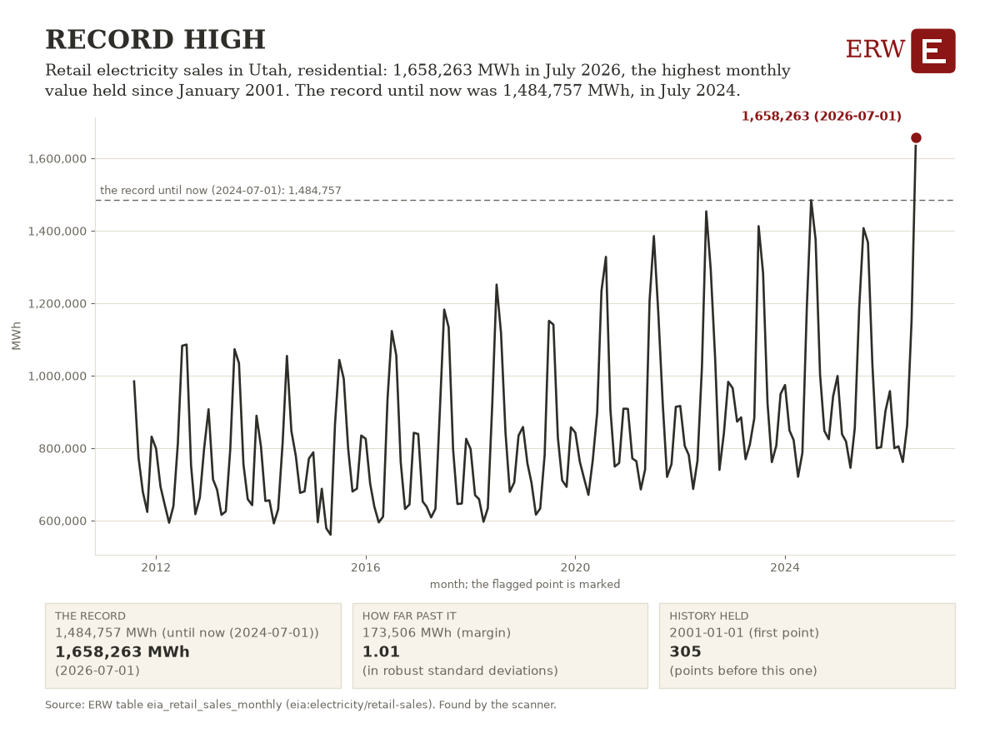

# ERW's Energy Digest, 2026-10-20

ERW's weekday brief of energy news for the 24 hours to 2026-10-20 06:55 UTC, from 335 scored stories.

## Top of the industry

1. **Nscale and Anthropic are in talks on a $45 Billion cloud computing deal, Bloomberg reports** (deal)  
   Major AI datacenter infrastructure deal signals massive power demand and capital commitment. $45 Billion; parties: Nscale; Anthropic. Sources: [Bloomberg](https://news.google.com/rss/articles/CBMisgFBVV95cUxOWElPM1lSczhESmRndWxlZjZIbWhtVS0zZXBjS2Z2Qi12ZVIwcXR0c2lZTWNSYjQxc2lTUnBGaEVBQWZpbUFhNUxQcUhNeVByZVFPQ0hJbm52TVVrX2c0WFFaMDJHSjktNHV3VFVhcDZoY2Ewc1Q4Yks2N0FTek1HR0lYYVoxV0ZYb0Y0c2RmUUtRdVlSbDRNYWJvcm5PeFdqQkVOeFVfQ1RMZTZTeGtzcDFR?oc=5), [Reuters](https://news.google.com/rss/articles/CBMiwgFBVV95cUxPcGMyclR5X0JrXzBKem90Uk1sZnBQNkcyRnlyc3ZnWTM4Q0ZoUWtKUzRrd1Y3aHlqaDRjT1pfaFdmV0pHYUFROFI3TFhTWVhtczJsM01PSF8tSEtXejB4emlhVjZGMmQzeWh0RXJoaS0tNDQ1SDhlZDRJZU5hZG5ibE85N3dxU21DS2ZKYm1NV2pVUUF4ZjF3XzQ1ZncwaHVMdXlWZ2FsWjRtQ1d0eFN2YUVQc2x4cTd6YjNwSTVuVUFQZw?oc=5), [Financial Times](https://news.google.com/rss/articles/CBMihAFBVV95cUxNU1NLVUZHTjRBSTloV1dqSi0wVmZXTUkwSmpzT2NpVG5ia29za0NIdkpGbWJDMnVVSmY2M2FvQTF5NnlrdWRkM0duNUZtNEdRQmVTLWxTZm1DN3V5NFBmQmxCOEJWZG4yNWRyN295NjYtc3A5Z1pzQ1QwUVJDY0VaZmNqbFI?oc=5)
2. **AEP, Amazon and X-energy plan a 960 MW, 12-SMR nuclear plant in Indiana** (nuclear)  
   Major datacenter power deal: 960 MW of small modular reactors for Amazon in Indiana. 960 MW; parties: AEP; Amazon; X-energy. Sources: [Financial Times](https://news.google.com/rss/articles/CBMimAFBVV95cUxON1U3dDJrZmhleVQ1ZzBwVkZhT3BPMlhEYUwzSUNOaU1adXJfMHo1ZDZMb1lzOEI1X1RhZmlUazA4RnFrNGNWdzV0elBjdHM4WU5KQjFPSE9vTkFoLW9aUHlQQWszZ0NkVmUyd3ZIdW5NM0pZZEhMaHpucHFxeFRrTUlmQWoya3BRQW9IUmFKMU1KcG1Sb0Y5WQ?oc=5), [World Nuclear News](https://www.world-nuclear-news.org/articles/aep-amazon-and-x-energy-plan-12-smr-plant), [Utility Dive](https://www.utilitydive.com/news/aep-signs-advanced-960-mw-nuclear-amazon-x-energy/833341/)
3. **Iran war tilts balance of global oil power towards the Americas, Financial Times reports** (geopolitics)  
   Major geopolitical shift affecting global oil supply and market structure. Sources: [Financial Times](https://news.google.com/rss/articles/CBMihAFBVV95cUxOcC1WUldmLXZleGpod29MTXNuME9vc2tYVkhmbjc5NkNFRGY0eV9OdUtac3R6UG9lTndqTjFpQi1kQkJnNHZZNDQzMkRYd09LM3A0MkFRcnpNaV9aaF9iT2NKX0xteHVscFRVQXotRHBoSVlzclIxWW90V2U0VDRBOGpDS24?oc=5)
4. **Voters in Texas, Georgia and Iowa decide Nov. 3 on state data center moratoriums** (policy)  
   State-level votes on data center moratoriums could reshape natural gas demand outlook. Sources: [Natural Gas Intelligence](https://naturalgasintel.com/news/november-races-put-data-centers-on-ballot-clouding-natural-gas-demand/)
5. **Data centers and the green shift are reviving Europe's power demand, Bloomberg reports** (generation)  
   Data center and renewable growth driving material increase in European electricity demand and investment. Sources: [Bloomberg.com](https://news.google.com/rss/articles/CBMitAFBVV95cUxPWmpvaFl6RHdyUDQ0RjhMYmR2QVpBLTBMSi1NZ3dmSVljcWZqZFd0dXZVMUFEbjk4aEZVek9POE55MFVORWpPaEE0LVBkdVY5NGhmdmMtUWl3bXNwaUFEUl9Gd2FDaTVWc3lNQV9QQVUtRXF6ZWtpX1VIbmdOZkFHSkFyTFhkUzJTb1VuR19lZkFIUWxlVDUtZmxDa1RjUjlQeW9HUGtDQ3o5LW5ZejBwRHY4Y28?oc=5)
6. **Woodside resumes work at its $12.5 Billion Scarborough gas project after a Greenpeace protest** (lng)  
   Major LNG project resumes operations after activist disruption; significant counterparty and asset. $12.5 Billion; parties: Woodside; Greenpeace. Sources: [Bloomberg](https://news.google.com/rss/articles/CBMiwgFBVV95cUxPc3RzTWlvckREcEp1ZHA5YUEwTjVTQ0tKSU9EcVBaX0lOaWFWeWdVTWcwamJjRkhHMVNCT0dPdFo4WHYwclpweEllTmRlR1pLSWQySEx1anExZkdIOXRONWR0cWpRSUREUzRiR3IyUmFmckM1UWktaFR4MUNZenJmdzhBbzBvYXpxMFhoNFdtVXhyTVRQbTFGc3hLbXU2ZV8wU28yWFZCQzZfRmc4TWtyWGh3ZWFHX2lNTHhITVloQWNuQQ?oc=5), [OilPrice.com](https://oilprice.com/Latest-Energy-News/World-News/Greenpeace-Protest-Forces-Shutdown-at-Woodsides-125-Billion-Gas-Project.html), [LNG Prime](https://lngprime.com/lng-terminals/woodside-resumes-scarborough-commissioning-work-after-protests/198616/)
7. **Blackstone announces $8.7 Billion final close for Blackstone Energy Transition Partners V** (capital)  
   Major capital commitment to energy transition infrastructure and projects. $8.7 Billion; parties: Blackstone. Sources: [Financial Times](https://news.google.com/rss/articles/CBMipgFBVV95cUxOeDF5eUNYYzNlVlJqb0VXN2pJTFNnbVhmcklucWFSQkFPZU9XLUlsQ3VTUHR5VVdzSnpFWG15Z1cyelNzRFgzcWpjM2Nody11andWem1RbzJ6NlNjS2lTSHJZOEIzSmM3akZTYVBhUEw2N0VSUGgtV0trVnRjSDBaa2RFRDZHTmh2X2JKdUZ2RjFpWjhOcjZKY1BVUUxmdjBkSkxCY2hR?oc=5), [Bloomberg](https://news.google.com/rss/articles/CBMirgFBVV95cUxPamg1MDY0VmlNSExrbE55R2RlSXlhajFmaDZFUDdTSjdzdFBKTVMybUFQaGVLc3VhQnpXM0lYTjY3ZDlVcjU1VDBDa21Lc0tEZGo0ZEJ6TDZCRE5SNURMYlVmd1hvX19Dbng3LWtoNnJmODluajBOV2JadVFKcG15SWZBbU1DZE41M2ZMWTZGNTB2TExNTFpKMmlRLUZ5TG5ON0t0TkRvT2toMFA4TUE?oc=5)
8. **Iran's main oil-loading terminals have stayed empty for weeks as US blockade bites** (oil)  
   Major supply disruption affecting global oil markets and prices parties: Iran. Sources: [Rigzone](https://www.rigzone.com/news/wire/irans_main_oil_terminals_remain_empty-19-oct-2026-184877-article/?rss=true), [Bloomberg.com](https://news.google.com/rss/articles/CBMirwFBVV95cUxOenB5TFdsTXhmTGFUbGdfNE9KemRReTJPZlp1WUdsaGh6VkZOMUZtMWhGRXRJd0tVLUh2WU9OMzhwQ21NOFRRaHBROFg1SVIyUHItRl9GNE1nYUJrQW4xNXd3REZVbURTem9SQ2VFcHJzeHVtV3VJTk9oYnh6ajlINU5XZU1tMDdXV0xNLXFkY1JXcTZyVGNiWGk4QVZtODR0MmNHZGN1Z1JjMkFNakRN?oc=5)
9. **Middle East tensions push global natural gas prices to four-year highs** (gas)  
   Geopolitical conflict threatens LNG supply and raises gas prices materially across global markets. Sources: [Natural Gas Intelligence](https://naturalgasintel.com/news/middle-east-tensions-rise-pushing-global-natural-gas-prices-to-four-year-highs/)
10. **Qatar offers Lebanon two gas plants and 20 years of LNG piped through Syria** (deal)  
   Major energy infrastructure deal to solve Lebanon power crisis with Qatari gas and generation. parties: Qatar; QatarEnergy; Lebanon. Sources: [OilPrice.com](https://oilprice.com/Latest-Energy-News/World-News/Qatar-Offers-Lebanon-2-Gas-Plants-and-20-Years-of-LNG-Piped-Through-Syria.html)

## By sector

**Power**

- Microsoft signs 20-year power deal with NiSource for a planned Indiana data center (datacenter power): Major datacenter power commitment from utility signals AI demand growth and grid planning. [Data Center Dynamics](https://www.datacenterdynamics.com/en/news/microsoft-signs-20-year-power-deal-with-indiana-utility-nisource-for-planned-data-center-in-the-state/)
- Israel to cap capacity of new data centers at 200 MW, report says (datacenter power): Government limits AI datacenter power demand growth amid capacity constraints. [Data Center Dynamics](https://www.datacenterdynamics.com/en/news/israel-to-cap-capacity-of-new-data-centers-at-200mw-report/)
- 5C Data Centers plans to expand Memphis site power from 20 MW to 84 MW (datacenter power): Major AI infrastructure expansion; fuel cell power addresses grid constraints amid data center zoning pressure. [Data Center Frontier](https://www.datacenterfrontier.com/hyperscale/article/55411657/beyond-colossus-5c-advances-575m-memphis-ai-factory-expansion)

**Oil and gas**

- Brent tops $110 as tanker attacks threaten Persian Gulf supply (oil): Oil prices surge on Middle East supply disruption; significant market move. [OilPrice.com](https://oilprice.com/Latest-Energy-News/World-News/Brent-Tops-110-as-Tanker-Attacks-Threaten-Persian-Gulf-Supply.html)
- Gas-fired generation rose as much as 71% year on year as three power markets set demand records (gas): 71% surge in gas-fired generation amid peak demand records; regional price divergence signals infrastructure constraints. [Natural Gas Intelligence](https://naturalgasintel.com/news/record-power-demand-exposes-a-natural-gas-market-divide/)
- Qatari LNG cargo takes a rare Red Sea route to Europe (lng): LNG routing around Houthi attacks shows supply chain stress and geopolitical risk to European gas. [Bloomberg.com](https://news.google.com/rss/articles/CBMitAFBVV95cUxQeWpKMENJOFNXdE1Zdy1yYzJtVHIta2FnaXBWZUpHU3U3cVBOY3MxblRmRldiRkdOTzkwM0pDOXJDTTYtNzFMMl9rUUJLZF9xeTFTQjlmNVBseEdZZTlyaWpTNnZTdnRpaEdiMkpZRjBtT0hpVkg1bThTbjRCc0wySUFzQldIblpZbWVSMXR3MWU1UVk5UXBtVV9wYlkyTEZfYkNKRzg1T2FVVmM3QWdUdHFkVVI?oc=5)

**Nuclear and renewables**

- Germany plans to let renewable hydrogen count triple toward its green gas mandate from 2028 (hydrogen): Policy change accelerates hydrogen blending in gas networks, affecting energy transition targets. [Hydrogen Insight](https://news.google.com/rss/articles/CBMi6wFBVV95cUxNOWlDeHNoNFVpaER3WVdyNjAtTnVDaExiTWJSWnA1cVhITHFSV3pzRGJkZjJUU0IxWWhqXzdhQ3pMQ2hxbFBwaGZDVGNfbTJlQmRZNngzRFFxLTBmU2lqbGdQYUpHUXFZWmRCVVF1Zng1eEtsbkRFM2F1NWRaNnRvSk1OTHhoY252am82Y3RSWnEwdWk5ODhWd3BrX2EzSU85RkVqSEZoVWp3U2R3dWYwVmptNnBENE01NFZzVl9XT0xLQVIxeUxlNmM3SVpnQ09kQXhFT05FQkNuZkJ1ajh2bFlGSXlWX2VyOGNF?oc=5)
- Rosatom signs floating nuclear power deal to supply an East Indonesian island (nuclear): Major nuclear technology deployment to island grid; new generation capacity for region. [World Nuclear News](https://www.world-nuclear-news.org/articles/rosatom-signs-floating-nuclear-power-deal-for-indonesia)
- Geothermal lease sale collides with planned Nevada solar farms, Reuters reports (renewables): Land-use conflict between geothermal and solar development affects renewable capacity. [Reuters](https://news.google.com/rss/articles/CBMivgFBVV95cUxObmVVLWhZQi1mVVJXZ3haU2hJNk55bGdjd3VMVEZ3R0VwMUlDcERKVmc0N0VSQjkzYmtpaDh1d09zZS1MenF2R09mWGZQNHFGLTBNU3R3UXNFNmgtSGlLUjR4R1o5MVdwRllua3UxY2E5UDRlYUlfT05fVXZKaVk4ZTVJZW0wZm5QRWlxblRqUEJuc19ZYTNkWENpTFk0WWttNkpFQkNyYUR4Y0dTV2xqVkJ4MlV6eU9jS091eWpR?oc=5)

**Policy**

- Virginia wants a 6-year rate freeze in the NextEra-Dominion deal (policy): Major utility merger condition affecting Virginia ratepayers and utility investment climate. [Bloomberg.com](https://news.google.com/rss/articles/CBMitgFBVV95cUxQd1QtS3dmaFBGbUhxMkZUVXladUlxYk1XMXUzbGtNMFkwVTcwOFM5OS1OYkNxXzhyc1IwczdsQWZ2THpwRmhKTjA4YXpVSzFYUWR6aERwZDFxdUlibGV5dlctRndoMHZncUF2dFhrRURsbVRoNGJydjVHSFI5U29VNFFyUXBYQzlpNTE1bzVReHl1Q3hyUE1VdEIzWEdZblljQUxnY2Q4cjY3QUR5cThqM1pIN1l1QQ?oc=5)
- Energy Department commits up to $42 million in Defense Production Act funds to Constitution Pipeline (policy): Federal support for 125-mile natural gas pipeline infrastructure [DOE newsroom](https://www.energy.gov/articles/energy-department-advances-constitution-pipeline-project-42-million-defense-production-act)
- US uses wartime law to help build stalled New York pipeline (policy): Defense Production Act use signals federal commitment to gas infrastructure amid energy demand surge. [Bloomberg](https://news.google.com/rss/articles/CBMisgFBVV95cUxOLTZ2aWZTNmM4MUNieWNrd21yeFR6ZC00YWc3T1Q0SVpIdlN1NjIwRF82dkh2LU56dWlIeW0tMktENUp5UFg3OWw5cE10Q0pPb1lYeHpzbWg1R0JwQUR0OGx3bTJycnFQVjFCaDF0TG5MUmtWaGJKek4zWEdxVHk2Y3RGQ1hCVEhvdXI0UnhJdG1Xb2piTG9kWjNhdWRNQmhzMHJQT1d0SVJlTjhmaVhGVW9B?oc=5)
- Moraga Storage, LLC, River Mill Storage, LLC, Hecate Energy Medway Energy Center LLC, Brough Storage, LLC, Partridge Storage, LLC v. ISO New England Inc.; Notice on Comment Periods (FERC notice, policy action): Five storage projects face an October 20 decision on signing an LGIA or leaving the ISO-NE queue. [FERC](https://www.federalregister.gov/documents/2026/10/19/2026-21364/moraga-storage-llc-river-mill-storage-llc-hecate-energy-medway-energy-center-llc-brough-storage-llc)

**Capital and companies**

- EnCap's record $3.5B deal extends its hold on Permian minerals (deal): Major oil and gas deal extending consolidation in key US production basin. [Hart Energy](https://news.google.com/rss/articles/CBMiowFBVV95cUxOVTR0dG5lY1UwakFlR2NBVzZnbm5YcEZpTFJ4OUlSRGJJekZEa3FOV2JWdVBJZ0ljUDlkSFVoeXdaUlY1akRIdzREcFhfTDYyZkl3VkIwR2xJZjVZS0F0QTFsdmptZFRfak5jNjBVSHdCN2t0VjdhQTBNV3JmOVB3Z2FQX0dsbndXQlphaEdBNHdWeUV0bkE4YnEwMkllRmN5LWk4?oc=5)
- LNG Canada awards Tecnicas Reunidas EPCM contract for second phase of Coastal GasLink pipeline (deal): Engineering contract for LNG Canada phase two; incremental project progress. [LNG Prime](https://lngprime.com/americas/tecnicas-reunidas-scores-lng-canada-pipeline-gig/198610/)
- Mozambique pitches Sasol and ROMPCO on a $250 million offshore gas project (deal): Regional gas development deal with FSRU infrastructure for southern Africa [OilPrice.com](https://oilprice.com/Latest-Energy-News/World-News/Mozambique-Pitches-Sasol-and-ROMPCO-on-250-Million-Gas-Project.html)

## AI and power

- Microsoft pulls out of Nscale's delayed Loughton data center deal over power supply (datacenter power): Major tech firm abandons project due to grid capacity limits, signaling datacenter power bottleneck. [WSJ](https://news.google.com/rss/articles/CBMirgFBVV95cUxPOFBSano2YWNRY1dzTTFvSmc4NjZ0NEtuRVZDa2ZDMGFmYzVFekJMVzR2aTd5aWZmVEFvLWFKQ052cFJYU3NfUGFpMGhla0c3VUYzR1VfUEQ4bHlfdDFCTnZuN2pvUzJNTDd2UWN0MmlqbVhYQ0V4dmdiT1VkUmUzb2preEF0ZHpnRlc2dGJwTnhTYm5zSTljbzZGMC1EdXF4OFRTUjBHa2E4Q2t5eHc?oc=5)
- Canada issues advance procurement notice for Ontario data center costing CA$1.5bn and $1.85bn (datacenter power): CA$1.5-1.85 billion data center procurement; AI infrastructure investment signal. [Data Center Dynamics](https://www.datacenterdynamics.com/en/news/canada-puts-out-advanced-procurement-notice-for-data-center-in-ontario/)
- Korea data center IPO set to test investor resolve after tumult (datacenter power): Data center IPO signals capital market stress for AI infrastructure. [Bloomberg.com](https://news.google.com/rss/articles/CBMiswFBVV95cUxPMWs2eVQ1a0VzdkhIdktZZ1dPZGJCN3pKMW1hQU5lTFlCQXFEZ2x5QkRXUm11a2l3cGwwZ0dQWHJ4VXdaNmZJbXlkV3ZHYVAwdHVUS0pVREV1eU00NC1ZV3RXcms0MGlLcXYwRFVFVk10LUJOY3dxTS1xR1pLeDlPcm90WV9lbE9WSjR5ZFczbi10SzNZZ2ZwTEg5bmpNWUl6ZkxQU2FiSVBsZVFxOHNkdHM0Yw?oc=5)
- Alcoa sells New York aluminum smelter to a data center developer for $315 million (datacenter power): Industrial power asset repurposed for AI datacenter, signals demand shift. [Data Center Dynamics](https://www.datacenterdynamics.com/en/news/alcoa-sells-new-york-aluminum-smelter-to-data-center-developer-for-315-million/)
- Schneider Electric reports record-high Q3 revenue on data center demand (datacenter power): Energy management supplier benefits from surge in datacenter power demand. [Utility Dive](https://www.utilitydive.com/news/schneider-electric-data-center-earnings/833358/)

## ERW's Numbers Today

Day-ahead power on 2026-10-19 was dearest at NYISO's N.Y.C., 52.53 USD/MWh, and cheapest at SPP's SPPSOUTH_HUB, 21.85; MISO has no prices in the warehouse for that day and PJM has no price table. The highest real-time price was 192.89 USD/MWh at N.Y.C. in the interval starting 2026-10-19 08:00 local. The latest EIA spot closes, from 2026-10-14, were 3.22 USD/MMBtu for Henry Hub gas, 101.91 USD/bbl for WTI and 126.55 USD/bbl for Brent.

**Day-ahead average, yesterday, main hub** (mean of the 24 hourly prices of the operating day):

| ISO | Hub or zone | Operating day | Average USD/MWh | Table |
|---|---|---|---|---|
| ERCOT | HB_NORTH | 2026-10-19 | 23.41 | [1] |
| CAISO | TH_SP15_GEN-APND | 2026-10-19 | 44.78 | [1] |
| NYISO | N.Y.C. | 2026-10-19 | 52.53 | [2] |
| MISO | INDIANA.HUB | 2026-10-19 | not in the warehouse (0 of 24 hours) | [1] |
| SPP | SPPSOUTH_HUB | 2026-10-19 | 21.85 | [1] |
| ISO-NE | .H.INTERNAL_HUB | 2026-10-19 | 42.50 | [3] |
| PJM | | | no PJM price table (no API key) | |

**Highest real-time price, yesterday:** 192.89 USD/MWh at N.Y.C. (NYISO), interval starting 2026-10-19 08:00 local (2026-10-19 12:00 UTC), PT15M `lmp_rtm_15m_mean` (a 15-minute mean of 5-minute prices) [4].

**Latest fuel spot closes** (EIA, trading dates):

- Henry Hub natural gas: 3.22 USD/MMBtu on 2026-10-14 [5]
- WTI Cushing crude: 101.91 USD/bbl on 2026-10-14 [5]
- Brent crude: 126.55 USD/bbl on 2026-10-14 [5]

Tables: [1] `iso_dam_hub_prices` (caiso:PRC_LMP, ercot:NP4-190-CD, miso:da_expost_lmp, spp:DA-LMP-SL); [2] `nyiso_dam_zone_prices` (nyiso:damlbmp); [3] `isone_dam_zone_prices` (isone:da_lmp_hourly); [4] `nyiso_rtm_zone_prices` (nyiso:realtime); real-time tables read: iso_rtm_hub_prices, isone_rtm_zone_prices, isone_rtm_zone_prices_hourly, nyiso_rtm_zone_prices; [5] `eia_fuel_spot_prices` (eia:natural-gas/pri/fut, eia:petroleum/pri/spt).

## ERW's Chart of the Day

Retail electricity sales in Utah, residential: 1,658,263 MWh in July 2026, the highest monthly value held since January 2001. The record until now was 1,484,757 MWh, in July 2024.

Table `eia_retail_sales_monthly`, series `entity=eia:retail_sales:UT:RES, variable=retail_sales, freq=P1M`: [the table and its download](/data#eia_retail_sales_monthly). Chosen by rule, not by a person or a model: the strongest flag of the day's scan that no Digest has shown (rule: record; 1.01 robust standard deviations past its threshold). [How the chart is chosen](/data/methods/automated_analysis_scanner).

## ERW's Fun Fact

US oil extraction peaked at 10.2 million barrels per day in 1970 before declining for the next 35 years.

Sources: [Wikipedia, Hubbert peak theory](https://en.wikipedia.org/wiki/Hubbert_peak_theory).

ERW

---

[How this is made.](/about#digest)

<!-- Generated by warehouse/news/brief.py at 2026-10-20 06:55 UTC; run log warehouse/output/logs/news_brief_20261020T065542Z.log; model claude-sonnet-5-5; story data warehouse/output/news_stories.csv. -->
