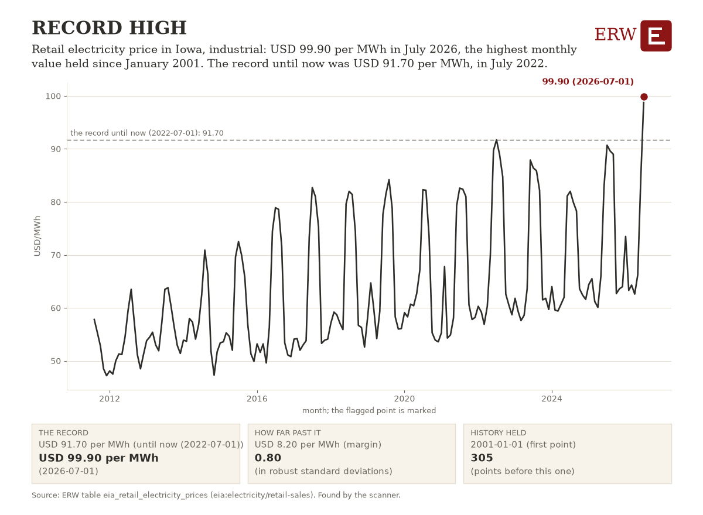

# ERW's Energy Digest, 2026-10-21

ERW's weekday brief of energy news for the 24 hours to 2026-10-21 15:45 UTC, from 256 scored stories.

## Top of the industry

1. **Anthropic may spend $750 Billion on computing costs, Bloomberg reports** (datacenter power)  
   Massive AI compute capex signals unprecedented power demand growth and infrastructure investment scale. $750 Billion; parties: Anthropic. Sources: [Bloomberg.com](https://news.google.com/rss/articles/CBMisgFBVV95cUxNOXVpSjBJbkx2b2NpZ1R5U1ViUklsVVFNZnNxc0QzcUxvMUdsR1VmN1pXN0pwcmtTVThramxfTVd6WFZWLURCbWF0VExuS2dKY0JHZEtGeGNhREhNNHhGem51MC0yZ1lvZldNRnlQY2xSMHJMUm41V2FMd3luRHBEbnRXS0NTR3NTVkhQbnZrNExfZUdKXzZCcm9RanN0eVk4bk1zdjQ1eDBXeHBXMmFoWnZ3?oc=5)
2. **Amazon pledges €16bn investment in Germany in 2027** (datacenter power)  
   Major datacenter and AI infrastructure expansion signals sustained power demand growth in Europe. €16bn; parties: Amazon. Sources: [Data Center Dynamics](https://www.datacenterdynamics.com/en/news/amazon-pledges-16bn-investment-in-germany-in-2027/)
3. **UK approves the long-delayed Jackdaw gas field, a $3B project, on energy security grounds** (gas)  
   Major North Sea gas project approval adds supply; supports energy security amid geopolitical tensions. $3B; parties: UK. Sources: [Reuters](https://news.google.com/rss/articles/CBMimgFBVV95cUxOMVhqQWZMc3FMQ2lhTXRCMm92QVlKRlk3Y2lNenRKRTJmWWxHUlNWc3pTZWJyOU92aHlVTmtwLXVTeE01WFZxU3NpQ19Eazh6TkM5VWZaaUpqRFo5SFZJbmRHeFVvYkRiZGJUYUpza0ZyMWZ1NThlMFpEM1U5dlRZeUNJQVBqN0VpbTFscWViMFNHdm84T1FhMWxB?oc=5), [Bloomberg.com](https://news.google.com/rss/articles/CBMi0wFBVV95cUxNby1FMEZxUzB1b1M1cnZZX05FS196bFhIbWw5QS1nWFZUNjJ3dnZYYTY2bGRYOVB0ZzJ1TjRJaHloVjFEajVYaS1oSzZicXJfa2ViMF9nVmJyWXJYZjlWU3hNZEhNckdCWXcyRi1lb05nMUtTMnFnWVRSSUQzWkRRb1E0cTlkUS1HSVB6ajJFb2p3b1RTbWhrYWpnRjZ0MUpCU01LZDhNNmlpSXBuWDJjSXpCRWNWdDhJYmhVNlBXRWIyVWgtUlhfTmVvcTdWY3ZFS05R?oc=5), [Rigzone](https://www.rigzone.com/news/uk_greenlights_3b_jackdaw_gas_project-21-oct-2026-184892-article/?rss=true)
4. **The Nuclear Company proposes a 6,600 MW campus of up to six AP1000 reactors in Kentucky** (nuclear)  
   Large-scale nuclear project with FID target; significant generation capacity addition if realized. 6,600 MW; parties: The Nuclear Company; Westinghouse. Sources: [POWER Magazine](https://www.powermag.com/the-nuclear-company-proposes-6-6-gw-ap1000-nuclear-campus-in-kentucky/), [POWER Magazine](https://www.powermag.com/nuclear-power-group-announces-six-reactor-6-6-gw-campus-at-kentucky-site/)
5. **DOE announces $967 million in funding for grid resilience projects** (transmission)  
   Significant federal investment in grid resilience and capacity to meet growing electricity demand. $967 million; parties: Department of Energy. Sources: [T&D World](https://www.tdworld.com/utility-business/news/55413254/doe-announces-967-million-in-grid-resilience-funding)
6. **Mexico's state utility set to approve up to 60 projects, 8,200 MW, $12.5 billion** (generation)  
   Major renewable capacity addition and investment in Mexico's power generation. 8,200 MW; $12.5 billion; parties: Federal Electricity Commission. Sources: [OilPrice.com](https://oilprice.com/Alternative-Energy/Solar-Energy/Mexico-Poised-to-Approve-125-Billion-in-Renewable-Energy-Projects.html)
7. **Nextdc cuts outlook as public backlash delays data center power; shares fall 42% to 44%** (datacenter power)  
   Community opposition delaying data center power supply, affecting AI infrastructure buildout. parties: Nextdc. Sources: [Bloomberg.com](https://news.google.com/rss/articles/CBMi0gFBVV95cUxNQkZyYmkwQ2U2NmhPbFZXRUhTQmtwVnRnd3BDd1dNeG5ORXMtcmVrM0t6Nks2YzU3RzhVenJTb3VvNW5oamUxdGhYaVdpczdkRERVWk01Z05MLTFCSW1SVGtpdE9DTVAwOWxVTHp3WEducXNVR3BJb0VFdndQVVl0M0lqdFprVFh6bUtiSzNKY1BWenhsRUk2STZXSWxaUk1uZENzZjgycTgxTEFfbElrek1FSjNkbGlIZlNWYnJ0RWU5b0RpREM0dGNtdkJISThGalE?oc=5), [Reuters](https://news.google.com/rss/articles/CBMiwwFBVV95cUxONWJyOF9XbWhodGFsMWVRYUhMYzlCUDRMR2ZqRDdTdTFsOTJZWVdTcS1sRTg1UldzbkMyN1JTMkFmWkpJT0s0NkVnOWgyeXNlRnMwOVlXX3RueEt4SkJ6OTU2em5yZzBpS3o5Q3paWUk1WjJLNXhrUjQ4bGhUb2xjSHYzOTV4N3lreHREMkFBa0F3bVpJdE9VMHg4d0d4ZWJJbVFEX2xZM0xyOU9PMWItaXItTUVSWWlid003RExodnIxUFE?oc=5), [Bloomberg.com](https://news.google.com/rss/articles/CBMitAFBVV95cUxOc2cycW1CNXNjRGR3blYyX0w5SWpPYURMTUFCQ1l6M1lJRUlPcHB6NHM3MncxQy1wYXBkeW12eC1lTmJHMXhPNWJUeXNTcFR3cEZLMmlCamtNcEZCbHpLbVN2aXJNM0lDWmZKemsyX0p3N05hMXBVdVFiOEhrQl82ZVBMRWFmanZqUHJabnQzUWJFYnI3Sl9QVGprLVNSVDFxNFlkb0dSX1JBMVZrY2NwMVM2ams?oc=5)
8. **European electricity demand returns to growth, driven by electrification and the data center boom** (power prices)  
   Data center boom and electrification reversing years of flat European power demand. Sources: [OilPrice.com](https://oilprice.com/Energy/Natural-Gas/Europes-Power-Demand-Returns-to-Growth.html)
9. **Exelon executive sees possible return to regulated generation as data center demand rises** (generation)  
   Exelon considering re-entry into generation to meet data center and capacity needs; PJM market pressures. parties: Exelon; Constellation Energy. Sources: [POWER Magazine](https://www.powermag.com/exelon-executive-sees-potential-return-to-regulated-generation-to-meet-soaring-demand/)
10. **US Department of Energy asks refiners to raise diesel output as prices climb** (policy)  
   Federal intervention to increase diesel production amid price surge; policy-driven energy supply action. parties: U.S. Department of Energy; Trump Administration. Sources: [OilPrice.com](https://oilprice.com/Latest-Energy-News/World-News/Trump-Administration-Pushes-Refiners-to-Boost-Diesel-Output-as-Prices-Soar.html), [Reuters](https://news.google.com/rss/articles/CBMiygFBVV95cUxQczBsMElXTmU3MHktOU91QkR4MWE3TkFnNjZ2OWNZakp6bFIzY1NGZk1nQWJ6T1h0VjExcUlBOUVHSW9KekVmVW54X25HNjBZM1oxOWUxN05pLXRZOENWOG53QnBqTEwwODlIWGVseU1PQjlHU1VzdERwclZGS0JxSi1PdFlmd2RjbE56c0E1RER2VzhYTExoY0gzaFdZUmdsb1REMHRCNTBERFYyT1NDNlZJWFg2enJvaV9rOEtoeDZqSXl6a2JRX3hR?oc=5)

## By sector

**Power**

- Half of India's coal plants run critically low on fuel as power demand rises (generation): Coal supply stress during peak demand signals potential generation constraints. [Reuters](https://news.google.com/rss/articles/CBMiuwFBVV95cUxOazNuSjVoOWdWeU9fY0hvSjV6UEpBQjNpVTZhaFg1Y3NXZUdobzk4Wk54a0ZMdHAtTk1CV1Z6OWstTlJ1dDdoSzV6aFZlRFpsVjRjdExPVDNrS2x3WTBSR3N2NThhRnRnYVJZdmkzN0ttNzFOdE9rTnkwS2pYdTNBWDFOcVZyb2xYRF9IU0F3S25fczdoWElJaFh3ajVndWF2bTFMeEVVLUlxbllnQUhxbjJBemxGS1MybXlZ?oc=5)
- Morgan Stanley says global fuel markets stay tight through mid-2027 (power prices): Analyst forecast of refinery maintenance and fuel tightness; market signal. [OilPrice.com](https://oilprice.com/Latest-Energy-News/World-News/Morgan-Stanley-Global-Fuel-Market-Will-Stay-Tight-Through-Mid-2027.html)
- Ormat dominates US geothermal auction in Nevada, Reuters reports (generation): Geothermal capacity addition signals renewable generation growth in western US. [Reuters](https://news.google.com/rss/articles/CBMiuAFBVV95cUxPQXl4LVdSQ2NEQlMySnZVRk1tU2NmbkI2Q3R6ZFMxWUZoY3prdXR4ai02WGJrMUZmOXc3eEtFNW93UXB0eW1EcFVINlJOVHdXV0VwbzFTLW5pQ1hDaDhCRUtyT2hpSGJLRUt3ZHBhLU9SZU5ER3IyT19lVjRqVTFqc0lKdEJHRmhtSVpuT0xDc0RsQVEwX19qQ0N1RDFsN2pzVUhIckRKUWo5cFhLZjVQVFROamNMUGNG?oc=5)

**Oil and gas**

- Brent crude trades at $110.30 per barrel as Middle East supply worries persist (oil): Geopolitical supply risk drives crude prices to multi-month highs; affects energy costs. [OilPrice.com](https://oilprice.com/Latest-Energy-News/World-News/Oil-Prices-Climb-Above-110-as-Middle-East-Supply-Fears-Persist.html)
- At least 23 ships attacked in or near Hormuz in first two weeks of October (geopolitics): Escalating maritime attacks threaten crude and LNG shipping through critical chokepoint; supply risk. [Rigzone](https://www.rigzone.com/news/wire/iran_intensifies_strikes_on_ships-21-oct-2026-184891-article/?rss=true)
- Goldman Sachs says average oil freight rate reached $20 per barrel from $3 last year (oil): Tanker rate surge from Iran war and Hormuz tensions creates material upside risk to oil prices. [OilPrice.com](https://oilprice.com/Latest-Energy-News/World-News/Goldman-Sachs-Warns-of-New-Oil-Price-Shock-as-Tanker-Rates-Soar.html)

**Nuclear and renewables**

- Philippines works toward first nuclear project, targeting 1.2 GW by 2032 and 4.8 GW by 2050 (nuclear): Nuclear capacity expansion; 1.2 GW by 2032 and 4.8 GW by 2050 signals major generation shift. [World Nuclear News](https://www.world-nuclear-news.org/articles/philippines-advances-plans-for-nuclear-power-as-energy-demand-rises)
- Indiana, Hoosier Energy and AtkinsRéalis sign MOU to explore a 6 GW CANDU nuclear plant (nuclear): 6 GW nuclear feasibility study signals major capacity addition potential. [ANS Nuclear Newswire](https://www.ans.org/news/2026-10-20/article-8504/in-latest-indiana-power-plant-proposal-parties-to-explore-candu-reactors/)
- Critical Capital: Lara Pierpoint on nuclear costs, hyperscaler contracts and trust in government funding (nuclear): Nuclear costs and hyperscaler contracts; explores AI power demand opportunity. [Latitude Media](https://www.latitudemedia.com/news/critical-capital-can-nuclear-seize-on-data-center-momentum/)

**Policy**

- US aims to loan about a third of its heating oil reserve to tame prices (policy): Strategic petroleum reserve loan could moderate heating oil prices this winter. [Reuters](https://news.google.com/rss/articles/CBMisgFBVV95cUxNUzkxVzJaMlBtRGhfVVdxVERodk94eEllV09nNDlZVFV5MnZxMUttc2d5djloZTFuVEN6UUlfbFo4aGFNZk83RGQ4MzNZV0ZzMXU1RjM0bnhNelR3Tmd6cUNacEJjdko4dnd5Q081U3dheFNZVm9aVmM1aHc1a2xJaVZadUFEX1YyWm9XSTNOT29RYk1wckVnZllWLUU2aUFkclNYS3NQQmpkUnMxakhDcUNR?oc=5)
- US Energy Department to invest nearly $1 billion in power grid upgrades (policy): Federal grid modernization funding; supports reliability but scale and scope unclear. [Reuters](https://news.google.com/rss/articles/CBMivAFBVV95cUxQZVlsOFBjMnoydS0yNXB0dVl2OExEVHAxa28wbUhDUGRYaEstWWVDUllteGYzYzJRaTk2LTlqNjRWenZnSHZaUUQzQlkzWnhxQnZYS1ZNdG5mVHBkWXJaeVJRY0NxaDNQY21sVW00cGJ5cTlvR3JJdi12QTVyX0x0bG9xSzRxZHlndWNrVG9fWFpndHl3akhQdnNROGxJdmMzLUEyZGpfS3B2UGNGVVJmbkVVc0dHRzJxQ0ZXSg?oc=5)
- DOE to use Defense Production Act funds, up to $42 million, for Constitution Pipeline work (policy): Federal support for natural gas pipeline; uses wartime law to advance Appalachian gas infrastructure. [Natural Gas Intelligence](https://naturalgasintel.com/news/doe-taps-defense-production-act-funds-to-help-pay-for-early-work-on-constitution-pipeline/)
- Environmental Review of Natural Gas Act Applications; Notice of Availability of Draft Policy Statement on Efficient Environmental Reviews of Natural Gas Project Applications (FERC notice, policy action): FERC would stop ordinarily requiring air modeling for compressor stations and LNG facilities, easing environmental review for gas projects. [FERC](https://www.federalregister.gov/documents/2026/10/20/2026-21442/environmental-review-of-natural-gas-act-applications-notice-of-availability-of-draft-policy)
- Texas LNG Brownsville LLC; Request for Extension of Export Commencement Deadline (DOE notice, policy action): A deadline extension request for non-FTA LNG exports signals project timing for the Brownsville terminal. [DOE](https://www.federalregister.gov/documents/2026/10/20/2026-21425/texas-lng-brownsville-llc-request-for-extension-of-export-commencement-deadline)
- Authorizations for Certain Activities at Liquefied Natural Gas Plants (FERC proposed rule, policy action): A proposed rule could cut approval steps for activities at LNG plants. [FERC](https://www.federalregister.gov/documents/2026/10/20/2026-21443/authorizations-for-certain-activities-at-liquefied-natural-gas-plants)

**Capital and companies**

- Ara Partners raises $2.5B for an energy fund targeting power and fuels (capital): Significant capital commitment to power and fuels sectors signals investor appetite. [Hart Energy](https://news.google.com/rss/articles/CBMinwFBVV95cUxOQVRVTlVjSklINDFybjdVWFZiLWo3TUdVdUY1OHAwRWtEOUVWMUNoOWo2UWtyNllXblJEREFJM1MtSHRaa3pZWHF2aWZNTXBkalRtYUh0UnhMMUhXbXplY253d3J0QnViam1ULWRWcnJjTk92YklRZFI3TGJuRGY2MG9GcE5CQ0h0aGJVYkFwV1hnSWRFaEV3TUdoVURGOG8?oc=5)
- Hudbay and Mitsubishi approve construction of a copper project in Arizona (deal): Large copper mining project greenlit; copper demand tied to power infrastructure and EV transition. [WSJ](https://news.google.com/rss/articles/CBMirgFBVV95cUxOcUNwZVY2M0R2QjdfWDc1UHA3eVdIenVhOW9fQkRKQ2pQZGlXZDZEWVh3V0tVSlBZb3dybG5kdVE5LVhnQndnak1DZ1NrMmVMNWx0TlN1NEJGbEk2N1B1UFRrUllhU21yRjNaSXN0TDhQZ0QtT2R2ZUJYd1loV0VEV2hGNkwtWkpUT0lyRlBsbWU0TEdUb2ZQOW04TC1FTG1sQWNCZjc2b1RmTGVFTlE?oc=5)
- NextEra Energy tops quarterly profit estimates and says Dominion deal is on track (company): Major utility earnings beat and merger progress; signals continued deal momentum. [Reuters](https://news.google.com/rss/articles/CBMipgFBVV95cUxPdmVMRWJNcGZGcXVkdVBIR0hFVDZ4aHlPUUNuZzRCNGVscVdaendlM2oxbXBmVVlOcUY0bW1MR3A5OUNULXUxeUZJNXVfY0ZvZEFtX3FRdzFTSkpaTWhHLTFnQXo1YVl4R0JJbzNRY1ZNTzcwVEQzaFVUSkxFRkNWYWhSTVhDbVlUOGVDSHRZS0lLUkFJZ0RrdUFubVVEbmN3UGRXSnNB?oc=5)

## AI and power

- Trump says companies should pay a dividend to communities to make data centers popular (datacenter power): Political pressure on data center siting could affect deployment timelines and costs. [Reuters](https://news.google.com/rss/articles/CBMi1gFBVV95cUxPSFFhcl9qcUZ1SGk4eFlwa0ZMZ1ZsbC1scnpKT0hVMDdZOWpsX0JudFE0REhVUU4ySGhBZ0VaSWxMOXA0N2lyN0FYVmJFMjBfMks4OERreGNOYWtzZnNCemx6blNJcmhRNEF0aFdmWHVSTDQ4NE1YNTN1ZTJKdlVGWld4b20xTzczWDRyZW1DMGhIcEs0NHE5clRNOEtMcXJCSDNRMDhLYnMxd2JfYWJ6amxldE9IUDF4Zl9rZjY5eHhiNklGZ3IxS1I2ZmlCZnYzNVVnMjdR?oc=5)
- BlackRock's Fink says slow data-center buildout is inflationary (datacenter power): Fink argues datacenter power constraints risk inflation; signals capital and policy implications for AI power demand. [Bloomberg.com](https://news.google.com/rss/articles/CBMitAFBVV95cUxPenBrbGQwVUtxZFJSMFc5Q3BMUkxJUWVJTVJlNUdkUHhWNmd5RTczLVZkSHhhY1R0OUxJTUR0WW9CZklMM05HdVNkSWhhVG10ZkV5X29XTlJVbVZVcnp5bEYtWDQtNUNTNU1KUmJqZTl5bkw0WGw5b2JHU1NvMXVhZzYxbDllVllJUTBJNVBvR3JodGtMekVLSTVaZ1JNeDVnY2pub2RNd3UtUEJycV9la0hKRno?oc=5)
- Crusoe plans Spark Liquid modular data center, with 3.5MW deployments for 20-50MW clusters (datacenter power): 3.5MW modular data center units; direct AI datacenter power infrastructure. [Data Center Dynamics](https://www.datacenterdynamics.com/en/news/crusoe-plans-spark-liquid-modular-data-center-to-support-latest-nvidia-gpus/)
- Trump says data centers must provide their own electricity (datacenter power): Policy signal that data centers should self-supply power; affects grid demand and capital needs. [WSJ](https://news.google.com/rss/articles/CBMipgFBVV95cUxPN0J4NWZrSG9CM0FwNktTR0tTTGhHc1RMOGgxc2dTUGJfVDBpRVQ2a2V6Nmtxd2ZmM09FUDA2QzhjeTc4VWtjRmVlRFM5NTFnZUZNR2VYNmlPSENDdnN6V19DeWluN1dKSmhTazYzbDcycml6SUg3eXNNcXpXQ3E5THhNdmg3UjJzUlBVNzJYdjk0ZWVRT3dTMTJQQXlZcWI5SGZ1ZjlR?oc=5)
- Georgia electric cooperative plans 50 MW home battery deployment (storage): Battery storage to manage datacenter peak demand; signals grid adaptation to AI power needs. [Utility Dive](https://www.utilitydive.com/news/georgia-electric-cooperative-plans-50-mw-home-battery-deployment/833492/)

## ERW's Numbers Today

Day-ahead power on 2026-10-20 was dearest at NYISO's N.Y.C., 49.25 USD/MWh, and cheapest at SPP's SPPSOUTH_HUB, 23.33. MISO's hub is not in the warehouse for the day and PJM has no price table. The highest real-time price was 276.41 USD/MWh at SPPNORTH_HUB, in the interval starting 2026-10-20 09:45 local.

**Day-ahead average, yesterday, main hub** (mean of the 24 hourly prices of the operating day):

| ISO | Hub or zone | Operating day | Average USD/MWh | Table |
|---|---|---|---|---|
| ERCOT | HB_NORTH | 2026-10-20 | 28.38 | [1] |
| CAISO | TH_SP15_GEN-APND | 2026-10-20 | 45.01 | [1] |
| NYISO | N.Y.C. | 2026-10-20 | 49.25 | [2] |
| MISO | INDIANA.HUB | 2026-10-20 | not in the warehouse (0 of 24 hours) | [1] |
| SPP | SPPSOUTH_HUB | 2026-10-20 | 23.33 | [1] |
| ISO-NE | .H.INTERNAL_HUB | 2026-10-20 | 40.64 | [3] |
| PJM | | | no PJM price table (no API key) | |

**Highest real-time price, yesterday:** 276.41 USD/MWh at SPPNORTH_HUB (SPP), interval starting 2026-10-20 09:45 local (2026-10-20 14:45 UTC), PT15M `lmp_rtm_15m_mean` (a 15-minute mean of 5-minute prices) [4].

**Latest fuel spot closes** (EIA, trading dates):

- Henry Hub natural gas: 3.22 USD/MMBtu on 2026-10-14 [5]
- WTI Cushing crude: 101.91 USD/bbl on 2026-10-14 [5]
- Brent crude: 126.55 USD/bbl on 2026-10-14 [5]

Tables: [1] `iso_dam_hub_prices` (caiso:PRC_LMP, ercot:NP4-190-CD, miso:da_expost_lmp, spp:DA-LMP-SL); [2] `nyiso_dam_zone_prices` (nyiso:damlbmp); [3] `isone_dam_zone_prices` (isone:da_lmp_hourly); [4] `iso_rtm_hub_prices` (caiso:PRC_INTVL_LMP, ercot:NP6-785-ER, ercot:NP6-905-CD, miso:rt_lmp_final, miso:rt_lmp_prelim, spp:RTBM-LMP-SL); real-time tables read: iso_rtm_hub_prices, isone_rtm_zone_prices, isone_rtm_zone_prices_hourly, nyiso_rtm_zone_prices; [5] `eia_fuel_spot_prices` (eia:natural-gas/pri/fut, eia:petroleum/pri/spt).

## ERW's Chart of the Day

Retail electricity price in Iowa, industrial: USD 99.90 per MWh in July 2026, the highest monthly value held since January 2001. The record until now was USD 91.70 per MWh, in July 2022.

Table `eia_retail_electricity_prices`, series `entity=eia:retail_price:IA:IND, variable=retail_price, freq=P1M`: [the table and its download](/data#eia_retail_electricity_prices). Chosen by rule, not by a person or a model: the strongest flag of the day's scan that no Digest has shown (rule: record; 0.80 robust standard deviations past its threshold). [How the chart is chosen](/data/methods/automated_analysis_scanner).

## ERW's Fun Fact

California's grid operator curtailed 1,459,998 MWh of wind and solar output in April 2026, its most in any month since 2022.

Sources: `iso_curtailment_monthly` (Energy Research Warehouse (ERW), derived).

ERW

---

[How this is made.](/about#digest)

<!-- Generated by warehouse/news/brief.py at 2026-10-21 15:45 UTC; run log warehouse/output/logs/news_brief_20261021T154503Z.log; model claude-sonnet-5-5; story data warehouse/output/news_stories.csv. -->
