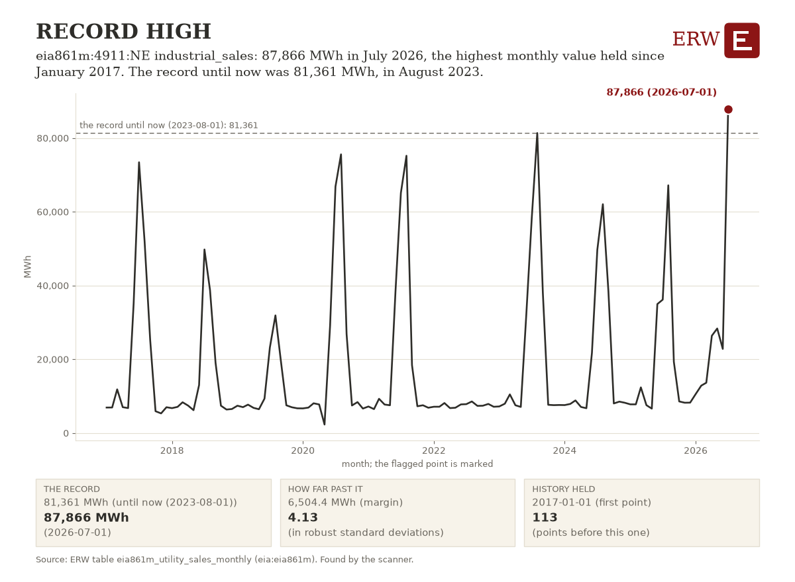

# ERW's Energy Digest, 2026-10-22

ERW's weekday brief of energy news for the 24 hours to 2026-10-22 15:39 UTC, from 258 scored stories.

## Top of the industry

1. **Cheniere signs long-term LNG deals with QatarEnergy for 4 mtpa through 2054** (lng)  
   Decade-spanning LNG contract locks in supply volumes and reshapes global LNG trade flows. parties: Cheniere; QatarEnergy. Sources: [LNG Prime](https://lngprime.com/contracts-and-tenders/cheniere-inks-long-term-lng-supply-deals-with-qatarenergy/198822/), [Bloomberg.com](https://news.google.com/rss/articles/CBMisgFBVV95cUxQaXV4a2huUEhKdW5KbG85VllTQ1pQN2E2TGc1Y3p6VXJmMlhjV0p6bUYtYlg2TUFleS11aXRNSmhMYkhFNDJCOXR0Q0g4OEhJZWRRLW1YYzBGRDBXQTQ2d3hLak8yVUUwMjU1LWtWVXpIdVdaUkc5NE1rajRsaTlNOVhKZV93Z3l3Q2ZETVBBS2FBaHVBV0NIZjRjU3VhX1kzS1g2QUhZU2ItR2JCSXRXRE5R?oc=5) (via Google News)
2. **Google and Voltus plan 1 GW of virtual power plant capacity in PJM** (datacenter power)  
   1 GW VPP to support data center power demand in constrained PJM grid. 1,000 MW; parties: Google; Voltus. Sources: [Canary Media](https://www.canarymedia.com/articles/virtual-power-plants/google-plans-big-virtual-power-plant-in-energy-strapped-pjm-grid), [Latitude Media](https://www.latitudemedia.com/news/google-is-purchasing-1-gw-of-distributed-capacity-in-pjm/), [Heatmap News](https://heatmap.news/climate-tech/google-virtual-power-plant-voltus)
3. **Rising AI bills are vexing Wall Street executives, Bloomberg reports** (datacenter power)  
   Data center power costs rising sharply, imposing cost and operational challenges on financial sector. Sources: [Bloomberg.com](https://news.google.com/rss/articles/CBMirAFBVV95cUxOMV9ZUUJjbkZrbGRYOEwwbTVTbml5NGctdUw5OUgzZE5hU2NNVGo2dUtlRTFnaERqaDc2eUxSNTR4eE93empUelRPdDdJMDJNUDV4bENNb21FOFhPT2lQT1lDcnNnVFp5em1PZEZCNDhGd0Q1R3hGM19QdjZheldWdjVRcHkxeDhOQ1E1ZlVNbG93aXJia0dQS2tOMVVfOXRYUVdLSV80WDc4bFdW?oc=5) (via Google News)
4. **UK clears gas production from the stalled Jackdaw field in the North Sea** (gas)  
   Gas project approval addresses European winter supply shortages from Iran tensions. Sources: [Natural Gas Intelligence](https://naturalgasintel.com/news/uk-revives-stalled-north-sea-natural-gas-project-as-energy-supply-fears-grow/), [OilPrice.com](https://oilprice.com/Energy/Energy-General/What-Jackdaws-Approval-Means-for-the-Future-of-North-Sea-Drilling.html), [Rigzone](https://www.rigzone.com/news/uk_union_welcomes_jackdaw_decision-22-oct-2026-184903-article/?rss=true)
5. **Three killed in attacks on Aramco oil field and Saudi airport; Brent rises more than 3%** (geopolitics)  
   Attacks on Saudi oil infrastructure heighten Middle East supply disruption risk. parties: Aramco. Sources: [Bloomberg.com](https://news.google.com/rss/articles/CBMitgFBVV95cUxPMmllOFR3NkgtdHNXaGVEWVJkQ0hxM0NLd2VBREpTc1dFVzhTMllCRnFScFZldU1qMFBHdWlhczdCNWNDNFFUQnQ1X3RhVEZiQXdibC03N0VEY2JaNUVYQXh1ZnRNRXN6NFdMa09DcEFLakxZbzJwUXVJdzkyY05ya1ZFal9IenRza1ZpLUtQVG1YR3R4cEx6c1dkUDhKY2RlY2xfVmpBVUQ3OW5WUlI5MTVjMm9Jdw?oc=5) (via Google News), [WSJ](https://news.google.com/rss/articles/CBMiuwFBVV95cUxPMmFfRk1fUG53OV9uTTV0Q3ZKMFNaMnJhbFNxZjI5Z09RVE91LWFuVlRMYXNOYkFMVUcwaDFXWnllTFFHMFlXdUlCRjI1UlAzdENwUWdtUXZ0OC1yUHhaYTFMaFJYeU96bkVwcWN5UEd2Q0t0ZXlPMVBvWjFRbE1INUF2QlA0NEczXzlFa01WcUR6cVZadlVhTmxnREo2cHgxd1ptNFUzdDFGSFNNUDFGOHBoVzhaSHFRNjlF?oc=5) (via Google News)
6. **Iran's IRGC Navy claims seven vessels were hit or struck mines in Persian Gulf** (geopolitics)  
   Escalating Middle East conflict threatens critical oil shipping routes and prices. parties: Iran; IRGC Navy. Sources: [OilPrice.com](https://oilprice.com/Latest-Energy-News/World-News/Iran-Claims-Seven-Ships-Hit-in-Persian-Gulf-as-Oil-Prices-Surge.html), [Reuters](https://news.google.com/rss/articles/CBMitwFBVV95cUxNcjlJZ1lSN1BZWFJWdDlKUWh3LWRselVrNHpobGthcDVzdnZ6bjJfM1dZcTJONUtTdURHc0ZaQkk0cUhzTlp0NVZocWlTNEhIWTB4TkN6VVZPMHdfN2ZsYXVmY2NISEN6dnRERW01T2dXbXNsb2dMNHl1UFdiTW1LVzJsZU1KYThwVDZ5OHdvYzZQMEZ6djduOERMNEI4YVVVTDFqVHBNZlpOcmJiNnppOVNJVjVzbUU?oc=5) (via Google News)
7. **Brent reaches five-month high as Middle East conflict escalates** (oil)  
   Oil price spike reflects geopolitical risk premium from Middle East supply disruption fears. Sources: [Reuters](https://news.google.com/rss/articles/CBMiwwFBVV95cUxOYzBEdGVKYmZ3VVpJajg0TW5DN2VHVEM2aDVTcFJKQVduMnVMTU5NbVcyMGxBanBHY3VvMzJQR1VrQWM4b0hLeG1YaTFWcldTeU9yTlBXc3FiR1FtcUp0SmxhRkJkWmpmZ2x6X3VGZHZEUDNLTE9LTFZNSlBWWjNJVGtaV3YwWkc4QVhxbHozYkx5THpZMVlYVDAtd0dqbUMyOUcyVk91NEYxaFFCZklRWWhjQm5qN2NvVHdWdnZIQVJSMk0?oc=5) (via Google News)
8. **Iranian oil in floating storage is drained as U.S. Navy blockade tightens** (oil)  
   US blockade eliminates Iran's swing supply; tightens global oil market significantly. parties: Iran; United States. Sources: [OilPrice.com](https://oilprice.com/Latest-Energy-News/World-News/Irans-Oil-Reserves-Run-Dry-as-US-Naval-Blockade-Tightens.html)
9. **NextEra advances 18 GW of gas-fired power projects amid data center demand** (generation)  
   Utility scaling gas generation specifically to serve datacenter demand surge. 18,000 MW; parties: NextEra. Sources: [Hart Energy](https://news.google.com/rss/articles/CBMimAFBVV95cUxOaVV0T3NfWW93RU84cTh5a3AyNnp5YjVibW1teU0tUDB5Q2lqYThEckZ6U3owV3MwUmlCc0FFZ3FzOWFfQTQzTGgtTVBEbHQxMHUzSE9ZSTVrQWZFcjVCLTZzUVhQQ0V6RjlXR3lTWGtYS2x4b3lXeFZLR2ItVWZHVHZFVlprdTczNVBuMERWM3VEZHpubWVLQQ?oc=5) (via Google News)
10. **Musk says SpaceX would be surprised not to add 13 GW of power by end of 2027** (datacenter power)  
   SpaceX targeting 13 GW of power for AI; implies new gas demand and capex. 13,000 MW; parties: SpaceX. Sources: [Natural Gas Intelligence](https://naturalgasintel.com/news/spacex-ai-expansion-could-drive-3-bcfd-of-natural-gas-demand-by-2027/)

## By sector

**Power**

- India curtailed 118.6 GW of solar and wind in September as coal fuel runs low (grid conditions): Severe renewable curtailment signals critical transmission and storage bottlenecks limiting clean energy integration. [OilPrice.com](https://oilprice.com/Latest-Energy-News/World-News/Grid-Constraints-Curtailed-119-GW-of-Renewables-in-India-in-September.html)
- Carrier plans a $600 million Texas plant for cooling gear for AI data centers (datacenter power): Cooling equipment investment directly targets datacenter power infrastructure demand. [WSJ](https://news.google.com/rss/articles/CBMitwFBVV95cUxQUXY2d0x4QnUxU1RETGdlTFZCZFZMOXdVRUFkeHJxS1AwNGZGMGtHajB2TVhEZUFoLXFkSzZrUS10V2FaRDA4aklRbG9WN1F5Y2pIZGJhLWRpLTNBX29wdGJpc0FDUERmS0p4dDZSeGRmNFI3blZrOXBUT1VTb1RPWThlVkhIMjZPNGRkYmlkbl9pVEJNLThwdmRpalJJQXZEMURQZllWUlVVM18yWDRveFU0RkpHblU?oc=5) (via Google News)
- Nebius signs for 50 MW at Neom's Oxagon data center in Saudi Arabia (datacenter power): AI compute infrastructure deal in Middle East with 50 MW allocation. [Data Center Dynamics](https://www.datacenterdynamics.com/en/news/nebius-signs-on-for-50mw-at-neoms-oxagon-data-center-in-saudi-arabia/)

**Oil and gas**

- New $4.2 Billion Texas gas pipeline will supply fuel for a data center (gas): Large pipeline investment directly serving data center power demand shows infrastructure build. [Bloomberg.com](https://news.google.com/rss/articles/CBMisgFBVV95cUxQZVdHY0Nrcm1GdkZ3aGJnNmFBUE5QT2VKRWFMb0RNcThLcjYzTjZTMldoQTlkelhQU1JhUGdhTmduVUtNcXBnekpFZXRXLVdabThnbnlYR3F1Z0Q4MXNGX1lLSXpHZ2NhWFZWZGRSZmdjOEhSZkE3di1GN3ZYVktRdUY5NW1WcUMzRHNIVWJiWWhtZUQ0MVZGcUd0elNyMWZUQ3NFc19rNFExajRhOWpvUmt3?oc=5) (via Google News)
- Kinder Morgan's natural gas project backlog reaches a record $13.2B (gas): Record pipeline backlog signals sustained demand for gas infrastructure and capex commitment. [Hart Energy](https://news.google.com/rss/articles/CBMinAFBVV95cUxPaGxQUEZsWU51dkhpTS1oUUJLNVNFNWpVQ3ZDYWF4ejhVakttTlA5V2pFa2c1X3JacVRCQ0M4ejlGdlVIRHNhNkt4aTF2YWxHQ01RbTRtckVCWk1SOWVocEg2REJDXzRBY1BJNDYwNnZ4VG50WUxWaDNwX1hmZzRzU1RjYXJRcVlsMDVMaFRoU1NLYkEtMjROUnZCYTQ?oc=5) (via Google News)
- Brent stays above $111 per barrel as Houthis attack Saudi targets (oil): Geopolitical risk in oil-critical Strait of Hormuz pushes crude prices higher. [OilPrice.com](https://oilprice.com/Latest-Energy-News/World-News/Oil-Prices-Surge-Above-111-as-Houthis-Strike-Saudi-Targets.html)

**Nuclear and renewables**

- SGE's UK project company and Origin Nuclear sign letter of intent for joint venture on 14 BWRX-300 reactors (nuclear): Firm commitment to build small modular reactors; material capacity and capital move. [World Nuclear News](https://www.world-nuclear-news.org/articles/joint-venture-to-operate-planned-uk-bwrx-300-fleet)
- US Navy selects Radiant's Kaleidos microreactor for Naval Weapons Station Crane, Indiana (nuclear): Navy microreactor deployment signals military advanced nuclear adoption and grid diversification. [World Nuclear News](https://www.world-nuclear-news.org/articles/radiant-microreactor-selected-for-deployment-by-us-navy)
- Nuclear projects advance in Wyoming, Kentucky and Louisiana (nuclear): Multiple state-level nuclear project discussions but early-stage exploration. [ANS Nuclear Newswire](https://www.ans.org/news/2026-10-21/article-8508/nuclear-developments-in-wyoming-kentucky-and-louisiana/)

**Policy**

- Trump administration backs groups seeking to strip approvals from 2-gigawatt New England Wind (policy): Federal attack on 2-GW New England Wind removes offshore project from development pipeline. [Canary Media](https://www.canarymedia.com/articles/offshore-wind/trump-admin-another-attack-offshore-wind)
- US to tap heating oil reserve as prices rise before election (policy): Strategic petroleum reserve use to manage energy prices; real but short-term policy response. [Hart Energy](https://news.google.com/rss/articles/CBMiqwFBVV95cUxOVk1URU56MHQxeEtmU0twZXRXdkNJaVlXQ1FOc1hNc1I0MzJNdGlwMldVMG8xOXkxWVNJY0txZ0tLdkdxRkV6SjRJQmJkVGo0cWxKTzlyRklfaVVCeTI1UF90S2hYeE1CWGtkUDlQSUtKU0E2dzFBX292RGFBTVNUZlJPRVEyd3FDeHZuZDNRa2hicDJfb2QzdWktYmVtM2JJS0Zib3p6NXRBWmM?oc=5) (via Google News)
- US fuel sellers warn on prices over a potential pipeline shift (policy): Fuel price warnings suggest pipeline policy or infrastructure changes affecting market dynamics. [Hart Energy](https://news.google.com/rss/articles/CBMinwFBVV95cUxQS3pYazV2cW9HdnBoMEJaNkdiR0U0c3k5RzRFbWpzYTNtTnUwZVNyQTZSS01ja3J2ZnE1bEsyMXhXb24zamVwcGhhXzNZQ0tjOFdoVTdzdGx0UFZlUVllRmU3VWFuWFN3QjRSYnhrZUsyeFdHNzRaYzhPb01mbHlyamF2d0FhemZpSUROT2tKUmhvYTVXUl9vVHFhemVkanM?oc=5) (via Google News)
- SMR, LLC; Palisades SMR, LLC; Pioneer Units 1 and 2; Phased Construction Permit Application-Limited Work Authorization (NRC notice, policy action): A dual-unit SMR-300 construction permit application with limited work authorization request advances new nuclear at the Palisades site in Michigan. [NRC](https://www.federalregister.gov/documents/2026/10/22/2026-21588/smr-llc-palisades-smr-llc-pioneer-units-1-and-2-phased-construction-permit-application-limited-work)
- Utah Underground Injection Control Program; Class VI Primacy (EPA proposed rule, policy action): Approval would let Utah issue and enforce permits for geologic carbon sequestration injection wells. [EPA](https://www.federalregister.gov/documents/2026/10/22/2026-21618/utah-underground-injection-control-program-class-vi-primacy)
- Virginia: Approval of State Coal Combustion Residuals Permit Program (EPA final rule, policy action): Virginia's state program will operate in place of the federal CCR program, changing coal ash regulation for plant owners. [EPA](https://www.federalregister.gov/documents/2026/10/22/2026-21622/virginia-approval-of-state-coal-combustion-residuals-permit-program)

**Capital and companies**

- Meta reports $825 billion in future spending commitments (capital): AI capex commitment signals sustained data center build-out and power demand. [Bloomberg.com](https://news.google.com/rss/articles/CBMiqgFBVV95cUxNc240WUY1R1RKRGM0amxKQ253QlN3TlpDUnNUZG96QWRER2daLW9fVFRmUTBDSVhicUNSelFNdXk2aEZMZG5qN0xNOWpLeDJyMjZXY0N3NVR0ekpoemJXR3NhaDFwOVRXRll3VV83WDljZnp4RXJQVTBrdlBXcVUzN25lenEzRnZRdWdmY2JtSklSYk50dWJ0V3g1aEpWU2VJOERHbWJ2MGdlZw?oc=5) (via Google News)
- Valero reports record quarterly profit as refining margins rise (company): Strong refiner profitability signals robust fuel demand and market tightness. [Reuters](https://news.google.com/rss/articles/CBMixwFBVV95cUxNS0J4Z1hTMUNSRXFieWxXREx5bWRTMzlTNU9yMUs1bnRlc0xJTUlJa1Q2S2w5X2lzTzNSQ2EzdVQzZERaWVU4NTlFVXRYakdIeG5lTVhYeWtPMDl3VHZSYkoxX1VIUGoyQmNfTlh3b0JJNG5lQnVwUmxWc3RzYk1TX3RaQTFVWGJkMk4yZU01VUZ2NmdTbDYwNkNNdTZ3X3lJdHd5bVBNTFFYcmFrS0NoeTJxREltcWRWbmt2a2g0bDJNa3NKYnhV?oc=5) (via Google News)
- ADNOC's XRG in talks to buy stake in Eni's Libya oil and gas business (deal): Potential stake acquisition in Libyan oil and gas assets by ADNOC subsidiary. [Reuters](https://news.google.com/rss/articles/CBMiugFBVV95cUxQR1g2NkVwaGlBeGlfNkxLTFhLYzdVOW42cThDUFRoVDJJa3RsSF9xdGxleFhFTXdHbHdTZFJFNk9UaTMwOXhtZHYteGJKWWgtNVctU0lwcWppNUZQWGl4SlpQUHhUbWZmbXFxWVNxbUlBNkx0U0NSTFQybWExWU9aLWVGa0lHaWNDOGNoYm4weENEVU9GbmtoZzlSVVZEdHNJbU9QU2JxQjNsM1B5NFNYcEtuSWw1TGVEMHc?oc=5) (via Google News)

## AI and power

- Cumberland County, Virginia, votes 3-1 to approve 3-GW Dominion gas-fired power station (generation): Utility gas plant approval; capacity added to serve regional demand including datacenters. [POWER Magazine](https://www.powermag.com/virginia-officials-give-go-ahead-for-3-gw-dominion-energy-gas-fired-power-station/)
- First grid utilization metrics show off-peak headroom and data center bottlenecks (grid conditions): Regulatory data on peak/off-peak headroom and bottlenecks informs infrastructure planning for surging demand. [Latitude Media](https://www.latitudemedia.com/news/what-to-know-about-the-nations-first-grid-utilization-metrics/)
- Efficiency and flexible workloads may free near-term capacity, but utilities will need proof (grid conditions): Analysis of efficiency gains and load flexibility shows utilities need proof of grid delivery capability. [Data Center Knowledge](https://www.datacenterknowledge.com/energy-power-supply/data-centers-can-delay-not-dodge-the-power-crunch)
- US considering 35 data center-related developments on public land, land records say (datacenter power): Large portfolio of proposed data center infrastructure on federal lands signals sustained AI power demand. [Data Center Dynamics](https://www.datacenterdynamics.com/en/news/us-considering-35-data-center-related-developments-on-public-land-land-records-say/)
- Nvidia Vera Rubin infrastructure becomes generally available on Google Cloud next month (datacenter power): Standardized infrastructure accelerates AI datacenter deployments and power needs. [Data Center Dynamics](https://www.datacenterdynamics.com/en/news/nvidia-vera-rubin-infrastructure-now-generally-available-on-google-cloud/)

## ERW's Numbers Today

Day-ahead power was dearest at CAISO's TH_SP15_GEN-APND, 51.62 USD/MWh, and cheapest at SPP's SPPSOUTH_HUB, 34.33, on 2026-10-21. The highest real-time price was 1165.64 USD/MWh at LONGIL (NYISO) in the interval starting 2026-10-21 20:00 local. MISO is paused and PJM has no price table, so neither is in the comparison; Henry Hub closed at 3.10 USD/MMBtu on 2026-10-20.

**Day-ahead average, yesterday, main hub** (mean of the 24 hourly prices of the operating day):

| ISO | Hub or zone | Operating day | Average USD/MWh | Table |
|---|---|---|---|---|
| ERCOT | HB_NORTH | 2026-10-21 | 39.85 | [1] |
| CAISO | TH_SP15_GEN-APND | 2026-10-21 | 51.62 | [1] |
| NYISO | N.Y.C. | 2026-10-21 | 50.31 | [2] |
| MISO | INDIANA.HUB | 2026-10-21 | not requested: paused by the ERW since 2026-10-04 (MISO's terms forbid automated access) | [1] |
| SPP | SPPSOUTH_HUB | 2026-10-21 | 34.33 | [1] |
| ISO-NE | .H.INTERNAL_HUB | 2026-10-21 | 43.74 | [3] |
| PJM | | | no PJM price table (no API key) | |

**Highest real-time price, yesterday:** 1165.64 USD/MWh at LONGIL (NYISO), interval starting 2026-10-21 20:00 local (2026-10-22 00:00 UTC), PT15M `lmp_rtm_15m_mean`, NYISO's real-time locational marginal price (a 15-minute mean of 5-minute prices) [4].

**Latest fuel spot closes** (EIA, trading dates):

- Henry Hub natural gas: 3.10 USD/MMBtu on 2026-10-20 [5]
- WTI Cushing crude: 107.89 USD/bbl on 2026-10-20 [5]
- Brent crude: 115.22 USD/bbl on 2026-10-20 [5]

Tables: [1] `iso_dam_hub_prices` (caiso:PRC_LMP, ercot:NP4-190-CD, miso:da_expost_lmp, spp:DA-LMP-SL); [2] `nyiso_dam_zone_prices` (nyiso:damlbmp); [3] `isone_dam_zone_prices` (isone:da_lmp_hourly); [4] `nyiso_rtm_zone_prices` (nyiso:realtime); real-time tables read: iso_rtm_hub_prices, isone_rtm_zone_prices, isone_rtm_zone_prices_hourly, nyiso_rtm_zone_prices; [5] `eia_fuel_spot_prices` (eia:natural-gas/pri/fut, eia:petroleum/pri/spt).

## ERW's Chart of the Day

eia861m:4911:NE industrial_sales: 87,866 MWh in July 2026, the highest monthly value held since January 2017. The record until now was 81,361 MWh, in August 2023.

Table `eia861m_utility_sales_monthly`, series `entity=eia861m:4911:NE, variable=industrial_sales, node=Dawson Power District, freq=P1M`: [the table and its download](/data#eia861m_utility_sales_monthly). Chosen by rule, not by a person or a model: the strongest flag of the day's scan that no Digest has shown (rule: record; 4.13 robust standard deviations past its threshold). [How the chart is chosen](/data/methods/automated_analysis_scanner).

## ERW's Fun Fact

In March 1974, OAPEC lifted the embargo, but the price of oil had risen by nearly 300%: from US$3/barrel to nearly US$12/barrel globally. Sadat liked to say that his favourite game was backgammon, making an analogy between how he played backgammon and conducted his diplomacy.

Sources: [Wikipedia, 1973 oil crisis](https://en.wikipedia.org/wiki/1973_oil_crisis).

ERW

---

[How this is made.](/about#digest)

<!-- Generated by warehouse/news/brief.py at 2026-10-22 15:39 UTC; run log warehouse/output/logs/news_brief_20261022T153954Z.log; model claude-sonnet-5-5; story data warehouse/output/news_stories.csv. -->
