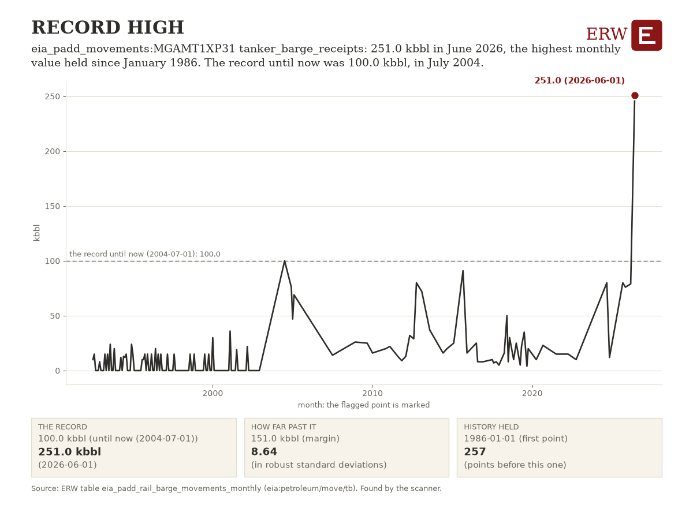

# ERW's Energy Digest, 2026-10-23

ERW's weekday brief of energy news for the 24 hours to 2026-10-23 15:45 UTC, from 276 scored stories.

## Top of the industry

1. **Kinder Morgan's project backlog reaches $14.4 billion, one of its largest quarterly increases, on gas power demand** (deal)  
   Largest quarterly backlog increase in KMI history driven by AI data center gas pipeline needs. USD 14.4 billion; parties: Kinder Morgan. Sources: [Natural Gas Intelligence](https://naturalgasintel.com/news/kinder-morgan-backlog-surges-on-ai-data-centers-southeast-power-demand/), [Hart Energy](https://news.google.com/rss/articles/CBMiogFBVV95cUxQYzJxZTNiMTVKWDBJejIxeHRuUlJPMkRHazI0enJNZDFNc0xlVHEyWThMMVh1RENuajh2QklkWGVtRUsxWGxBekpXWjJZUnl3UXo5Z0U1Vkh0UUhhV1hVY2dvMS1BcjFnY0lMQzJFQWlwVDcwX2x2NnNlOHZIWE1IMjM5UVdiRllMSW8tRlY0b2hDNDM5TkpnNXdRTkt2RmxTVlE?oc=5) (via Google News)
2. **Brent climbed above $113 amid Saudi attacks and renewed Iran tensions; diesel supplies stayed tight** (geopolitics)  
   Middle East escalation triggers large oil price move and supply shock fears. parties: Saudi Arabia; Iran. Sources: [Rigzone](https://www.rigzone.com/news/wire/oil_surges_4_after_deadly_saudi_attacks-22-oct-2026-184912-article/?rss=true)
3. **European gas prices rose 3% at opening in Amsterdam as Qatari LNG flows stay restricted** (gas)  
   TTF benchmark hits multi-year high; Middle East escalation and LNG supply fears roil European gas. Sources: [OilPrice.com](https://oilprice.com/Latest-Energy-News/World-News/European-Natural-Gas-Prices-Surge-to-Highest-Level-Since-2022.html)
4. **US and Israeli militaries prepare for possible new attacks on Iran in early November, New York Times reports** (geopolitics)  
   Geopolitical event; threatens Middle East oil and LNG flows, Strait of Hormuz. parties: US; Israel; Iran. Sources: [Natural Gas Intelligence](https://naturalgasintel.com/news/us-israel-prep-for-possible-iran-war-escalation-raising-stakes-for-global-energy-flows/)
5. **SK data center arm is in talks to fund a $350 Billion AI buildout** (datacenter power)  
   AI infrastructure funding signals power demand wave and datacenter capital acceleration globally. USD 350 billion; parties: SK Data Center. Sources: [Bloomberg.com](https://news.google.com/rss/articles/CBMirwFBVV95cUxPM0Jxa0ItbDlOQTU1RVRBUHhvNjViZFM2WDJpb2Y0VzF6WW52Nzdqajg3NzhVQVNuZ2EyRXo3Mzk2TXh4LTd3UlF6WWxHcV93ODlQYUI3c3pzM2h2a25paGZTNmpQVnc4OHNfc1NlYWlzOWdqU29jWXByNERzUGpOV2luSTEyR1hxMjZzRFpXaW5RQUNYQmZfSlA3NVFxVWk0Z1EtVExKaFp5dHJqaG9N?oc=5) (via Google News)
6. **India's Welspun wins $580 million US gas pipeline order tied to data centre buildout** (gas)  
   Gas infrastructure deal directly serving AI data center power demand expansion. USD 580 million; parties: Welspun. Sources: [Reuters](https://news.google.com/rss/articles/CBMiywFBVV95cUxNcWphMFNwdGZkOGo5TGZxMXk3SFhidGZOWXpKWV8xN2hYeXY2MlRITjRIZDM0ZE1RYnpPRTNzdzlaVEwwMGZnR0pqWG9Kd0xJbC1KX1gtUVZfRTZ2T0ZOZUw0bjJ2a3hBYWU4bDl0eWRQQXpUYllPTndTVEJxYzhXLWtETldoYmdOYkVLNUE4RWRPRGcyc1hBWFZUQmNsSXkxdTJkWnlQcURjOVJHZWhYZmc0X2x5OVlQSGpYMTRhb1lWOXBWNU8wLTh0UQ?oc=5) (via Google News)
7. **Westinghouse to invest $1 billion in new fuel plant in Hopkins, South Carolina** (nuclear)  
   Nuclear fuel fabrication expansion to produce 600 metric tons uranium annually. USD 1 billion; parties: Westinghouse. Sources: [ANS Nuclear Newswire](https://www.ans.org/news/2026-10-23/article-8513/westinghouse-to-fabricate-leu-fuel-at-expanded-sc-facility/)
8. **Eni adds an extraordinary dividend and more buybacks after third-quarter earnings more than double** (company)  
   Refiner earnings strength signals sustained energy price support and capital return capacity. parties: Eni. Sources: [OilPrice.com](https://oilprice.com/Latest-Energy-News/World-News/Enis-Profits-Soar-125-as-Refining-Boom-Fuels-Massive-Investor-Payouts.html), [Rigzone](https://www.rigzone.com/news/eni_further_boosts_shareholder_returns-23-oct-2026-184917-article/?rss=true)
9. **European Parliament votes to delay methane reporting rules for fossil fuel importers by three years** (policy)  
   Regulatory delay affects LNG suppliers and carbon accounting across Europe. parties: European Parliament. Sources: [Natural Gas Intelligence](https://naturalgasintel.com/news/european-parliament-backs-longer-methane-rule-delay-for-lng-importers/)
10. **Brent crude reaches more than a five-month high on Houthi-Saudi attacks and a UAE oil spill** (oil)  
   Escalating Middle East conflict and supply disruption drives oil price move at market-sensitive levels. Sources: [Reuters](https://news.google.com/rss/articles/CBMixAFBVV95cUxPR2dZUC10TmJYRUk2RmM5WWpxaUx2XzBPZ0ZTV3hIR3BkaGFvZ3B2T1hhd0xEcXZOWk5LdXhLLUF5QU9XdTRQdnRyTk9jcmVNMEZvZlZBRW8xcG1TVW1fTkY2UnFrcXlVWlUwbDhRYk9pcW1fdEdzMVNRR2ZhYVl2T0RZa09uZTktZGFWRVRWSEpGeFhYVXVPR09zNDVaTVdiNDdRRHg3VFNyZWNNWVBmdkxGMWFOa05yN2NBRnRVZjF3eF9i?oc=5) (via Google News)

## By sector

**Power**

- Net Power, once aimed at low-emission power, turns to data center demand (generation): Clean tech firm abandons emissions targets to build conventional gas plant for AI datacenter demand. [Heatmap News](https://heatmap.news/energy/net-power-data-center-boom)
- Steep bill for AI buildout weighs on Meta and other tech stocks, Reuters reports (datacenter power): Rising capital costs for AI datacenters may pressure power demand growth and investment returns. [Reuters](https://news.google.com/rss/articles/CBMipAFBVV95cUxOaG4yYUM1ZzJnZmtpWnhIUVEzU01PRmxZM1BDRDJLazA1dkdaX3k0Z2pPMHJJUi1HUEM2OF9oV1JzSFh3d1dEU0dzc3JMQWRCeDhRa2JvNGVBbVluUlY4UGY3REoyWVZkTFBZT3BGa0swX2s1RzY3MDM5ZWlBTm1wYVBYNEt5M2VlTFoyRVNTTXJUaUVVYzVNcUtQQ2hfUW9nalZGbQ?oc=5) (via Google News)
- Nebius secures $3.5bn senior secured financing from Citi (datacenter power): Capital raise for datacenter and AI infrastructure; substantial funding signals sector strength. [Data Center Dynamics](https://www.datacenterdynamics.com/en/news/neocloud-nebius-secures-35bn-in-financing-from-citi/)

**Oil and gas**

- Brent trades at $114.00 per barrel as Houthi attacks threaten Saudi energy infrastructure (oil): Price move driven by geopolitical risk to crude supply. [OilPrice.com](https://oilprice.com/Latest-Energy-News/World-News/Brent-Hits-114-as-Houthi-Attacks-Threaten-Saudi-Energy-Infrastructure.html)
- Oil holds its biggest gain in a week as Saudi attacks raise supply risks (oil): Escalating Middle East conflict drives notable oil price move and supply risk reassessment. [Bloomberg.com](https://news.google.com/rss/articles/CBMingFBVV95cUxPZjR5Ukt1bFQ2cG5CR2xEckxfejgwaHhOLWwyTGFRM0xFOUowbGEyUEphdVZFQ2hjaEFLZ3g0ZndDWUxLNzNUN0ZzQUx6a3NtMjZtTG05WDI5cjh1NzlkLVdBQzNqR05ZQURMeE9GWlRuUXA0MDR5alI0N1JrNmtsenhPcGtZcnJwRk1xWlpTQVpuamwwaHdBenB0cTJTZw?oc=5) (via Google News)
- Tanker with Russian diesel signals a US port after the Trump-Putin deal (oil): Sanctions relief enables Russian fuel imports; impacts US refining and markets. [Reuters](https://news.google.com/rss/articles/CBMixwFBVV95cUxOb3Zka2dCZ1RzeXJfN1BWOGlIbHpxODVFbTdvdjFuengzUlVHTkpLVGlOa05wUXNvdWpyNl9MTGRVMTJmWFdMTTFyU3pka3FrZ0hzMGhHVEJTRGpVQXV1TEhPYXBsSjU2UllWZHlfVzBCMnBvT01NbVNUdkJiMER4YWhKZDljRUVMY2N1REdxMEpZVkg1RFhOMGFkT3NnNWljS29Jd05ZLXdNMnhmaUlUZXJWY3hGTzN4b3hEM2ExUGxNcDRLMDVr?oc=5) (via Google News)

**Nuclear and renewables**

- Posiva receives licence to operate Finnish used fuel repository at Olkiluoto, a world first (nuclear): World's first used fuel repository operational license; milestone for nuclear waste management. [World Nuclear News](https://www.world-nuclear-news.org/articles/posiva-given-go-ahead-to-operate-finnish-used-fuel-repository)
- NRC finalizes rule easing licensing for reactor designs already authorized by DOE or Defense Department (nuclear): Expedites commercial nuclear licensing for designs already approved by DOE or DOD, potentially accelerating reactor deployment. [ANS Nuclear Newswire](https://www.ans.org/news/2026-10-22/article-8512/nrc-finalizes-rule-on-licensing-reactors-with-prior-doe-or-dod-authorization/)
- WSJ reports on the US push to put nuclear reactors in ports and on cargo ships (nuclear): Novel nuclear applications for maritime and port power, early-stage policy and development focus. [WSJ](https://news.google.com/rss/articles/CBMijgFBVV95cUxOOE9KM2tuaTcxbTA2SXJENWFXU1Ixd1g2X0hNZXkzR2RjU2lQMUNmX1RETjB6UFNOMGxpcmVMSWlBMzdZdWlOc094TFpjVGRMMnI5TnFUc1ZqTUJ2TmpxZW93aE00TENZZ3NxOGpoZjBuUWpVdTF0WHhwOVhNNW9RMjNBU3NzOVE3RUNCVFVn?oc=5) (via Google News)

**Policy**

- Trump invokes the Defense Production Act for oil production and refining; $150 million listed (policy): Executive action to boost domestic oil production and refining capacity signals supply priorities. [Reuters](https://news.google.com/rss/articles/CBMiwwFBVV95cUxOdm9ka0hnal9OOUFnN19HQmRZd0ljY2tJOVNoN2tIWURrMHExZ0p0NWN0UEpTMmFORG1TTU1CeXZkb3RhenhtelltYVY2SmRyZEctMnRIcUNEQlFXODdsZGxBMXhpem81NjJwRjRCbVl1N2tyWVkxeXU0T2k3ZEttNk5lbzZCVzRrUEtwT3JPTlJiUUVmSjU4b25EaXNIQ3dyS3c3NlJUSkFBdWZSMDFZVmZ1dmhncGFIYjNQU0tOd1I5dFk?oc=5) (via Google News)
- Trump says wind turbine imports threaten national security (policy): Trade restriction threatens renewable energy supply chains and could raise deployment costs significantly. [Reuters](https://news.google.com/rss/articles/CBMisAFBVV95cUxQbXBnbGtXTC1kdE85WW5oRjI1dW9WU1d6RGdZLXoyRS12V0l0NXZyT21Rcnk5eERXeDhacVlpSWRDNVc2VlhoOUJyWWFvOVV3ck5oeU45eXZHQVpCaklMLTh4QXJkcXVWX192VUQ3QmNEa2VyMVdWNUtTaGlYdm1qb3pNRGtDazdsdjFQb3lISUNBNDNEWkJjUkFhLXJXcGpjWndUaVJLaDJFaHRIQk9KZQ?oc=5) (via Google News)
- Japan weighs phasing out gasoline subsidies from December as payments become hard to sustain (policy): Policy shift on fuel price support amid sustained high oil prices. [OilPrice.com](https://oilprice.com/Latest-Energy-News/World-News/Japan-Weighs-Gasoline-Subsidy-Cuts-as-Energy-Costs-Soar.html)
- Energy Department to Use Defense Production Act Funding to Restart American Refinery and Expand Refining Capacity (DOE news release, policy action): Federal use of Defense Production Act funds for refining signals direct government support for domestic refining capacity. [DOE](https://www.energy.gov/articles/energy-department-use-defense-production-act-funding-restart-american-refinery-and-expand)
- SMR, LLC; Palisades SMR, LLC; Pioneer Units 1 and 2; Phased Construction Permit Application-Limited Work Authorization (NRC notice, policy action): A dual-unit SMR-300 construction permit application with limited work authorization request advances new nuclear at the Palisades site in Michigan. [NRC](https://www.federalregister.gov/documents/2026/10/22/2026-21588/smr-llc-palisades-smr-llc-pioneer-units-1-and-2-phased-construction-permit-application-limited-work)
- Energy Department Announces Over $125 Million for 63 Projects Across 16 States to Lower Energy Costs, Expand Electricity Access, and Advance Economic Development for America’s Tribal Communities (DOE news release, policy action): Federal funding for tribal energy cost reduction, electricity access and economic development; mid-size program with real dollars. [DOE](https://www.energy.gov/articles/energy-department-announces-over-125-million-63-projects-across-16-states-lower-energy)

**Capital and companies**

- Commerce Department commits up to $389m in R&D funding for fusion and advanced computing semiconductors (capital): Federal support for fusion and semiconductor cooling to power AI datacenters; capital directed to frontier energy solutions. [Data Center Dynamics](https://www.datacenterdynamics.com/en/news/us-department-of-commerce-commits-up-to-389m-in-rd-funding-to-power-semiconductors-for-fusion-and-advanced-computing/)
- Meta's credit risk indicator hits a record high on its increased AI spending plan (capital): USD 25 billion AI spending commitment raises default risk; signals datacenter power demand and capital intensity. [Reuters](https://news.google.com/rss/articles/CBMipwFBVV95cUxOMXV0RkI1VFVXRm4xc0tyNDBnc2NENDA3aF9XdjNxZVVGeU9IMkVlN0s0N3dvbTlYdzFFM0JwbUZjQ01tNFJpWE1GVG5wZXZjOWZMbnk1dUFrWWJlTjNrVU5kZjZxblBOUWFRX2hicTlFUEUyaTV0TjEyZUtUeHliMzZBTHFkS3BOb2FOWmF2S0RoTDBMSm1rdE84YmVQUnZ6bU9CazJmNA?oc=5) (via Google News)
- Eni raises its payout after profit doubles; shares near 20-year highs (company): Oil company profit surge likely supports upstream investment and shareholder returns. [WSJ](https://news.google.com/rss/articles/CBMiqgFBVV95cUxNaWJNOEkxeFNGUzRFN0JzSng3Z2FyWi1BeC0wVkdPT3ZtY0Nta3BzX2JZbGowU3VZX1JsZUxibXRjbmtuNGZ6Y1R2aUhfNjVaRGVGMlQ2bTVXWDZMd25xcTA4Y2R3cTg1MGhiWXJvamFUbGpfcVRKQVlGWWxSbFdKMU9HY3FzdzZXSExhZDdIbXllc19PcXJLWVVpdHJWcGhtTTh2S2NuM1hHQQ?oc=5) (via Google News)

## AI and power

- Innio signs 620 MW gas engine order with an undisclosed US data center developer (generation): Data center power demand drives gas engine procurement for backup and primary power. [Data Center Dynamics](https://www.datacenterdynamics.com/en/news/innio-signs-620mw-gas-engine-order-with-undisclosed-us-data-center-developer/)
- Krolmap plans a 225 MW off-grid data center in Zaragoza, Spain (datacenter power): Mid-scale datacenter project with novel off-grid power model; incremental but real generation deal. [Data Center Dynamics](https://www.datacenterdynamics.com/en/news/krolmap-plans-a-225mw-off-grid-data-center-in-zaragoza-spain/)
- Data center backlash threatens Australia's $70 Billion plan; NextDC outlook darkens (datacenter power): Political and community opposition to AI data center buildout in Australia. [Bloomberg.com](https://news.google.com/rss/articles/CBMiswFBVV95cUxOTlVoS0NUczZuM0VxNENQTjNJbnU0RDRhLURoSGU5ZjEzWTdUMWsxLU10aHoxdlNOVDFaQl9mcjJhRGRxUlh6azhEbWI3dnVfTTVpZU9mdjBpRFl0aGktaVRPWG9lZHRid2ppZVZEQ2diQzN1ZUpBOC03bDVFbi1CY2RrWnZJcm9mVFg3TkRSWFVJUENCNlV6c1ZQQnVxSjJlYW1ibjEwYjdSY1BuOG9jMzBsQQ?oc=5) (via Google News)
- Sodium-ion storage maker Peak Energy raises $108 million in a GM-led round (storage): Storage startup capital raise for datacenter support; emerging but unproven market. [Hart Energy](https://news.google.com/rss/articles/CBMirwFBVV95cUxQY2RrSjMyZ1d5eDlFYzhVR0tOalJEWWZzaDJob25KNmpINWVFRDBmYnNSb2xjMmJhLTVCdXplMm9ub3JNY3NmSUdsOFdoNGNvQzdvaXM0VTY3QjRHQ0RkVjNOS2NXXzQ4dm16cFNNX0sybG5Ybm9zTkc3OG85S3k1ZTg0WTRZOTE1c1NOZTJxY29fcC1keHU5ZmNZMlZOV0JOS2FRZ2pSS2pVLWt0NmJZ?oc=5) (via Google News)
- Reuters Breakingviews commentary says data centres fail as an AI pick-and-shovel trade (datacenter power): Commentary on datacenter economics and AI capex returning diminishing power returns; strategic insight. [Reuters](https://news.google.com/rss/articles/CBMipgFBVV95cUxOLWtTX2NYLUhOZFo0blFUbTdMeV9CV2tydlRTOWdLWHo5cTF5cG5sb1ZRTjZjVWphWHFkbFlnSWZ3aEpUWmtzRmNUTWQtVnNGMXdUczhhUWJMVjRPWGFMY1JYZUZ5VjVRWUJfVTdtaWcwV1JhNUlOd3YtSGlfcFJ4X09FT3Vzd3ZnN3VLS01UOF9qMGNYengxLVJNUkFvTDNsVUhKdmJn?oc=5) (via Google News)

## ERW's Numbers Today

Day-ahead power on 2026-10-22 was dearest at NYISO's N.Y.C., 52.60 USD/MWh, and cheapest at SPP's SPPSOUTH_HUB, 23.36. The highest real-time price was 129.51 USD/MWh at LONGIL (NYISO), in the interval starting 2026-10-22 21:00 local. MISO is paused by the ERW and PJM has no price table, so neither is in the comparison; the latest EIA closes, on 2026-10-20, were 3.10 USD/MMBtu for Henry Hub, 107.89 USD/bbl for WTI and 115.22 USD/bbl for Brent.

**Day-ahead average, yesterday, main hub** (mean of the 24 hourly prices of the operating day):

| ISO | Hub or zone | Operating day | Average USD/MWh | Table |
|---|---|---|---|---|
| ERCOT | HB_NORTH | 2026-10-22 | 30.48 | [1] |
| CAISO | TH_SP15_GEN-APND | 2026-10-22 | 43.02 | [1] |
| NYISO | N.Y.C. | 2026-10-22 | 52.60 | [2] |
| MISO | INDIANA.HUB | 2026-10-22 | not requested: paused by the ERW since 2026-10-04 (MISO's terms forbid automated access) | [1] |
| SPP | SPPSOUTH_HUB | 2026-10-22 | 23.36 | [1] |
| ISO-NE | .H.INTERNAL_HUB | 2026-10-22 | 40.92 | [3] |
| PJM | | | no PJM price table (no API key) | |

**Highest real-time price, yesterday:** 129.51 USD/MWh at LONGIL (NYISO), interval starting 2026-10-22 21:00 local (2026-10-23 01:00 UTC), PT15M `lmp_rtm_15m_mean`, NYISO's real-time locational marginal price (a 15-minute mean of 5-minute prices) [4].

**Latest fuel spot closes** (EIA, trading dates):

- Henry Hub natural gas: 3.10 USD/MMBtu on 2026-10-20 [5]
- WTI Cushing crude: 107.89 USD/bbl on 2026-10-20 [5]
- Brent crude: 115.22 USD/bbl on 2026-10-20 [5]

Tables: [1] `iso_dam_hub_prices` (caiso:PRC_LMP, ercot:NP4-190-CD, miso:da_expost_lmp, spp:DA-LMP-SL); [2] `nyiso_dam_zone_prices` (nyiso:damlbmp); [3] `isone_dam_zone_prices` (isone:da_lmp_hourly); [4] `nyiso_rtm_zone_prices` (nyiso:realtime); real-time tables read: iso_rtm_hub_prices, isone_rtm_zone_prices, isone_rtm_zone_prices_hourly, nyiso_rtm_zone_prices; [5] `eia_fuel_spot_prices` (eia:natural-gas/pri/fut, eia:petroleum/pri/spt).

## ERW's Chart of the Day

eia_padd_movements:MGAMT1XP31 tanker_barge_receipts: 251.0 kbbl in June 2026, the highest monthly value held since January 1986. The record until now was 100.0 kbbl, in July 2004.

Table `eia_padd_rail_barge_movements_monthly`, series `entity=eia_padd_movements:MGAMT1XP31, variable=tanker_barge_receipts, node=New England (PADD 1A) Receipts by Tanker and Barge from Gulf Coast (PADD 3) of Aviation Gasoline (Thousand Barrels), freq=P1M`: [the table and its download](/data#eia_padd_rail_barge_movements_monthly). Chosen by rule, not by a person or a model: the strongest flag of the day's scan that no Digest has shown (rule: record; 8.64 robust standard deviations past its threshold). [How the chart is chosen](/data/methods/automated_analysis_scanner).

## ERW's Fun Fact

The term duck curve was coined in 2012 by the California Independent System Operator, and the curve is named for its visual similarity to the outline of a duck. Grid operators hope batteries help the duck keep its neck in check.

Sources: [Wikipedia, Duck curve](https://en.wikipedia.org/wiki/Duck_curve).

ERW

---

[How this is made.](/about#digest)

<!-- Generated by warehouse/news/brief.py at 2026-10-23 15:45 UTC; run log warehouse/output/logs/news_brief_20261023T154552Z.log; model claude-sonnet-5-5; story data warehouse/output/news_stories.csv. -->
