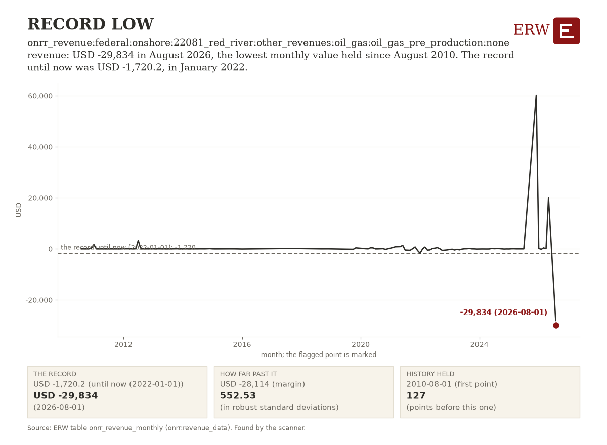

# ERW's Energy Digest, 2026-11-06

ERW's weekday brief of energy news for the 24 hours to 2026-11-06 00:48 UTC, from 221 scored stories.

## Top of the industry

1. **IEA publishes World Energy Outlook 2026** (policy)  
   Annual forecast of global energy trends shapes investment and policy decisions. parties: IEA. Sources: [IEA - International Energy Agency](https://news.google.com/rss/articles/CBMiYkFVX3lxTE1rel9yc0pyRWJ2WXd2c3lPRXlhQmNwZjgxUXhGamd4RHNQUksyekhmdEE4V05TdnNCZ0JaVUtxUGdLRXR0cnduWWY2RmZnOXNFVXlWLW1ta3ZFeC1zaGRuQUFR?oc=5) (via Google News)
2. **Lambda plans four-building data center campus in Lowndes County, Alabama, and says it will invest $33.1bn** (datacenter power)  
   Hyperscale data center expansion; AI power demand commitment. USD 33.1 billion; parties: Lambda. Sources: [Data Center Dynamics](https://www.datacenterdynamics.com/en/news/lambda-to-develop-four-building-data-center-campus-in-lowndes-county-alabama/)
3. **EQT's Zelestra unveils $12 billion plan to chase US AI demand** (deal)  
   Large capital commitment to power infrastructure for datacenter AI load. USD 12 billion; parties: EQT; Zelestra. Sources: [Bloomberg.com](https://news.google.com/rss/articles/CBMisAFBVV95cUxQRHlEdFRkMlJHUlhvRDdZQVBmemZNcWVULWRITjNrVlBnNl9XVWlacTlyV28zb01jYlFCNjJSbXBFVUJwb3M5clVUbEhOVnBKY091XzlmTXBtRFBPYkhTUXVINE9sTkJFV3lURFFWeTlCVTZlcF85TXRPM0JTQ1R5ZHRNaGY1X0lLbkZmdU9EMnNtb2JzVURTYlRsZGc0VHZJbWFwS2xyeUZtVFpQX0tkLQ?oc=5) (via Google News)
4. **AI data center demand is reviving nuclear energy; whether SMRs, restarts and fusion deliver quickly is uncertain** (nuclear)  
   AI datacenter demand reviving nuclear energy investment; analyzes feasibility of SMRs, restarts, and fusion. Sources: [Data Center Knowledge](https://www.datacenterknowledge.com/energy-power-supply/ai-data-centers-are-fueling-a-nuclear-comeback)
5. **Brattle and Pew report: distributed energy resources could avoid $614 Billion in US power system costs through 2050** (storage)  
   Quadrupling DER capacity to 400 GW by 2050 reshapes power infrastructure investment priorities. 400,000 MW; USD 614 billion; parties: Brattle; Pew. Sources: [T&D World](https://www.tdworld.com/distributed-energy-resources/news/55416974/brattle-pew-report-finds-distributed-energy-resources-could-avoid-614-billion-in-us-power-system-costs-through-2050)
6. **Orsted completes 704 MW Revolution Wind offshore project, now in commercial operation** (renewables)  
   Offshore wind project completion signals continued momentum despite political opposition. 704 MW; USD 6.2 billion; parties: Orsted. Sources: [Bloomberg.com](https://news.google.com/rss/articles/CBMisAFBVV95cUxOSGFnSVZaSlZGQXhCdFQ4WFBVN2Itc2RPaWg5WXAwTk1XclFiTVpLVFplTXhMWmZYcWJXRWZuaF9BckxjenNDOHAtSkMyWGtxMGxxbEQ2dmhOSXJMVWdpWTh3S1V5NkhZcUp2QlN5al8wMEl4ZmR2TXl3eS10N3JlSUpqZ1htN2cxSno2aVB5R2REY0pxc3RncVlNNnZ2NXRKcXNkU3Q3VU9tRkx4YWsxWg?oc=5) (via Google News), [POWER Magazine](https://www.powermag.com/revolution-wind-offshore-wind-project-enters-commercial-operation/), [Canary Media](https://www.canarymedia.com/articles/offshore-wind/revolution-wind-fully-operational)
7. **ConocoPhillips raises dividend after beating estimates on higher oil prices** (oil)  
   Oil producer signals strong cash generation and shareholder returns amid elevated prices. parties: ConocoPhillips. Sources: [Reuters](https://news.google.com/rss/articles/CBMitgFBVV95cUxPWmVXLVh5bHBBQWh5ZkFmckpmSkRNMVB2UGZwaDFuYVc1TE93TVZKcjl4c1lPSjVQb1doc1pJdm11S01RTGtwTDRUblRGVWp2M3hrb2ZLakV3R0poTGRjcmRyOEI2M2hNOEJFVllydTcyQ043WFVSRURkREJvZWxtaWJmaDJNRllnc3lPZllyM1JtMEhnY09NLWRpZzNuQWt0YU1jTFpCMlQ2UG1ZQVVtYVF5dUlZZw?oc=5) (via Google News), [OilPrice.com](https://oilprice.com/Latest-Energy-News/World-News/ConocoPhillips-Doubles-Profit-to-4-Billion-Raises-Dividend.html)
8. **Spain saved $26 billion on gas imports thanks to renewables, IEA says** (renewables)  
   Economic benefit from renewables reduces gas import demand; signals structural shift in European energy. USD 26 billion; parties: IEA. Sources: [Reuters](https://news.google.com/rss/articles/CBMiugFBVV95cUxPdzdjLXZwM1pEU2toUHlrMy03NXZmUFo1TzdIQjRSRTRicUJ0MGNHQ2NYTGp0QjZ3T0lpNW96U29SSVdBdlhXaUYzN2xOWi1lS1ZPY2xPRkU3dkNKekVSVGM5RjJUcm5VN2NGV0VkUVRmRW9rR0tFRDdCbTZCSFQ4dHM1bUJ5b3NueGJVdmJEZk1qNUZsRzUxcThwTi1fYXJ6UjlWUWljRG44cUF6dXpfeVZuWlVRWU1yNmc?oc=5) (via Google News)
9. **Saudi Arabia warns of potential danger at Yanbu oil hub as Houthi attacks continue** (oil)  
   Supply disruption risk to oil export facility; geopolitical threat to global oil markets. parties: Saudi Arabia. Sources: [Reuters](https://news.google.com/rss/articles/CBMixgFBVV95cUxQR1J2UXI1T2psd21CTE9jNjdvWmZpaktQTVh0Vzg1VGNzZndWZVNab0JhcFNkMEZSRlF1R0d1Vm9EVmZVMDhfUThrOG84Q2VQaTZocklZaEV4end3cjBUYWFTTWxWZFc4WjBLV1MtOFQ3c0d1bHRvODdrQTFTT01MLVFvTlA1eXI3T3JnMzlXNmpXcGNsWE1KQ3hQRDZCRG8xZjBZMTJSRHZqMmNuVkFWZTVXLXRqdkoxaUlvQUVmcVoxTW9FdFE?oc=5) (via Google News)
10. **Energy Transfer sanctions 1.2 Bcf/d South Mississippi Pipeline from Perryville Hub to Florida Gas Transmission** (gas)  
   Gas pipeline sanctioned to serve growing southeastern markets with regional price widening. parties: Energy Transfer; Florida Gas Transmission. Sources: [Natural Gas Intelligence](https://naturalgasintel.com/news/energy-transfer-greenlights-12-bcfd-natural-gas-pipeline/)

## By sector

**Power**

- Google plans to spend $17 billion on a Wyoming data center (datacenter power): Datacenter capex signals continued cloud provider power demand despite backlash. [Bloomberg.com](https://news.google.com/rss/articles/CBMiqgFBVV95cUxNNE1UblF4V2JrTFJGbnZvOWxFaURSZ3d6Y1VFRjcwWHVCcXlMQm94STFoeF95ekVHclBNbWtURXppSW1iV2NpWVFJNXdwZlU5MFd2UjlOWEhubnIyX2t5N1hhUU12MWh1QVJHZDljSjdOQk5EMHZNeWRMQ2tWUGhqdFpqR1JmMTBoUjdtZFpSSlFWU3FpaElDQV9mUzB5RWtSdnRQVmF3QTF5Zw?oc=5) (via Google News)
- UK renewable firm Downing expands into data centers with 500 MW pipeline in Sweden and Finland (datacenter power): 500 MW datacenter power projects in Nordics; direct AI-driven demand growth and renewable sourcing. [Data Center Dynamics](https://www.datacenterdynamics.com/en/news/uk-renewable-firm-downing-expands-into-data-center-market-with-500mw-pipeline/)
- Google to back credit for TeraWulf's Kentucky data center, contracted to Anthropic under $19bn deal (datacenter power): USD 19 billion AI infrastructure deal signals tech commitment to dedicated DC capacity. [Data Center Dynamics](https://www.datacenterdynamics.com/en/news/google-to-serve-as-credit-backstop-for-terawulf-data-center-in-kentucky/)

**Oil and gas**

- Iran's IRGC says two tankers and a tugboat caught fire in Strait of Hormuz (geopolitics): Strait of Hormuz incident threatens oil shipping; geopolitical supply risk. [Reuters](https://news.google.com/rss/articles/CBMitgFBVV95cUxQN2pHcmkxeDJDM184TXNiS2xIOUdXdHNrTXcyVHFKcUNGZEgtanhxTm9TR0UxWjA5cGlXSy12RVBLT3JYYVVBVEltbXFTNWtFT09OMVBIUkFEVlZiaW1mcVhPM3JfQ2tnZm1uRnJSQlVoX1FfNTl5bmh1c1pZMUJBVlVZeVdoWnlQMURoR0g0WVZYcjU4WDloZzRxMHh3Q24zMlRSYXV3MUFZTGxEQXM3NXNuNExxUQ?oc=5) (via Google News)
- Wartsila wins order for engines and thrusters on Delfin's first 4.4 mtpa floating LNG unit (lng): 4.4 mtpa FLNG project offshore Louisiana advances US liquefaction capacity expansion. [LNG Prime](https://lngprime.com/asia/wartsila-scores-delfin-lng-gig/199584/)
- European gas prices fell 2.2% on Iran deal hopes after US midterms (gas): Democratic victory raises prospects for Iran LNG flow resumption, easing European gas supply. [OilPrice.com](https://oilprice.com/Latest-Energy-News/World-News/European-Gas-Prices-Drop-on-Iran-Deal-Hopes-after-US-Midterms.html)

**Nuclear and renewables**

- PSEG executives say Salem nuclear plant expects a 200 MW uprate (nuclear): Capacity addition at dual-unit facility adds ~2% to nuclear fleet. [ANS Nuclear Newswire](https://www.ans.org/news/2026-11-05/article-8561/salem-power-plant-planning-200mw-uprate/)
- China dominates clean ammonia and methanol investment as 20 projects reach FID in 12 months, study says (hydrogen): Shift toward clean energy carriers; 20 FIDs represent capital deployment. [Hydrogen Insight](https://news.google.com/rss/articles/CBMi7gFBVV95cUxPTWhSWEZJdGlWMk12S2wxbjdlVlNNblotVlJQUTd3T05WczVmN09KTVc3cUd3NTB0Vl9vaFJia3hQbzZuOHFnc085WDRwZHZ0ajBwejRtTHNjSDNDNDBwbF9mb1Fsa1hfZndHSDc4elBhQUVQMGpxcHV0bmFUMWpJRkVtWk40ZmFTX1UyazhBTm5XXy04dklvM2xVN0taNkt2eHlwdlU5cFFpNExSWUJ3aFRqR053R1dXaTc5bWZleE8xM0pGOU9vMFZRczltMWsxd1hkQ19OUVhzZUNtUmRPVnQxOFpLUHRhZW8zbDRR?oc=5) (via Google News)
- Orsted profit beats estimates; company says energy volatility boosts offshore wind growth (renewables): Renewables developer reports strong earnings tied to higher energy prices and uncertainty. [Reuters](https://news.google.com/rss/articles/CBMiuAFBVV95cUxQWkVPb2dPRENTSkswNlhtYnFMOElBZEZiUTM5Yzh1Y2lqYnFzTkNSZmtkLUZ0dFcyVHZsek1lbXNKd1plRWplcmg1Tk9MQXFWbTFWZ0FkZnJSQTljME90MUw1UzJqdVlEeWpoRzVKckVZZmR0ZVlLUFBQLUkxcGRVcUIxUVppM0czZUp4bkpUeXhOdkIxbEFiTUxWQlhsN2RRVk5naTdjVHdUVFRDT2JUdXJWZ3NBTXVN?oc=5) (via Google News)

**Policy**

- Over half of US hyperscale data center projects face regulatory friction after midterms, report says (policy): Midterm election outcome creates permitting and regulatory headwinds for AI data center expansion. [Data Center Dynamics](https://www.datacenterdynamics.com/en/news/more-than-half-of-us-hyperscale-data-center-projects-face-regulatory-friction-after-2026-midterm-elections-report/)
- Democrats take House and Senate; changes likely for clean energy, BESS and renewables (policy): Policy shift favoring storage and renewables under Democratic control; affects capital allocation and permitting. [Energy-Storage.news](https://www.energy-storage.news/what-democratic-control-of-congress-could-mean-for-us-bess-and-renewables/)
- Article considers what a bluer Texas means for energy and data centers (policy): Political shift in energy hub threatens deregulated market, renewable and datacenter growth. [Heatmap News](https://heatmap.news/politics/hinojsas-win-data-centers)
- Last Energy, Inc; Phased Construction Permit Application-Limited Work Authorization (NRC notice, policy action): First part of a phased construction permit application for a new reactor, a real step for advanced nuclear licensing. [NRC](https://www.federalregister.gov/documents/2026/11/05/2026-22577/last-energy-inc-phased-construction-permit-application-limited-work-authorization)
- Natural Gas Pipeline Company of America, LLC; Notice of Scoping Period Requesting Comments on Environmental Issues for the Proposed Amarillo Expansion Project (FERC notice, policy action): Pipeline expansion in the Texas Panhandle enters environmental review, a step toward added gas transport capacity. [FERC](https://www.federalregister.gov/documents/2026/11/05/2026-22608/natural-gas-pipeline-company-of-america-llc-notice-of-scoping-period-requesting-comments-on)

**Capital and companies**

- Column asks whether climate tech is back, two years after Trump's second-term win (capital): Democratic control may shift capital toward energy and data center infrastructure; sentiment signal for investor strategy. [Heatmap News](https://heatmap.news/climate-tech/climate-tech-back)
- Southern Co. sees $100 billion investment potential as data center contracts shield costs (deal): Utility-scale long-term capital commitment anchored by new power offtaker category. [Hart Energy](https://news.google.com/rss/articles/CBMimwFBVV95cUxQVjNnUGE3dDk1NXJsbWVlY0ZweW1QWF9waXFlYXYtSUZqbXQ0czVHRUx4TVEtVXREWURnVWlSTkZJVllEVXJzeXBKUDZRX2p1ZjlkTDRHZjVfOEt3VkY1T291eUFvQ3BEN2pTNWU0RzQzWTFaODZOQnliRjVUbTdwTUlRLXNkUTJpOEtWUGhQVzVyaTc4TEQxY2VMYw?oc=5) (via Google News)
- Return secures €835 million financing for Germany BESS rollout, targets 1GW annually (deal): Portfolio financing for BESS expansion in Germany; 1GW annual deployment target scales storage market. [Energy-Storage.news](https://www.energy-storage.news/return-secures-835-million-germany-bess-rollout-targets-1gw-annually/)

## AI and power

- Rising power demand from AI and industrial electrification drives utilities toward solar and storage (generation): Utilities ramping solar and storage procurement to handle AI and industrial demand surges. [pv magazine USA](https://pv-magazine-usa.com/2026/11/05/grid-pressures-accelerate-utility-solar-and-storage-integration/)
- Silicon Ranch CTO says AI load growth pushes utilities toward solar and storage (generation): Solar and storage deployment ramping to serve AI datacenter demand with speed-to-power models. [pv magazine USA](https://pv-magazine-usa.com/2026/11/05/speed-to-power-runs-through-the-community/)
- NextEra and Dominion outline measures for regulatory approval ahead of SCC hearings; close expected second half of 2027 (transmission): Merger regulatory process signals potential grid investment model changes to serve data center load. [T&D World](https://www.tdworld.com/policy/news/55417048/nextera-dominion-merger-hearings-could-influence-nationwide-re-examination-of-legacy-utility-rate-frameworks-amid-ai-boom)
- Entergy reports progress on Arkansas data center deal and strong Q3 sales (datacenter power): Utility securing substantial gas-fired generation capacity to serve large datacenter customer. [Utility Dive](https://www.utilitydive.com/news/entergy-makes-progress-on-arkansas-data-center-reports-strong-q3-sales/873873/)
- Microsoft declined to expand Texas data center offer with Nscale before IPO (datacenter power): Signals data center deployment slowdown amid regulatory uncertainty post-election. [Hart Energy](https://news.google.com/rss/articles/CBMioAFBVV95cUxPeG1xZjZ4VDhNeUFZdXQ2dW5CLUdFWnVXcTQ3LVhsbThvQUo4SHhZWnd5YWZSZFJKZHpnLW5EOUpCZG92UFk5YkU4emFqeTJHcUJ6SGVtZ19sM2Z5SHM4dWE5N09yTk50c1hPQmpGRGZTUlY4dUpRanhnN2t0d1JNUDN0WVliME5QR2VKb1JrWmlEU1c0eXdlbVNkREFXQ2tn?oc=5) (via Google News)

## ERW's Numbers Today

Day-ahead power on 2026-11-05 was dearest at CAISO's TH_SP15_GEN-APND, 43.40 USD/MWh, and cheapest at ERCOT's HB_NORTH, 19.86. MISO is paused and PJM has no price table, so neither is included, and no real-time table covers yesterday. The latest fuel closes, on 2026-11-03, were Henry Hub at 2.63 USD/MMBtu, WTI at 99.64 USD/bbl and Brent at 107.03 USD/bbl.

**Day-ahead average, yesterday, main hub** (mean of the 24 hourly prices of the operating day):

| ISO | Hub or zone | Operating day | Average USD/MWh | Table |
|---|---|---|---|---|
| ERCOT | HB_NORTH | 2026-11-05 | 19.86 | [1] |
| CAISO | TH_SP15_GEN-APND | 2026-11-05 | 43.40 | [1] |
| NYISO | N.Y.C. | 2026-11-05 | 38.55 | [2] |
| MISO | INDIANA.HUB | 2026-11-05 | not requested: paused by the ERW since 2026-10-04 (MISO's terms forbid automated access) | [1] |
| SPP | SPPSOUTH_HUB | 2026-11-05 | 24.07 | [1] |
| ISO-NE | .H.INTERNAL_HUB | 2026-11-05 | 41.55 | [3] |
| PJM | | | no PJM price table (no API key) | |

**Highest real-time price, yesterday:** no real-time table covers yesterday.

**Latest fuel spot closes** (EIA, trading dates):

- Henry Hub natural gas: 2.63 USD/MMBtu on 2026-11-03 [4]
- WTI Cushing crude: 99.64 USD/bbl on 2026-11-03 [4]
- Brent crude: 107.03 USD/bbl on 2026-11-03 [4]

Tables: [1] `iso_dam_hub_prices` (caiso:PRC_LMP, ercot:NP4-190-CD, miso:da_expost_lmp, spp:DA-LMP-SL); [2] `nyiso_dam_zone_prices` (nyiso:damlbmp); [3] `isone_dam_zone_prices` (isone:da_lmp_hourly); [4] `eia_fuel_spot_prices` (eia:natural-gas/pri/fut, eia:petroleum/pri/spt).

## ERW's Chart of the Day

onrr_revenue:federal:onshore:22081_red_river:other_revenues:oil_gas:oil_gas_pre_production:none revenue: USD -29,834 in August 2026, the lowest monthly value held since August 2010. The record until now was USD -1,720.2, in January 2022.

Table `onrr_revenue_monthly`, series `entity=onrr_revenue:federal:onshore:22081_red_river:other_revenues:oil_gas:oil_gas_pre_production:none, variable=revenue, node=Red River, Louisiana: Other revenues, Oil & gas (pre-production), freq=P1M`: [the table and its download](/data#onrr_revenue_monthly). Chosen by rule, not by a person or a model: the strongest flag of the day's scan that no Digest has shown (rule: record; 552.53 robust standard deviations past its threshold). [How the chart is chosen](/data/methods/automated_analysis_scanner).

## ERW's Fun Fact

In 2002, GE acquired the wind power assets of Enron during its bankruptcy proceedings, and Enron Wind was the only surviving U.S. manufacturer of large wind turbines at the time.

Sources: [Wikipedia, General Electric](https://en.wikipedia.org/wiki/General_Electric).

ERW

---

[How this is made.](/about#digest)

<!-- Generated by warehouse/news/brief.py at 2026-11-06 00:48 UTC; run log warehouse/output/logs/news_brief_20261106T004813Z.log; model claude-sonnet-5-5; story data warehouse/output/news_stories.csv. -->
