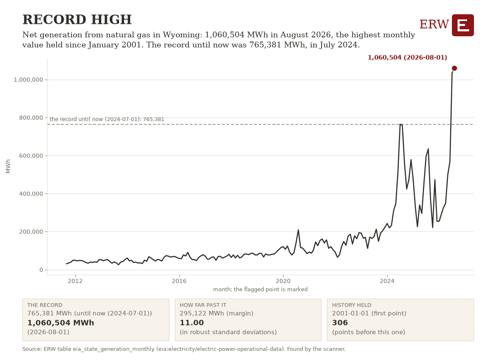

# ERW Daily Digest, 2026-11-12

**12 November 2026.** Data through 17:56 ET, 22:56 UTC.

<!-- subject: ERW Daily | 12 November 2026 -->

<!-- opening: story:news:d824995d3d0b202d -->

ERW's weekday brief of energy news for the 96 hours to 2026-11-12 22:56 UTC, from 2026-11-08 22:56 UTC, from 262 scored stories.

## The opening number

**USD 74 billion**: SpaceX plans USD 74 billion in data center projects in Arizona and Texas, as Bloomberg.com reported on 2026-11-11 (ranked 1 of the day's top ten). No price moved enough to lead; this is a reported figure, not a warehouse table's.

## The numbers

- **Market price.** Henry Hub natural gas: 3.00 USD/MMBtu on 2026-11-11, up 0.00 USD/MMBtu (0.0%) from 3.00 USD/MMBtu on 2026-11-10 [1]. Status: observed, EIA's spot close, published about a week after the trading day.
- **Physical.** US48 demand peaked at 488,034 MW in the hour starting 2026-11-11 23:00 UTC [2]; the same weekday a week before (2026-11-04) peaked at 496,093 MW in the hour starting 2026-11-04 22:00 UTC [2], so -1.6% on the week. The same weekday a year before is not held. Status: observed, EIA-930 hourly demand.
- **Project or capacity.** Storage capacity, USA: 580 MW (Sunrun, Tesla; pv magazine USA, 2026-11-12) [3]. Change: first report, no earlier figure held. Status: the outlet's figure, not a table's.
- **Policy, capital or reliability.** Deal value: USD 2.1 billion (Strathcona, Greenfire; JPT Homepage, 2026-11-11) [3]. Change: first report, no earlier figure held. Status: the outlet's figure, not a table's.

Tables: [1] `eia_fuel_spot_prices` (eia:natural-gas/pri/fut, eia:petroleum/pri/spt); [2] `eia930_all_demand` (eia:electricity/rto/region-data); balancing authority us48; [3] `news_stories`; story news:63369e9ec598452f (mw); story news:808f73a07b2ad109 (price).

## What moved

1. **SpaceX plans USD 74 billion in data center projects in Arizona and Texas** (datacenter power)  
   Sources: [Bloomberg.com](https://news.google.com/rss/articles/CBMisgFBVV95cUxQYkphbl9aSlh4QjR1eUwzLVIwREZYd1NZbU9qY05vQ3JiZEFjMFJsdXdGRmxkMzB0VW1SOXJYbGJrRGo5V04zNTdONy12eWt6OTdNNnluSlM2TnhyanB3NXBJNXgzZWxiUkFxbHR5NjBCSFZETzhnaFZzV2kwYXBzQzhjR0N2QnROUXFlTlRMQTBkTnVzVTY5ampycVI4SllMVFNLSjRxNm9ISlV2NklzZDNB?oc=5) (via Google News), [Reuters](https://news.google.com/rss/articles/CBMixAFBVV95cUxQdlQwLUxxTENmenRpSFFXVlNUeVkzeURtNWxCZ1RuVEQwdENKV0g3MndreVZsZFYwVGtpT3Q3SDJZU0pHTGI1WFFYWERreFJmbzVjaUtOR2NjUURRMTVHNVlKdGE0VkdRVzRvekpIcHdmRGdOV2kwRXVmbWl1blRIV1VKSjQ4c19FSVFTUWZNM2ptQ0ZaMW96a2UyTFphWjNsSnc3ZmJZdWhHNWpiS19hTDhYSk9vNkpkeng1N3prZ1Y3b1lI?oc=5) (via Google News), [Hart Energy](https://news.google.com/rss/articles/CBMihgFBVV95cUxQZFIwWWFZOGFZTjFQaFVjLUl4dS1JY1Q4cjd4WS1iWXVyeWg4V1ZxTHp1MFphblJTelhXWXFLZ3h4RldNYklKaDhBSlBtVW5qdjlvYVFvMmZ5b192SjVoLVd3V3JRM0tTNUFuMUducVFtY2IxaGZhZXo2RTg2cXdHWXBDdVFtdw?oc=5) (via Google News)  
   Also in datacenter power: Rowan Digital Infrastructure Secures $1.5 Billion in Financing for Hyperscale Development Platform ([POWER Magazine](https://www.powermag.com/rowan-digital-infrastructure-secures-1-5-billion-in-financing-for-hyperscale-development-platform/)).
2. **Oil settles USD 3 higher on attacks on Saudi energy sites and Strait of Hormuz disruptions** (oil)  
   Attacks on Saudi Arabian oil infrastructure and Strait of Hormuz transit risk trigger price move. One outlet has reported it so far. Sources: [Reuters](https://news.google.com/rss/articles/CBMixgFBVV95cUxNSVNfOWE4dnhlMzA3cExiOE1nR0FNQXFJejNsQTExRExKTlVKNjNjcFRGMWQxMGNmYnNOWFdLaUp0OUo2SHFlNVoxMUo0Y21WazFhVmhZU1VxYlRuWVRfZEtiQ0NGWENEejFpMFRzaUtNbVV3TEhKUHp2aUc0SHJ2VkNzM1BHNU5VeGNNbnRldWZaZUFkTWdDNm9ibk5kQXlOQlRRWHRhdGk5ZEtPZjVjMjE1Q1BJaTZ1NmplRWJVSDlvRFBUQnc?oc=5) (via Google News)
3. **Ontario Power Generation says first Darlington SMR unit will be late and over budget** (nuclear)  
   First of four planned BWRX-300 units at Darlington will miss October 2030 target and exceed cost budget. Sources: [World Nuclear News](https://www.world-nuclear-news.org/articles/opg-to-revise-timeline-and-cost-of-first-smr-unit), [Canary Media](https://www.canarymedia.com/articles/nuclear/small-modular-nuclear-reactor-late-canada), [Heatmap News](https://heatmap.news/am/canada-smr)
4. **Strathcona pursues growth with a USD 2.1 billion Greenfire deal** (deal)  
   Sources: [JPT Homepage](https://news.google.com/rss/articles/CBMigwFBVV95cUxOTzVOaDZab20xNk1fTzZfWXRCWmFBalZqT3VQRFNMNmFOVm5ERXFKVjVRVDJqcDFtQlpZVWVzTndJWVBCVHJTRWRmeEhTRzAxamdFYVRWVDdaQU1KSE9obTQ4enNBYjBNZFpzVm8zeklGb21kaWtkQThqc1VCbVdGencyUQ?oc=5) (via Google News), [Hart Energy](https://news.google.com/rss/articles/CBMiygFBVV95cUxOZDBncHRILXZld2w2VFdMUlB0M01kcERrZXFuY0JsVEtMTFhBTjVMMjNsaUlDUnVjYUZma3J6UU44d3lpQm83akF3QTlBaV9wZi1rbGZTdXlpbmg1QlVaODg1WmFzMW9lYkJQNlFNN0F3NUZ6UWhqUHI3SXUzX2lwSTZoSnYzUDI0dWR1Sk5QdERpQjNGVFNZN3hJQVhid3VTbENVdXpZaHNnUUFYdjdzaExDSUFKS2lKWmpuMlEtY2xWOGEwRkRFSnFn?oc=5) (via Google News)
5. **Sempra nears sale of KKR's LNG stake ahead of Port Arthur startup** (deal)  
   One outlet has reported it so far. Sources: [Hart Energy](https://news.google.com/rss/articles/CBMitgFBVV95cUxQWVZXUEtCM1ZyYjUzd1FZOUItRDdMY0JBcEZwWkVNVU9pcHJxaGZEZU5YaEF4dHNDbXY4Y3Rkeml6VVFtLWJ1UmxvdXNaWnhKMDhhMlpVR0JFNUN5UGZ0TTFqVlVTX1F4MW1kQmdLTE1qdzZIUlBKQ2RSOWtNWldJSGcyczA4VUMxQVNfdEZZbEZLZ3RkS3ZFYlpZQXp6OUpMclJRU1VwTks0bXZRTC1rS25vV1NVdw?oc=5) (via Google News)

## More

### The rest of the top ten

1. **Repsol takes final investment decision on third large-scale green hydrogen project in Spain** (hydrogen)  
   parties: Repsol. Sources: [Hydrogen Insight](https://news.google.com/rss/articles/CBMi3wFBVV95cUxOcDJ5NUJ6VEZEQVlubjVMV0lCM2JUSFZJV2FQRVJXR3pwWjlFdENFWGFUSlRtWDB3QmZVM3EwUWZGSkRXTl9qcTFyNkJydjN2TUpPTU5kcl83bV83OWVUdS0yaWNZanVlTU1hVlkyUDhDeVFaYUg4elctRy1hSjVNRzMtMkNLaUpabkoxTnlMZUZtbUV6NmhFYmVtWGNqWlpDbkZEQ0ZIRjN3dGxRUTdpT0RVT3M1Q2d0alFJQXJjUERPZGdWeVRkTk4yLUZobFgxX2RTUnRhWlFfTFk0S01v?oc=5) (via Google News)
2. **India's Clean Max plans USD 5.3 billion clean energy investment to power an AI computing facility** (datacenter power)  
   Indian developer commits capital to renewable generation for datacenter load. parties: Clean Max. Sources: [Reuters](https://news.google.com/rss/articles/CBMixwFBVV95cUxPbUd5azlyc2VuWEFpbXhjNFBHM0I1SGRVRld4QVJHdUpxcHNaYlppRXFpRGZZdHlMWVR2TVAtbTd5bnV6WV9DNHliaWlteTM2S0xaYjBJT3BCODhrck9uNWVnVXJEcEZWZWNvbXZfUDkyNzB1a1IxYzduM2tIRFlIa0lod1FXbUNzTUozbHdSdjhnV3NqdURJYzk1WGd4TURSM0F6SmlTM2VyajNJWlphQ3VYdzctckxJX1p1aWIzUmp2S2hwRVQw?oc=5) (via Google News)
3. **Sunrun and Tesla dispatched more than 580 MW from over 140,000 home batteries in September** (storage)  
   parties: Sunrun; Tesla. Sources: [pv magazine USA](https://pv-magazine-usa.com/2026/11/12/recent-dispatch-of-vpp-power-to-grid-demonstrates-viability-of-coordinated-residential-storage-at-scale/)
4. **Families pay 16% more for natural gas than two years ago** (power prices)  
   Electricity demand from data centers will require enough new gas plants to expand generation capacity by one-third, raising customer bills. Sources: [Heatmap News](https://heatmap.news/ideas/gas-customer-protection-pledge)
5. **CoreWeave plans to raise at least USD 4 billion in a high-grade loan** (capital)  
   parties: CoreWeave. Sources: [Bloomberg.com](https://news.google.com/rss/articles/CBMiswFBVV95cUxPdDZFbWh5TVg1cmk3LWhHVVR2OGhKZGlWdC0wVmtINGlSWmU3VzctR3M2NTNIamh1OVliNDhGbThzYWtlM19BbXVKblIxLVBmeXNmRG50cnNUV05qNGRZbTVOU1ZTWFBDOXg2UmtGc0stSkNNcU0waDEzcVNoNVlxTEh6RzRoeDJuQThNVWsxa1dOOHBZSXVMdjVubGNYd0lOWFg3cUM3enR4U25BWjJIWmtXSQ?oc=5) (via Google News)

### By sector

**Power**

- EIA says power sector could install more than 26,000 MW of battery storage next year (generation): Battery storage deployment and renewables are becoming the primary source to meet rising power demand as coal burn falls. [Utility Dive](https://www.utilitydive.com/news/as-coal-burn-declines-rising-power-demand-will-be-primarily-met-by-renewab/874315/)
- Citi says electricity demand feeds a USD 1 trillion goal (datacenter power). [Bloomberg.com](https://news.google.com/rss/articles/CBMisgFBVV95cUxQQ1pyMVRBSldRRmdmR211bjdKOVBmOUE1aEhaNzVmT1BmNUZEMzQxLVpNeWx5cy0xRmtlRTg5OEpMMVY3YmpIUDdjRzRiNVlUaUpBcEFnTHJ4QjZ0TTBEWUE2THgybzcwaHNOdUJmcjhvSmhIQk9jZ0xLTU16UjJBQnd4NnFnckFTS3JXY3gtclFUOFczVU8yVFdkMlg4bkIxLVctenJnbWpuMHlyY3NLLUV3?oc=5) (via Google News)
- Record LNG feedgas demand lifts forward natural gas prices in the United States and Canada (power prices). [Natural Gas Intelligence](https://naturalgasintel.com/news/record-lng-demand-ignites-natural-gas-forward-rally-but-will-it-last/)

**Oil and gas**

- Yemen's Houthis say they attacked a pumping station on Saudi Arabia's East-West oil pipeline (oil). [Reuters](https://news.google.com/rss/articles/CBMiygFBVV95cUxPOHNyWUhKaHR2QmJXUjJ6S0xNdDZnZmpKRzJQak9SWVc3cmttUGVfbk13NzBZclpqNnp5N1JFc0JYakw2Wl9hV3BYdm1mMnJQR3BKRFI2Zzh3cVRhTFFxejBSVWtTMkt2WTRGRUxFSkVocF83aFlIOU10Vk11d29TRERPcnFVWHRJYktFOUlGU0x4c0Q0UWVtT3JkUE91ZVNPQ09NTnhaMGxJajZxQnkwWTFvTzN4WnNpMTBYalNZOHFZdnUtX1VHeUVR?oc=5) (via Google News)
- Oil rises after Trump says the US does not need a deal with Iran (oil): Reduced diplomatic prospects increase risk premium in crude oil prices. [Rigzone](https://www.rigzone.com/news/wire/oil_rises_as_trump_dims_iran_deal_hopes-12-nov-2026-185073-article/?rss=true)
- Saudi Arabia tells OPEC its crude production climbed 26 percent in October (oil). [Rigzone](https://www.rigzone.com/news/wire/saudi_oil_production_surges_to_one_of_highest_levels_in_years-11-nov-2026-185059-article/?rss=true)

**Nuclear and renewables**

- U.K. Fusion Energy seeks suppliers for STEP; First Light works with U.K. laser facility (nuclear): UK fusion prototype advances to procurement phase reducing timeline uncertainty for future generation capacity. [ANS Nuclear Newswire](https://www.ans.org/news/2026-11-12/article-8575/step-begins-major-procurements-first-light-collaborates-with-uk-laser-facility/)
- X-energy's reactor permit raises hopes for nuclear, though costs remain high and some projects are troubled (nuclear). [Latitude Media](https://www.latitudemedia.com/news/is-nuclear-finally-moving-faster/)
- AtkinsRéalis and Turkey sign agreement for study of a possible 4,500 MW Candu plant (nuclear): Turkey proceeds with nuclear study following COP31 climate commitment. [World Nuclear News](https://www.world-nuclear-news.org/articles/atkinsrealis-producing-study-for-six-unit-candu-plant-in-turkey)

**Policy**

- Exxon files legal challenge to EU carbon capture law, FT reports (policy): Legal challenge to EU carbon capture regulation may affect policy compliance costs and investment timelines. [Heatmap News](https://heatmap.news/am/guterres-cop31)
- More than 70 senators vote to advance permitting reform bill; Heinrich discusses next steps (policy). [Heatmap News](https://heatmap.news/daily/exclusive-martin-heinrich-on-whats-next-for-permitting-reform)
- New Democratic regulators on Georgia's commission plan to take on Georgia Power's data center gas buildout (policy): PSC control shifts to party opposing unregulated power demand for compute. [Canary Media](https://www.canarymedia.com/articles/politics/new-dem-regulators-georgia-power)
- Long Mott Energy, LLC; Long Mott Generating Station; Construction Permit (NRC notice, policy action): The permit, numbered CPAR-3, authorizes Long Mott Energy to begin building the reactor facility. [NRC](https://www.federalregister.gov/documents/2026/11/12/2026-23029/long-mott-energy-llc-long-mott-generating-station-construction-permit)
- Energy Department Closes $480 Million Loan to Expand American Energy Production and Strengthen Offshore Infrastructure in the Gulf of America (DOE news release, policy action):  [DOE](https://www.energy.gov/articles/energy-department-closes-480-million-loan-expand-american-energy-production-and-strengthen)
- SMR, LLC; Palisades SMR, LLC; Pioneer Units 1 and 2; Receipt of Construction Permit Application (NRC notice, policy action):  [NRC](https://www.federalregister.gov/documents/2026/11/10/2026-22884/smr-llc-palisades-smr-llc-pioneer-units-1-and-2-receipt-of-construction-permit-application)

**Capital and companies**

- US oil and gas M&A totals USD 12.6 billion in third-quarter deals (deal). [Rigzone](https://www.rigzone.com/news/how_did_usa_upstream_ma_look_in_q3_2026-11-nov-2026-185061-article/?rss=true)
- BP in talks to sell stake in Brazil oil discovery to Petrobras (deal). [Bloomberg.com](https://news.google.com/rss/articles/CBMiswFBVV95cUxPWVhJd0xQTThBRnlhVHJnQ1JRVHUyTS1mS0xxUGlQd2RzUFRJUjJueWd6WWswbHgteDZUU20teUpUdklHOHVqdEdBdDZGWTlvWFhTalNTSTdBTmRaVUFUTnN5ZUFiX0IxbFdwNXo0RUpuR1ZWbUVBeTZPRFFjbUdHUTZDWnA5RFF0U0E2MlhSaW1BM1hpaU92eVZKLXdKbFl5WExHUkpuZUhDanBNUWUwNUlFbw?oc=5) (via Google News)
- Lithium Americas faces rising costs from tariffs (capital): US-backed lithium producer faces increased project costs due to tariff policy. [Hart Energy](https://news.google.com/rss/articles/CBMiiwFBVV95cUxNb0sxdjhaR1RqSVZxU3lYU0tzTkZSQlRBTTdGV0NzX3BpaGc1LUtobTBHSzAtVDA2eTVySTM1Ny1Eb1ZRV1l0TXhkUkc1WDZpMkF2UXZIU2t3OHktLTBuMXNfVUpmUElucWF4MWlDVU9Nd29yT3ZDc1VTVlh2SDR3aGFvWDJJZXg5cWRV?oc=5) (via Google News)

### AI and power

- Google contracts 396 MW of geothermal power in Utah, could buy about 600 MW more (datacenter power). [Data Center Frontier](https://www.datacenterfrontier.com/energy/article/55418235/googles-utah-deal-puts-geothermal-power-on-the-data-center-map)
- Venture Global targets 250 MW of computing capacity in Louisiana by late 2028 and 5 GW by 2031 (datacenter power). [Natural Gas Intelligence](https://naturalgasintel.com/news/venture-global-maps-pipeline-supply-for-louisiana-data-center-growth/)
- Nebius signs USD 12 billion in third-quarter deals and notes delays to a Microsoft data center project (deal). [Data Center Dynamics](https://www.datacenterdynamics.com/en/news/nebius-signs-12bn-in-deals-for-q3-all-deals-reportedly-cover-its-capex/)
- EIA sees record US power generation through 2027, with little lift for natural gas (generation). [Natural Gas Intelligence](https://naturalgasintel.com/news/record-power-demand-outlook-offers-limited-lift-for-natural-gas/)
- AirTrunk gets exclusivity on more than 800MWh of battery storage in New South Wales (storage): Hyperscale data center operator locks storage to support renewable capacity serving compute loads. [Energy-Storage.news](https://www.energy-storage.news/airtrunk-secures-exclusivity-on-800mwh-battery-storage-as-part-of-1gw-hunter-renewables-deal-in-australia/)

### ERW's Numbers Today

Day-ahead power was dearest at ERCOT's HB_NORTH, 40.34 USD/MWh, and cheapest at SPP's SPPSOUTH_HUB, 20.68 USD/MWh on 2026-11-11. SPPSOUTH_HUB fell the most, 39.1% below the day before. Henry Hub closed at 3.00 USD/MMBtu, unchanged at 0.0%, and Brent rose 2.2% to 92.14 USD/bbl. ERCOT's highest real-time price was 926.42 USD/MWh at HB_WEST.

**What moved most** (the 5 largest moves in percent among the main hubs' day-ahead averages against the day before, and EIA's spot closes against the close before them):

- SPP SPPSOUTH_HUB day-ahead: 20.68 USD/MWh on 2026-11-11, down 13.30 USD/MWh (39.1%) from 33.98 USD/MWh on 2026-11-10 [1].
- CAISO TH_SP15_GEN-APND day-ahead: 34.35 USD/MWh on 2026-11-11, down 2.15 USD/MWh (5.9%) from 36.50 USD/MWh on 2026-11-10 [1].
- ERCOT HB_NORTH day-ahead: 40.34 USD/MWh on 2026-11-11, up 2.10 USD/MWh (5.5%) from 38.24 USD/MWh on 2026-11-10 [1].
- Brent crude: 92.14 USD/bbl on 2026-11-11, up 1.98 USD/bbl (2.2%) from 90.16 USD/bbl on 2026-11-10 [5].
- Not ranked: NYISO N.Y.C. (licensed source needed); ISO-NE .H.INTERNAL_HUB (licensed source needed); MISO INDIANA.HUB (paused by the ERW since 2026-10-04); TTF, the Dutch gas benchmark (not held: its source asks for a license); JKM, the Japan-Korea LNG marker (not held: its source asks for a license).

**Day-ahead average, yesterday, main hub** (mean of the 24 hourly prices of the operating day, and the day before):

| ISO | Hub or zone | Operating day | Average USD/MWh | Table | Day before USD/MWh | Change |
|---|---|---|---|---|---|---|
| ERCOT | HB_NORTH | 2026-11-11 | 40.34 | [1] | 38.24 | +2.10 (+5.5%) |
| CAISO | TH_SP15_GEN-APND | 2026-11-11 | 34.35 | [1] | 36.50 | -2.15 (-5.9%) |
| NYISO | N.Y.C. | 2026-11-11 | licensed source needed | [2] |  | not computed |
| MISO | INDIANA.HUB | 2026-11-11 | not requested: paused by the ERW since 2026-10-04 (MISO's terms forbid automated access) | [1] |  | not computed |
| SPP | SPPSOUTH_HUB | 2026-11-11 | 20.68 | [1] | 33.98 | -13.30 (-39.1%) |
| ISO-NE | .H.INTERNAL_HUB | 2026-11-11 | licensed source needed | [3] |  | not computed |
| PJM | | | no PJM price table (no API key) | | | |

**Highest real-time price, yesterday:** 926.42 USD/MWh at HB_WEST (ERCOT), interval starting 2026-11-11 22:00 local (2026-11-12 04:00 UTC), PT15M `spp_rtm`, ERCOT's real-time settlement point price [4]. Not read: ISO-NE, MISO, NYISO (licensed source needed).

**Latest fuel spot closes** (EIA, trading dates; EIA publishes its closes about a week after the day):

- Henry Hub natural gas: 3.00 USD/MMBtu on 2026-11-11 [5], EIA's newest close when this was written (1 days before this issue)
- WTI Cushing crude: 89.62 USD/bbl on 2026-11-11 [5], EIA's newest close when this was written (1 days before this issue)
- Brent crude: 92.14 USD/bbl on 2026-11-11 [5], EIA's newest close when this was written (1 days before this issue)

**US48 demand, yesterday:** peaked at 488,034 MW in the hour starting 2026-11-11 23:00 UTC [6]; the same weekday a week before (2026-11-04) peaked at 496,093 MW in the hour starting 2026-11-04 22:00 UTC [6], so -1.6% on the week. The same weekday a year before is not held (the hourly table's window does not reach it).

Tables: [1] `iso_dam_hub_prices` (caiso:PRC_LMP, ercot:NP4-190-CD, miso:da_expost_lmp, spp:DA-LMP-SL); [2] `nyiso_dam_zone_prices` (nyiso:damlbmp); [3] `isone_dam_zone_prices` (isone:da_lmp_hourly); [4] `iso_rtm_hub_prices` (caiso:PRC_INTVL_LMP, ercot:NP6-785-ER, ercot:NP6-905-CD, miso:rt_lmp_final, miso:rt_lmp_prelim, spp:RTBM-LMP-SL); real-time tables read: iso_rtm_hub_prices; [5] `eia_fuel_spot_prices` (eia:natural-gas/pri/fut, eia:petroleum/pri/spt); [6] `eia930_all_demand` (eia:electricity/rto/region-data); balancing authority us48.

## ERW's Chart of the Day

Net generation from natural gas in Wyoming: 1,060,504 MWh in August 2026, the highest monthly value held since January 2001. The record until now was 765,381 MWh, in July 2024.
The table holds 308 months of this series; the last is August 2026.

Source: EIA (`eia:electricity/electric-power-operational-data`), period August 2026, newest period held 2026-08-01, retrieved by the ERW 2026-11-12 21:47 UTC. Table `eia_state_generation_monthly`, series `entity=eia:generation:WY:NG, variable=net_generation, freq=P1M`: [the table and its download](/data#eia_state_generation_monthly).

Chosen by rule, not by a person or a model: the strongest flag of the day's scan that no Digest has shown (rule: record; 11.00 robust standard deviations past its threshold). It is the candidate most related to the day's top stories: it shares generation with 'OPG set to revise timeline and cost of first SMR unit'. [How the chart is chosen](/data/methods/automated_analysis_scanner).

## ERW's Fun Fact

The term horsepower was adopted in the late 18th century by Scottish engineer James Watt to compare the output of steam engines with the power of draft horses. The Citroën 2CV is named for its French fiscal horsepower rating, deux chevaux (2CV).

Sources: [Wikipedia, Horsepower](https://en.wikipedia.org/wiki/Horsepower).

ERW

---

[How this is made.](/about#digest)

Corrections: [open an issue](https://github.com/SamuelEnrique/erw/issues). Preferences and topics: [subscribe](/subscribe). Every email carries its own unsubscribe link.

<!-- Generated by warehouse/news/brief.py at 2026-11-12 22:56 UTC; run log warehouse/output/logs/news_brief_20261112T225609Z.log; model claude-sonnet-5-5; story data warehouse/output/news_stories.csv. -->
