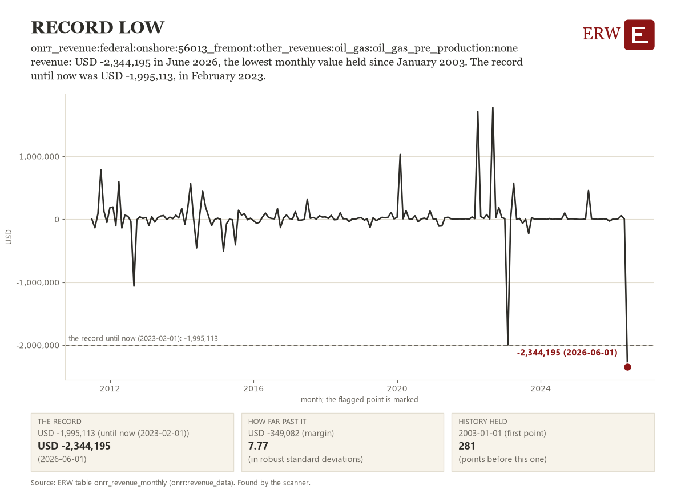

# ERW Daily Digest, 2026-10-23

**23 October 2026.** Data through 11:45 ET, 15:45 UTC.

<!-- subject: ERW Daily | Brent crude: 115.22 USD/bbl, down 3.0% on the close before -->

<!-- opening: Brent_crude -->

ERW's weekday brief of energy news for the 24 hours to 2026-10-23 15:45 UTC, from 2026-10-22 15:39 UTC, from 308 scored stories.

## The opening number

**Brent crude: 115.22 USD/bbl on 2026-10-20, down 3.60 USD/bbl (3.0%) from 118.82 USD/bbl on 2026-10-19 [1].** EIA's spot close of Brent, the North Sea crude benchmark, against the close before it. Reason, from the day's stories: Escalating Middle East conflict and supply disruption drives oil price move at market-sensitive levels. ([Reuters](https://news.google.com/rss/articles/CBMixAFBVV95cUxPR2dZUC10TmJYRUk2RmM5WWpxaUx2XzBPZ0ZTV3hIR3BkaGFvZ3B2T1hhd0xEcXZOWk5LdXhLLUF5QU9XdTRQdnRyTk9jcmVNMEZvZlZBRW8xcG1TVW1fTkY2UnFrcXlVWlUwbDhRYk9pcW1fdEdzMVNRR2ZhYVl2T0RZa09uZTktZGFWRVRWSEpGeFhYVXVPR09zNDVaTVdiNDdRRHg3VFNyZWNNWVBmdkxGMWFOa05yN2NBRnRVZjF3eF9i?oc=5) (via Google News))

Tables: [1] `eia_fuel_spot_prices` (eia:natural-gas/pri/fut, eia:petroleum/pri/spt).

## The numbers

- **Market price.** WTI Cushing crude: 107.89 USD/bbl on 2026-10-20, down 2.12 USD/bbl (1.9%) from 110.01 USD/bbl on 2026-10-19 [1]. Status: observed, EIA's spot close, published about a week after the trading day.
- **Physical.** US48 demand peaked at 495,741 MW in the hour starting 2026-10-22 22:00 UTC [2]; the same weekday a year before (2025-10-23) is not held, so no change is shown. Status: observed, EIA-930 hourly demand.
- **Project or capacity.** No story of the day states a capacity figure in MW.
- **Policy, capital or reliability.** USD 14.4 billion: Kinder Morgan's project backlog reaches $14.4 billion, one of its largest quarterly increases, as power demand grows (deal, ranked 1 of the day's top ten), reported on 2026-10-22 by Natural Gas Intelligence. Change: a new report, no earlier figure held. Status: reported by the outlet, not a warehouse table's figure.

Tables: [1] `eia_fuel_spot_prices` (eia:natural-gas/pri/fut, eia:petroleum/pri/spt); [2] `eia930_all_demand` (eia:electricity/rto/region-data); balancing authority us48.

## What moved

1. **Kinder Morgan's project backlog reaches $14.4 billion, one of its largest quarterly increases, as power demand grows** (deal)  
   Largest quarterly backlog increase in KMI history driven by AI data center gas pipeline needs. Sources: [Natural Gas Intelligence](https://naturalgasintel.com/news/kinder-morgan-backlog-surges-on-ai-data-centers-southeast-power-demand/), [Hart Energy](https://news.google.com/rss/articles/CBMiogFBVV95cUxQYzJxZTNiMTVKWDBJejIxeHRuUlJPMkRHazI0enJNZDFNc0xlVHEyWThMMVh1RENuajh2QklkWGVtRUsxWGxBekpXWjJZUnl3UXo5Z0U1Vkh0UUhhV1hVY2dvMS1BcjFnY0lMQzJFQWlwVDcwX2x2NnNlOHZIWE1IMjM5UVdiRllMSW8tRlY0b2hDNDM5TkpnNXdRTkt2RmxTVlE?oc=5) (via Google News)
2. **Brent climbed above $113 amid Saudi attacks and renewed Iran tensions; diesel supplies remain tight** (geopolitics)  
   Middle East escalation triggers large oil price move and supply shock fears. One outlet has reported it so far. Sources: [Rigzone](https://www.rigzone.com/news/wire/oil_surges_4_after_deadly_saudi_attacks-22-oct-2026-184912-article/?rss=true)  
   Also on this topic: US, Israel Prep for Possible Iran War Escalation, Raising Stakes for Global Energy Flows ([Natural Gas Intelligence](https://naturalgasintel.com/news/us-israel-prep-for-possible-iran-war-escalation-raising-stakes-for-global-energy-flows/)).
3. **European natural gas prices rose 3% at opening in Amsterdam, highest since 2022, as Qatari LNG flows stay restricted** (gas)  
   TTF benchmark hits multi-year high; Middle East escalation and LNG supply fears roil European gas. One outlet has reported it so far. Sources: [OilPrice.com](https://oilprice.com/Latest-Energy-News/World-News/European-Natural-Gas-Prices-Surge-to-Highest-Level-Since-2022.html)

## More

### The rest of the top ten

1. **Eni adds an extraordinary dividend and larger buybacks after third-quarter earnings more than double** (company)  
   Refiner earnings strength signals sustained energy price support and capital return capacity. parties: Eni. Sources: [OilPrice.com](https://oilprice.com/Latest-Energy-News/World-News/Enis-Profits-Soar-125-as-Refining-Boom-Fuels-Massive-Investor-Payouts.html), [Rigzone](https://www.rigzone.com/news/eni_further_boosts_shareholder_returns-23-oct-2026-184917-article/?rss=true)
2. **European Parliament votes to delay methane reporting rules for fossil fuel importers by three years** (policy)  
   Regulatory delay affects LNG suppliers and carbon accounting across Europe. parties: European Parliament. Sources: [Natural Gas Intelligence](https://naturalgasintel.com/news/european-parliament-backs-longer-methane-rule-delay-for-lng-importers/)
3. **SK data center arm is in talks to fund a $350 Billion buildout** (datacenter power)  
   AI infrastructure funding signals power demand wave and datacenter capital acceleration globally. parties: SK Data Center. Sources: [Bloomberg.com](https://news.google.com/rss/articles/CBMirwFBVV95cUxPM0Jxa0ItbDlOQTU1RVRBUHhvNjViZFM2WDJpb2Y0VzF6WW52Nzdqajg3NzhVQVNuZ2EyRXo3Mzk2TXh4LTd3UlF6WWxHcV93ODlQYUI3c3pzM2h2a25paGZTNmpQVnc4OHNfc1NlYWlzOWdqU29jWXByNERzUGpOV2luSTEyR1hxMjZzRFpXaW5RQUNYQmZfSlA3NVFxVWk0Z1EtVExKaFp5dHJqaG9N?oc=5) (via Google News)
4. **Brent crude reaches more than a five-month high on Houthi-Saudi attacks and a UAE oil spill** (oil)  
   Escalating Middle East conflict and supply disruption drives oil price move at market-sensitive levels. Sources: [Reuters](https://news.google.com/rss/articles/CBMixAFBVV95cUxPR2dZUC10TmJYRUk2RmM5WWpxaUx2XzBPZ0ZTV3hIR3BkaGFvZ3B2T1hhd0xEcXZOWk5LdXhLLUF5QU9XdTRQdnRyTk9jcmVNMEZvZlZBRW8xcG1TVW1fTkY2UnFrcXlVWlUwbDhRYk9pcW1fdEdzMVNRR2ZhYVl2T0RZa09uZTktZGFWRVRWSEpGeFhYVXVPR09zNDVaTVdiNDdRRHg3VFNyZWNNWVBmdkxGMWFOa05yN2NBRnRVZjF3eF9i?oc=5) (via Google News)  
   Also on this topic: Brent Hits $114 as Houthi Attacks Threaten Saudi Energy Infrastructure ([OilPrice.com](https://oilprice.com/Latest-Energy-News/World-News/Brent-Hits-114-as-Houthi-Attacks-Threaten-Saudi-Energy-Infrastructure.html)); Oil Holds Biggest Gain in Week as Saudi Attacks Fan Supply Risks ([Bloomberg.com](https://news.google.com/rss/articles/CBMingFBVV95cUxPZjR5Ukt1bFQ2cG5CR2xEckxfejgwaHhOLWwyTGFRM0xFOUowbGEyUEphdVZFQ2hjaEFLZ3g0ZndDWUxLNzNUN0ZzQUx6a3NtMjZtTG05WDI5cjh1NzlkLVdBQzNqR05ZQURMeE9GWlRuUXA0MDR5alI0N1JrNmtsenhPcGtZcnJwRk1xWlpTQVpuamwwaHdBenB0cTJTZw?oc=5) (via Google News)).
5. **India's Welspun wins a $580 million US gas pipeline order tied to data centre buildout** (gas)  
   Gas infrastructure deal directly serving AI data center power demand expansion. parties: Welspun. Sources: [Reuters](https://news.google.com/rss/articles/CBMiywFBVV95cUxNcWphMFNwdGZkOGo5TGZxMXk3SFhidGZOWXpKWV8xN2hYeXY2MlRITjRIZDM0ZE1RYnpPRTNzdzlaVEwwMGZnR0pqWG9Kd0xJbC1KX1gtUVZfRTZ2T0ZOZUw0bjJ2a3hBYWU4bDl0eWRQQXpUYllPTndTVEJxYzhXLWtETldoYmdOYkVLNUE4RWRPRGcyc1hBWFZUQmNsSXkxdTJkWnlQcURjOVJHZWhYZmc0X2x5OVlQSGpYMTRhb1lWOXBWNU8wLTh0UQ?oc=5) (via Google News)
6. **NextEra Energy secures $5.7B for federal energy hub projects; Dominion merger still expected in second half of 2027** (capital)  
   Large capital commitment to federal hub projects; Dominion merger on track for H2 2027 despite Virginia political headwinds. parties: NextEra Energy; Dominion Energy. Sources: [Utility Dive](https://www.utilitydive.com/news/nextera-energy-secures-57b-to-support-federal-energy-hub-projects/833810/)
7. **Westinghouse to invest $1 billion in a new fuel plant at its Hopkins, S.C. site** (nuclear)  
   Nuclear fuel fabrication expansion to produce 600 metric tons uranium annually. parties: Westinghouse. Sources: [ANS Nuclear Newswire](https://www.ans.org/news/2026-10-23/article-8513/westinghouse-to-fabricate-leu-fuel-at-expanded-sc-facility/)

### By sector

**Power**

- Data center spending to more than double to $2.1 trillion by 2028, BofA says (datacenter power): Capital surge signals sustained power demand growth and infrastructure buildout for AI-driven computing. [Reuters](https://news.google.com/rss/articles/CBMipAFBVV95cUxOSjJIVzNjUS1NU0VqTDNJTm10djYzSVFBVkZuR2xlbmF3MHdyR1hLeWlOclg5Q1dtUGFINVhkc1RXakZ2QXhJdlpVSk5DVEk1XzRuSjhuRVJFMGhyaWFUZThoLUlLZXNTd3RuYUhGM2dGWUxNU0VHeC1CRjROUjVnVmRBWDZhTmFWMVlJUFJZbWZWSS1lNEk2NHdMU2lFcUJSN2ZFWA?oc=5) (via Google News)
- Australia's Snowy Hydro project cost is now estimated at $18 billion, 11 times the original estimate (generation): Cost escalation signals project management and financing challenges for large-scale generation infrastructure. [Bloomberg.com](https://news.google.com/rss/articles/CBMivwFBVV95cUxQQlhxVmlrNmhHclZ6UzFhdGFfeFR6dHJNVnpYUHJsckVXQlluMXZGLVg4YVU2NE1HcnpUakw3T0xZOXZQcVdkZ1VvU0FjZW9DRlFfSjJBQ1JkN0ZNekFZUnEwdXlxcFNfSGFXUGhINVJqbnBORC1CMXpvVHhIMk5DYjFocEMxRzEzTUZIMktTNjhQOTNNLUp1N2JDV0M1MWNPUUtWdWttQWhGellHUnN5RzI2Q1ZWa29XaEJtdmg1dw?oc=5) (via Google News)
- Australia's gas generation falls to its lowest since 2000 as batteries and renewables grow (generation): Shift in power generation mix shows gas displacement by storage and renewables. [Bloomberg.com](https://news.google.com/rss/articles/CBMivAFBVV95cUxQcURYeUZpSDVkVDF5UEZaNl9xOFZEeFI1Vkxpb2lNVXp3MVBoWUJVTmsyLVdLeTZMM0Y1ZERCUXBIejV4bjRzdm5lN1EzT1Jia01kR1JDNWlDNVRmUnRjS3ZjOVRXeF9iMk91bkRNeUp3eXRneFFfYmpoakNVRFVpZXRjVEZaR09Rb1FsNkpYRXVEX0RKQkNQRFpBT3RmSlg1RkxrdnBxRlhGMm05QmZLVHBfZks5WkV5d0hkTA?oc=5) (via Google News)

**Oil and gas**

- Tanker carrying Russian diesel signals a US port after the Trump-Putin deal (oil): Sanctions relief enables Russian fuel imports; impacts US refining and markets. [Reuters](https://news.google.com/rss/articles/CBMixwFBVV95cUxOb3Zka2dCZ1RzeXJfN1BWOGlIbHpxODVFbTdvdjFuengzUlVHTkpLVGlOa05wUXNvdWpyNl9MTGRVMTJmWFdMTTFyU3pka3FrZ0hzMGhHVEJTRGpVQXV1TEhPYXBsSjU2UllWZHlfVzBCMnBvT01NbVNUdkJiMER4YWhKZDljRUVMY2N1REdxMEpZVkg1RFhOMGFkT3NnNWljS29Jd05ZLXdNMnhmaUlUZXJWY3hGTzN4b3hEM2ExUGxNcDRLMDVr?oc=5) (via Google News)
- QatarEnergy is in talks with Venture Global to buy LNG in a long-term supply deal, sources say (lng): LNG buyer seeks additional long-term supply; signals continued premium on US capacity. [Reuters](https://news.google.com/rss/articles/CBMiywFBVV95cUxQWURhT3VUeGtQdDZGb0d4dnpPTUhGWW5NM0g2R3QwZFRWTUtaSm5ONEI0aFk1aUxRa0U0cUFFMHV6aDgxUjZCREo3TVNTNTBJNjE4QnJ0RUlyelh1RHI4eXdjWUdQdHVXOFBtN3k1VXhXUTh2LVY0UTdpSWVfQWFxd2FoeW1mV0IzR1RleTZLUDYxOFpTLUhydEJaT29QUXJTZE5KVkhkRGs5dWR5V1NwQXVXUUhjV2Vsd044WFZaaEdqWUR1SmdFaHdJaw?oc=5) (via Google News)
- European gas prices reach their highest since 2022 on LNG supply fears (gas): European gas prices spike to multi-year highs on LNG supply concerns amid Middle East tensions. [WSJ](https://news.google.com/rss/articles/CBMioAFBVV95cUxPUkxWNG5HNDJPQmpHenhWU1owTjFNSW1nRndXc3JzUnhhRXBZenRENXNBSmthNVg1SzNQVnliWE5pZmhCckMzN0YyYzM1QWJVUEVDVFBUcW1FT2N1VjgtdlFVMjJ0azhZTDhyQ0VPTVEwZ2oxcUJBZ0hvTUJwV3hiMHdYRVg1LTh4U01YOF9KYmNNejdHeVJySnVNM0k3ckxL?oc=5) (via Google News)

**Nuclear and renewables**

- NRC finalizes rule letting applicants with DOE or Defense Department authorized reactor designs use a streamlined licensing path (nuclear): Expedites commercial nuclear licensing for designs already approved by DOE or DOD, potentially accelerating reactor deployment. [ANS Nuclear Newswire](https://www.ans.org/news/2026-10-22/article-8512/nrc-finalizes-rule-on-licensing-reactors-with-prior-doe-or-dod-authorization/)
- WSJ reports on the US push to put nuclear reactors in ports and on cargo ships (nuclear): Novel nuclear applications for maritime and port power, early-stage policy and development focus. [WSJ](https://news.google.com/rss/articles/CBMijgFBVV95cUxOOE9KM2tuaTcxbTA2SXJENWFXU1Ixd1g2X0hNZXkzR2RjU2lQMUNmX1RETjB6UFNOMGxpcmVMSWlBMzdZdWlOc094TFpjVGRMMnI5TnFUc1ZqTUJ2TmpxZW93aE00TENZZ3NxOGpoZjBuUWpVdTF0WHhwOVhNNW9RMjNBU3NzOVE3RUNCVFVn?oc=5) (via Google News)
- Rosatom plans to start construction of large nuclear units in Uzbekistan in 2027 (nuclear): Emerging market nuclear build signals geopolitical energy competition outside Western sphere. [World Nuclear News](https://www.world-nuclear-news.org/articles/rosatom-eyes-2027-for-uzbek-reactor-construction)

**Policy**

- Trump invokes the Defense Production Act for oil production and refining; Energy Department cites $150 million (policy): Executive action to boost domestic oil production and refining capacity signals supply priorities. [Reuters](https://news.google.com/rss/articles/CBMiwwFBVV95cUxOdm9ka0hnal9OOUFnN19HQmRZd0ljY2tJOVNoN2tIWURrMHExZ0p0NWN0UEpTMmFORG1TTU1CeXZkb3RhenhtelltYVY2SmRyZEctMnRIcUNEQlFXODdsZGxBMXhpem81NjJwRjRCbVl1N2tyWVkxeXU0T2k3ZEttNk5lbzZCVzRrUEtwT3JPTlJiUUVmSjU4b25EaXNIQ3dyS3c3NlJUSkFBdWZSMDFZVmZ1dmhncGFIYjNQU0tOd1I5dFk?oc=5) (via Google News)
- DOE is advancing the long-delayed Constitution natural gas pipeline, citing energy security (policy): Multi-year stalled gas pipeline project revived under Trump energy security framework. [Rigzone](https://www.rigzone.com/news/doe_advancing_constitution_pipeline_to_strengthen_security-23-oct-2026-184918-article/?rss=true)
- Trump says wind turbine imports threaten national security (policy): Trade restriction threatens renewable energy supply chains and could raise deployment costs. [Reuters](https://news.google.com/rss/articles/CBMisAFBVV95cUxQbXBnbGtXTC1kdE85WW5oRjI1dW9WU1d6RGdZLXoyRS12V0l0NXZyT21Rcnk5eERXeDhacVlpSWRDNVc2VlhoOUJyWWFvOVV3ck5oeU45eXZHQVpCaklMLTh4QXJkcXVWX192VUQ3QmNEa2VyMVdWNUtTaGlYdm1qb3pNRGtDazdsdjFQb3lISUNBNDNEWkJjUkFhLXJXcGpjWndUaVJLaDJFaHRIQk9KZQ?oc=5) (via Google News)

**Capital and companies**

- Eni to sign up to $1.8 Billion of infrastructure contracts for Cyprus gas project, sources say (deal): LNG project infrastructure investment imminent; signals Eastern Mediterranean development momentum. [WSJ](https://news.google.com/rss/articles/CBMi7AFBVV95cUxQMEw4Y3hfdWNYbC1XMkI5NGRwVG1mbzNoMGlxUGN3QjVTZFd4UU9CY0RnNFhMdkJ2QkZiMENoUlQ1dVUyTjIydnVweDQ4ZnViLXNBYllHUW5vX1BaMTRQb3RIR2xUSngzX3MwX3lvWXdTbzVPbk9uZFFKbXRLeWhyWjl2ZVc2V2VqazlyZU9sOUtvQWxrWGduamoyUVM5aUotSks1Y0hJR2NfU2NLNEMxMTg2Z1hMcWc3RGNFUF9SaVdfMnkxU1ZRWUNwX3pGSDFIOE1vRjNDaEtKalBEQTFENEFiamJ1dWNxNF9QNQ?oc=5) (via Google News)
- Eni raises payout after profit doubles; shares near 20-year highs (company): Oil company profit surge likely supports upstream investment and shareholder returns. [WSJ](https://news.google.com/rss/articles/CBMiqgFBVV95cUxNaWJNOEkxeFNGUzRFN0JzSng3Z2FyWi1BeC0wVkdPT3ZtY0Nta3BzX2JZbGowU3VZX1JsZUxibXRjbmtuNGZ6Y1R2aUhfNjVaRGVGMlQ2bTVXWDZMd25xcTA4Y2R3cTg1MGhiWXJvamFUbGpfcVRKQVlGWWxSbFdKMU9HY3FzdzZXSExhZDdIbXllc19PcXJLWVVpdHJWcGhtTTh2S2NuM1hHQQ?oc=5) (via Google News)
- Meta's credit risk indicator hits a record high on its increased AI spending plan (capital): USD 25 billion AI spending commitment raises default risk; signals datacenter power demand and capital intensity. [Reuters](https://news.google.com/rss/articles/CBMipwFBVV95cUxOMXV0RkI1VFVXRm4xc0tyNDBnc2NENDA3aF9XdjNxZVVGeU9IMkVlN0s0N3dvbTlYdzFFM0JwbUZjQ01tNFJpWE1GVG5wZXZjOWZMbnk1dUFrWWJlTjNrVU5kZjZxblBOUWFRX2hicTlFUEUyaTV0TjEyZUtUeHliMzZBTHFkS3BOb2FOWmF2S0RoTDBMSm1rdE84YmVQUnZ6bU9CazJmNA?oc=5) (via Google News)

### AI and power

- Net Power turns to data center demand, as a report asks if the data center boom is faltering (generation): Clean tech firm abandons emissions targets to build conventional gas plant for AI datacenter demand. [Heatmap News](https://heatmap.news/energy/net-power-data-center-boom)
- Steep bill for AI buildout weighs on Meta and other tech stocks (datacenter power): Rising capital costs for AI datacenters may pressure power demand growth and investment returns. [Reuters](https://news.google.com/rss/articles/CBMipAFBVV95cUxOaG4yYUM1ZzJnZmtpWnhIUVEzU01PRmxZM1BDRDJLazA1dkdaX3k0Z2pPMHJJUi1HUEM2OF9oV1JzSFh3d1dEU0dzc3JMQWRCeDhRa2JvNGVBbVluUlY4UGY3REoyWVZkTFBZT3BGa0swX2s1RzY3MDM5ZWlBTm1wYVBYNEt5M2VlTFoyRVNTTXJUaUVVYzVNcUtQQ2hfUW9nalZGbQ?oc=5) (via Google News)
- PJM and FERC discuss operating and planning challenges from large data center loads at a tech conference (datacenter power): Grid operator and regulator focus on supply, generation, and transmission lags for data center demand. [PJM newsroom](https://insidelines.pjm.com/pjm-ferc-focus-on-large-load-challenges-at-tech-conference/)
- Neocloud Nebius secures $3.5bn in financing from Citi (datacenter power): Capital raise for datacenter and AI infrastructure; substantial funding signals sector strength. [Data Center Dynamics](https://www.datacenterdynamics.com/en/news/neocloud-nebius-secures-35bn-in-financing-from-citi/)
- Reuters reports AI data centers are driving a boom in fuel-cell demand (datacenter power): Fuel cells emerging as viable power solution for data center loads, expanding beyond grid. [Reuters](https://news.google.com/rss/articles/CBMiqgFBVV95cUxQRjFzVkZlN1pldm9DZW9ENXBqb0ZSMzljNWVGalBnZDdZZ3k5T19lSWhoQUstV1o0WlB3b2FvaC15anF2X0pKWmluaDNxdURiTU1FUHRFOEZ3MWxwREdhMmVPUWpjTXVNdGllVTZ3eXYyU3FXUkZiMDBfa2FqbGVNWTRDWTdpaFNHdlVXVnlhMGtCR2dXMW9XWFd4SjlEcXYzLU90V19semtvUQ?oc=5) (via Google News)

### ERW's Numbers Today

Day-ahead power fell at all three hubs with data on 2026-10-22: SPP's SPPSOUTH_HUB dropped the most, to 23.36 USD/MWh (31.9% below the day before), while CAISO's TH_SP15_GEN-APND was dearest at 43.02 and ERCOT's HB_NORTH closed at 30.48. The highest real-time price was 114.54 USD/MWh at ERCOT's HB_SOUTH. EIA's newest closes, dated 2026-10-20, were 3.10 USD/MMBtu for Henry Hub, 107.89 USD/bbl for WTI and 115.22 USD/bbl for Brent, with Henry Hub down 5.5% and Brent down 3.0% on the close before.

**What moved most** (the 5 largest moves in percent among the main hubs' day-ahead averages against the day before, and EIA's spot closes against the close before them):

- SPP SPPSOUTH_HUB day-ahead: 23.36 USD/MWh on 2026-10-22, down 10.97 USD/MWh (31.9%) from 34.33 USD/MWh on 2026-10-21 [1].
- ERCOT HB_NORTH day-ahead: 30.48 USD/MWh on 2026-10-22, down 9.37 USD/MWh (23.5%) from 39.85 USD/MWh on 2026-10-21 [1].
- CAISO TH_SP15_GEN-APND day-ahead: 43.02 USD/MWh on 2026-10-22, down 8.60 USD/MWh (16.7%) from 51.62 USD/MWh on 2026-10-21 [1].
- Henry Hub natural gas: 3.10 USD/MMBtu on 2026-10-20, down 0.18 USD/MMBtu (5.5%) from 3.28 USD/MMBtu on 2026-10-19 [5].
- Not ranked: NYISO N.Y.C. (licensed source needed); ISO-NE .H.INTERNAL_HUB (licensed source needed); MISO INDIANA.HUB (paused by the ERW since 2026-10-04); TTF, the Dutch gas benchmark (not held: its source asks for a license); JKM, the Japan-Korea LNG marker (not held: its source asks for a license).

**Day-ahead average, yesterday, main hub** (mean of the 24 hourly prices of the operating day, and the day before):

| ISO | Hub or zone | Operating day | Average USD/MWh | Table | Day before USD/MWh | Change |
|---|---|---|---|---|---|---|
| ERCOT | HB_NORTH | 2026-10-22 | 30.48 | [1] | 39.85 | -9.37 (-23.5%) |
| CAISO | TH_SP15_GEN-APND | 2026-10-22 | 43.02 | [1] | 51.62 | -8.60 (-16.7%) |
| NYISO | N.Y.C. | 2026-10-22 | licensed source needed | [2] |  | not computed |
| MISO | INDIANA.HUB | 2026-10-22 | not requested: paused by the ERW since 2026-10-04 (MISO's terms forbid automated access) | [1] |  | not computed |
| SPP | SPPSOUTH_HUB | 2026-10-22 | 23.36 | [1] | 34.33 | -10.97 (-31.9%) |
| ISO-NE | .H.INTERNAL_HUB | 2026-10-22 | licensed source needed | [3] |  | not computed |
| PJM | | | no PJM price table (no API key) | | | |

**Highest real-time price, yesterday:** 114.54 USD/MWh at HB_SOUTH (ERCOT), interval starting 2026-10-22 08:00 local (2026-10-22 13:00 UTC), PT15M `spp_rtm`, ERCOT's real-time settlement point price [4]. Not read: ISO-NE, MISO, NYISO (licensed source needed).

**Latest fuel spot closes** (EIA, trading dates; EIA publishes its closes about a week after the day):

- Henry Hub natural gas: 3.10 USD/MMBtu on 2026-10-20 [5], EIA's newest close when this was written (3 days before this issue)
- WTI Cushing crude: 107.89 USD/bbl on 2026-10-20 [5], EIA's newest close when this was written (3 days before this issue)
- Brent crude: 115.22 USD/bbl on 2026-10-20 [5], EIA's newest close when this was written (3 days before this issue)

**US48 demand, yesterday:** peaked at 495,741 MW in the hour starting 2026-10-22 22:00 UTC [6]; the same weekday a year before (2025-10-23) is not held: the hourly table's window does not reach it.

Tables: [1] `iso_dam_hub_prices` (caiso:PRC_LMP, ercot:NP4-190-CD, miso:da_expost_lmp, spp:DA-LMP-SL); [2] `nyiso_dam_zone_prices` (nyiso:damlbmp); [3] `isone_dam_zone_prices` (isone:da_lmp_hourly); [4] `iso_rtm_hub_prices` (caiso:PRC_INTVL_LMP, ercot:NP6-785-ER, ercot:NP6-905-CD, miso:rt_lmp_final, miso:rt_lmp_prelim, spp:RTBM-LMP-SL); real-time tables read: iso_rtm_hub_prices; [5] `eia_fuel_spot_prices` (eia:natural-gas/pri/fut, eia:petroleum/pri/spt); [6] `eia930_all_demand` (eia:electricity/rto/region-data); balancing authority us48.

## ERW's Chart of the Day

onrr_revenue:federal:onshore:56013_fremont:other_revenues:oil_gas:oil_gas_pre_production:none revenue: USD -2,344,195 in June 2026, the lowest monthly value held since January 2003. The record until now was USD -1,995,113, in February 2023.
The table holds 282 months of this series; the last is June 2026.

Source: ONRR (`onrr:revenue_data`), period June 2026, newest period held 2026-08-01, retrieved by the ERW 2026-10-23 12:16 UTC. Table `onrr_revenue_monthly`, series `entity=onrr_revenue:federal:onshore:56013_fremont:other_revenues:oil_gas:oil_gas_pre_production:none, variable=revenue, node=Fremont, Wyoming: Other revenues, Oil & gas (pre-production), freq=P1M`: [the table and its download](/data#onrr_revenue_monthly).

Chosen by rule, not by a person or a model: the strongest flag of the day's scan that no Digest has shown (rule: record; 7.77 robust standard deviations past its threshold). It is the candidate most related to the day's top stories: it shares gas with 'European Natural Gas Prices Surge to Highest Level Since 2022'. [How the chart is chosen](/data/methods/automated_analysis_scanner).

## ERW's Fun Fact

The term duck curve was coined in 2012 by the California Independent System Operator, and the curve is named for its visual similarity to the outline of a duck. Grid operators hope batteries help the duck keep its neck in check.

Sources: [Wikipedia, Duck curve](https://en.wikipedia.org/wiki/Duck_curve).

ERW

---

[How this is made.](/about#digest)

Corrections: [open an issue](https://github.com/SamuelEnrique/erw/issues). Preferences and topics: [subscribe](/subscribe). Every email carries its own unsubscribe link.

<!-- Generated by warehouse/news/brief.py at 2026-10-23 15:45 UTC; run log warehouse/output/logs/news_brief_20261025T073809Z.log; model claude-sonnet-5-5; story data warehouse/output/news_stories.csv. -->
