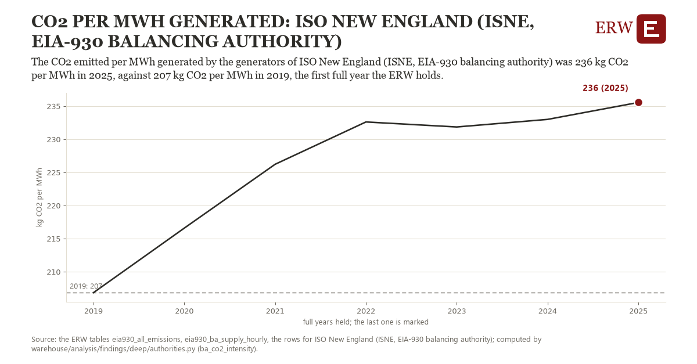

# Co2 per mwh generated: ISO New England (ISNE, EIA-930 balancing authority)

Draft `scan-deep-c046d3a731c3` of the findings hunt over the whole warehouse (chain 502), 2026-11-19. State: draft, not reviewed. Review at `/internal/findings`.

**The finding.** The CO2 emitted per MWh generated by the generators of ISO New England (ISNE, EIA-930 balancing authority) was 236 kg CO2 per MWh in 2025, against 207 kg CO2 per MWh in 2019, the first full year the ERW holds.

**The figure by full year** (kg CO2 per MWh): 2019: 207, 2020: 217, 2021: 226, 2022: 233, 2023: 232, 2024: 233, 2025: 236.

**The tables and rows.** `eia930_all_emissions`, `eia930_ba_supply_hourly`; the rows for ISO New England (ISNE, EIA-930 balancing authority), region key `ba_isne` (the card's `hunt.region`), years 2019 to 2025. The yearly values: `ba-co2-intensity-ba-isne.csv`.

**Its strength.** The change is 4.33 typical yearly moves (a typical move is 7 kg CO2 per MWh, 1.4826 times the median absolute change between full years). Holds in more than one year: 6 of the 6 full years after 2019 lie above 2019's value. Survives a change of window: from 2020 to 2025 the change is 19, from 2019 to 2024 it is 26. Sample large enough: 2019 holds 8,760 and 2025 holds 8,760 observations; the floor is 8,000. Half the change remains without the first year: from 2020 to 2025 the change is 19, 66.1 percent of the change from 2019. At least one typical yearly move: the change is 4.33 typical yearly moves (7 kg CO2 per MWh a year, the median move between full years); the floor is 1.

**Its limits.** EIA-930's CO2, which EIA estimates from the authority's hourly generation by fuel and standard emission rates, not a measured stack figure; CO2 from generation inside the authority, whatever is imported or exported.

**Reproduce.** `python ba-co2-intensity-ba-isne.reproduce.py <the table's CSV>` and `do ba-co2-intensity-ba-isne.reproduce.do` (Stata) recompute the figures by year from the tables as the public downloads hold them; each names the expected values at its top.
