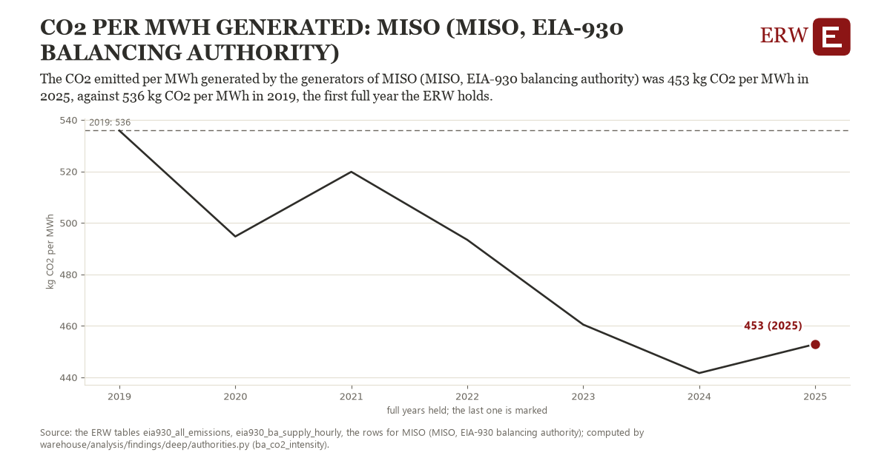

# Co2 per mwh generated: MISO (MISO, EIA-930 balancing authority)

Draft `scan-deep-54712df77ec7` of the findings hunt over the whole warehouse (chain 502), 2026-11-19. State: draft, not reviewed. Review at `/internal/findings`.

**The finding.** The CO2 emitted per MWh generated by the generators of MISO (MISO, EIA-930 balancing authority) was 453 kg CO2 per MWh in 2025, against 536 kg CO2 per MWh in 2019, the first full year the ERW holds.

**The figure by full year** (kg CO2 per MWh): 2019: 536, 2020: 495, 2021: 520, 2022: 493, 2023: 460, 2024: 442, 2025: 453.

**The tables and rows.** `eia930_all_emissions`, `eia930_ba_supply_hourly`; the rows for MISO (MISO, EIA-930 balancing authority), region key `ba_miso` (the card's `hunt.region`), years 2019 to 2025. The yearly values: `ba-co2-intensity-ba-miso.csv`.

**Its strength.** The change is 2.17 typical yearly moves (a typical move is 38 kg CO2 per MWh, 1.4826 times the median absolute change between full years). Holds in more than one year: 6 of the 6 full years after 2019 lie below 2019's value. Survives a change of window: from 2020 to 2025 the change is -42, from 2019 to 2024 it is -94. Sample large enough: 2019 holds 8,592 and 2025 holds 8,712 observations; the floor is 8,000. Half the change remains without the first year: from 2020 to 2025 the change is -42, 50.4 percent of the change from 2019. At least one typical yearly move: the change is 2.17 typical yearly moves (38 kg CO2 per MWh a year, the median move between full years); the floor is 1.

**Its limits.** EIA-930's CO2, which EIA estimates from the authority's hourly generation by fuel and standard emission rates, not a measured stack figure; CO2 from generation inside the authority, whatever is imported or exported.

**Reproduce.** `python ba-co2-intensity-ba-miso.reproduce.py <the table's CSV>` and `do ba-co2-intensity-ba-miso.reproduce.do` (Stata) recompute the figures by year from the tables as the public downloads hold them; each names the expected values at its top.
