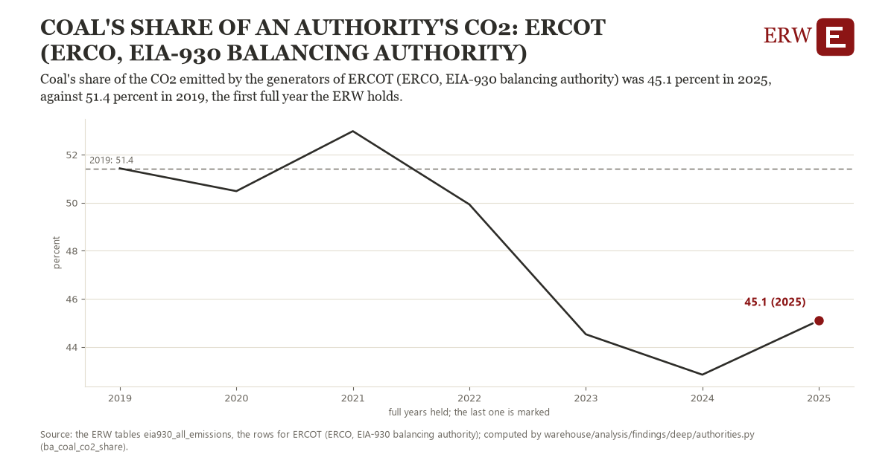

# Coal's share of an authority's co2: ERCOT (ERCO, EIA-930 balancing authority)

Draft `scan-deep-4f826d74be45` of the findings hunt over the whole warehouse (chain 502), 2026-11-19. State: draft, not reviewed. Review at `/internal/findings`.

**The finding.** Coal's share of the CO2 emitted by the generators of ERCOT (ERCO, EIA-930 balancing authority) was 45.1 percent in 2025, against 51.4 percent in 2019, the first full year the ERW holds.

**The figure by full year** (percent): 2019: 51.4, 2020: 50.5, 2021: 53.0, 2022: 49.9, 2023: 44.5, 2024: 42.8, 2025: 45.1.

**The tables and rows.** `eia930_all_emissions`; the rows for ERCOT (ERCO, EIA-930 balancing authority), region key `ba_erco` (the card's `hunt.region`), years 2019 to 2025. The yearly values: `ba-coal-co2-share-ba-erco.csv`.

**Its strength.** The change is 1.80 typical yearly moves (a typical move is 3.5 percent, 1.4826 times the median absolute change between full years). Holds in more than one year: 5 of the 6 full years after 2019 lie below 2019's value. Survives a change of window: from 2020 to 2025 the change is -5.4, from 2019 to 2024 it is -8.6. Sample large enough: 2019 holds 8,712 and 2025 holds 8,664 observations; the floor is 8,000. Half the change remains without the first year: from 2020 to 2025 the change is -5.4, 85.0 percent of the change from 2019. At least one typical yearly move: the change is 1.80 typical yearly moves (3.5 percent a year, the median move between full years); the floor is 1.

**Its limits.** EIA-930's CO2, which EIA estimates from the authority's hourly generation by fuel and standard emission rates, not a measured stack figure; CO2 from generation inside the authority, whatever is imported or exported.

**Reproduce.** `python ba-coal-co2-share-ba-erco.reproduce.py <the table's CSV>` and `do ba-coal-co2-share-ba-erco.reproduce.do` (Stata) recompute the figures by year from the tables as the public downloads hold them; each names the expected values at its top.
