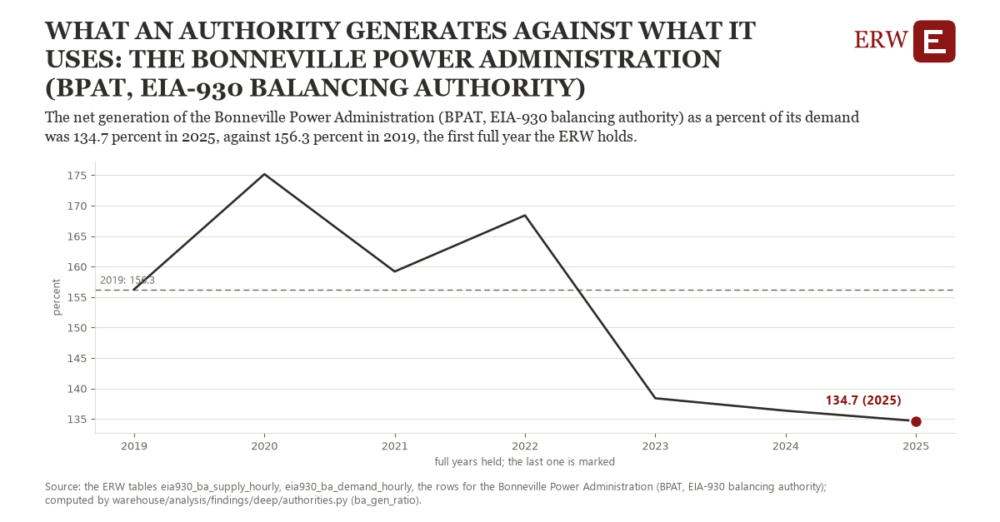

# What an authority generates against what it uses: the Bonneville Power Administration (BPAT, EIA-930 balancing authority)

Draft `scan-deep-b2af2986a6d5` of the findings hunt over the whole warehouse (chain 502), 2026-11-19. State: draft, not reviewed. Review at `/internal/findings`.

**The finding.** The net generation of the Bonneville Power Administration (BPAT, EIA-930 balancing authority) as a percent of its demand was 134.7 percent in 2025, against 156.3 percent in 2019, the first full year the ERW holds.

**The figure by full year** (percent): 2019: 156.3, 2020: 175.2, 2021: 159.2, 2022: 168.4, 2023: 138.4, 2024: 136.3, 2025: 134.7.

**The tables and rows.** `eia930_ba_supply_hourly`, `eia930_ba_demand_hourly`; the rows for the Bonneville Power Administration (BPAT, EIA-930 balancing authority), region key `ba_bpat` (the card's `hunt.region`), years 2019 to 2025. The yearly values: `ba-gen-ratio-ba-bpat.csv`.

**Its strength.** The change is 1.16 typical yearly moves (a typical move is 18.7 percent, 1.4826 times the median absolute change between full years). Holds in more than one year: 3 of the 6 full years after 2019 lie below 2019's value. Survives a change of window: from 2020 to 2025 the change is -40.5, from 2019 to 2024 it is -19.9. Sample large enough: 2019 holds 8,760 and 2025 holds 8,760 observations; the floor is 8,000. Half the change remains without the first year: from 2020 to 2025 the change is -40.5, 187.5 percent of the change from 2019. At least one typical yearly move: the change is 1.16 typical yearly moves (18.7 percent a year, the median move between full years); the floor is 1.

**Its limits.** EIA-930 as the authority filed it; an authority whose footprint changed (one that absorbed another) changes its figures with it; not adjusted for weather. Hours both are held.

**Reproduce.** `python ba-gen-ratio-ba-bpat.reproduce.py <the table's CSV>` and `do ba-gen-ratio-ba-bpat.reproduce.do` (Stata) recompute the figures by year from the tables as the public downloads hold them; each names the expected values at its top.
