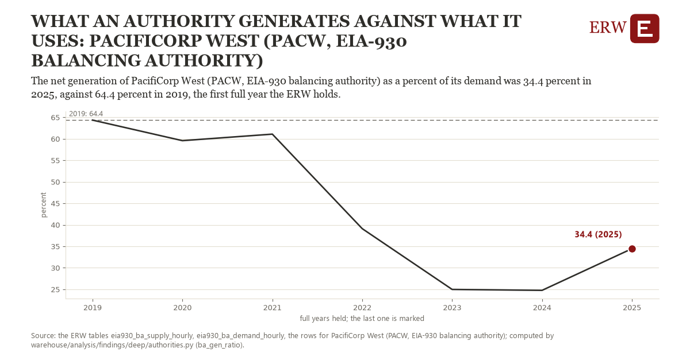

# What an authority generates against what it uses: PacifiCorp West (PACW, EIA-930 balancing authority)

Draft `scan-deep-a614a8d88a86` of the findings hunt over the whole warehouse (chain 502), 2026-11-19. State: draft, not reviewed. Review at `/internal/findings`.

**The finding.** The net generation of PacifiCorp West (PACW, EIA-930 balancing authority) as a percent of its demand was 34.4 percent in 2025, against 64.4 percent in 2019, the first full year the ERW holds.

**The figure by full year** (percent): 2019: 64.4, 2020: 59.6, 2021: 61.1, 2022: 39.1, 2023: 25.0, 2024: 24.8, 2025: 34.4.

**The tables and rows.** `eia930_ba_supply_hourly`, `eia930_ba_demand_hourly`; the rows for PacifiCorp West (PACW, EIA-930 balancing authority), region key `ba_pacw` (the card's `hunt.region`), years 2019 to 2025. The yearly values: `ba-gen-ratio-ba-pacw.csv`.

**Its strength.** The change is 2.79 typical yearly moves (a typical move is 10.7 percent, 1.4826 times the median absolute change between full years). Holds in more than one year: 6 of the 6 full years after 2019 lie below 2019's value. Survives a change of window: from 2020 to 2025 the change is -25.1, from 2019 to 2024 it is -39.6. Sample large enough: 2019 holds 8,760 and 2025 holds 8,760 observations; the floor is 8,000. Half the change remains without the first year: from 2020 to 2025 the change is -25.1, 84.0 percent of the change from 2019. At least one typical yearly move: the change is 2.79 typical yearly moves (10.7 percent a year, the median move between full years); the floor is 1.

**Its limits.** EIA-930 as the authority filed it; an authority whose footprint changed (one that absorbed another) changes its figures with it; not adjusted for weather. Hours both are held.

**Reproduce.** `python ba-gen-ratio-ba-pacw.reproduce.py <the table's CSV>` and `do ba-gen-ratio-ba-pacw.reproduce.do` (Stata) recompute the figures by year from the tables as the public downloads hold them; each names the expected values at its top.
