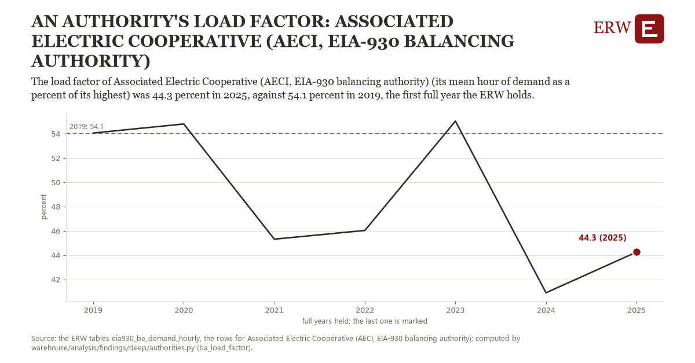

# An authority's load factor: Associated Electric Cooperative (AECI, EIA-930 balancing authority)

Draft `scan-deep-f0b21dea527c` of the findings hunt over the whole warehouse (chain 502), 2026-11-19. State: draft, not reviewed. Review at `/internal/findings`.

**The finding.** The load factor of Associated Electric Cooperative (AECI, EIA-930 balancing authority) (its mean hour of demand as a percent of its highest) was 44.3 percent in 2025, against 54.1 percent in 2019, the first full year the ERW holds.

**The figure by full year** (percent): 2019: 54.1, 2020: 54.8, 2021: 45.3, 2022: 46.0, 2023: 55.0, 2024: 40.9, 2025: 44.3.

**The tables and rows.** `eia930_ba_demand_hourly`; the rows for Associated Electric Cooperative (AECI, EIA-930 balancing authority), region key `ba_aeci` (the card's `hunt.region`), years 2019 to 2025. The yearly values: `ba-load-factor-ba-aeci.csv`.

**Its strength.** The change is 1.07 typical yearly moves (a typical move is 9.2 percent, 1.4826 times the median absolute change between full years). Holds in more than one year: 4 of the 6 full years after 2019 lie below 2019's value. Survives a change of window: from 2020 to 2025 the change is -10.5, from 2019 to 2024 it is -13.2. Sample large enough: 2019 holds 8,759 and 2025 holds 8,759 observations; the floor is 8,000. Half the change remains without the first year: from 2020 to 2025 the change is -10.5, 107.6 percent of the change from 2019. At least one typical yearly move: the change is 1.07 typical yearly moves (9.2 percent a year, the median move between full years); the floor is 1.

**Its limits.** EIA-930 as the authority filed it; an authority whose footprint changed (one that absorbed another) changes its figures with it; not adjusted for weather. A lone spike is dropped first.

**Reproduce.** `python ba-load-factor-ba-aeci.reproduce.py <the table's CSV>` and `do ba-load-factor-ba-aeci.reproduce.do` (Stata) recompute the figures by year from the tables as the public downloads hold them; each names the expected values at its top.
