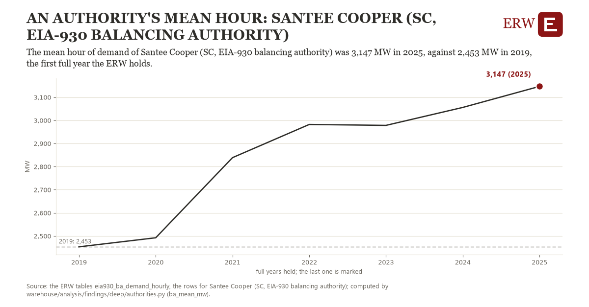

# An authority's mean hour: Santee Cooper (SC, EIA-930 balancing authority)

Draft `scan-deep-51d81ab35c9f` of the findings hunt over the whole warehouse (chain 502), 2026-11-19. State: draft, not reviewed. Review at `/internal/findings`.

**The finding.** The mean hour of demand of Santee Cooper (SC, EIA-930 balancing authority) was 3,147 MW in 2025, against 2,453 MW in 2019, the first full year the ERW holds.

**The figure by full year** (MW): 2019: 2,453, 2020: 2,492, 2021: 2,839, 2022: 2,982, 2023: 2,978, 2024: 3,056, 2025: 3,147.

**The tables and rows.** `eia930_ba_demand_hourly`; the rows for Santee Cooper (SC, EIA-930 balancing authority), region key `ba_sc` (the card's `hunt.region`), years 2019 to 2025. The yearly values: `ba-mean-mw-ba-sc.csv`.

**Its strength.** The change is 5.55 typical yearly moves (a typical move is 125 MW, 1.4826 times the median absolute change between full years). Holds in more than one year: 6 of the 6 full years after 2019 lie above 2019's value. Survives a change of window: from 2020 to 2025 the change is 655, from 2019 to 2024 it is 603. Sample large enough: 2019 holds 8,759 and 2025 holds 8,760 observations; the floor is 8,000. Half the change remains without the first year: from 2020 to 2025 the change is 655, 94.3 percent of the change from 2019. At least one typical yearly move: the change is 5.55 typical yearly moves (125 MW a year, the median move between full years); the floor is 1.

**Its limits.** EIA-930 as the authority filed it; an authority whose footprint changed (one that absorbed another) changes its figures with it; not adjusted for weather.

**Reproduce.** `python ba-mean-mw-ba-sc.reproduce.py <the table's CSV>` and `do ba-mean-mw-ba-sc.reproduce.do` (Stata) recompute the figures by year from the tables as the public downloads hold them; each names the expected values at its top.
