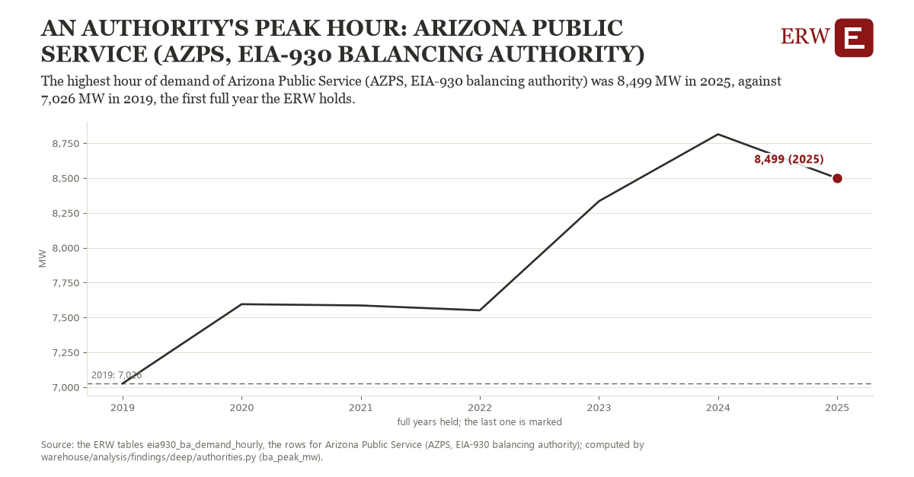

# An authority's peak hour: Arizona Public Service (AZPS, EIA-930 balancing authority)

Draft `scan-deep-18be6067be31` of the findings hunt over the whole warehouse (chain 502), 2026-11-19. State: draft, not reviewed. Review at `/internal/findings`.

**The finding.** The highest hour of demand of Arizona Public Service (AZPS, EIA-930 balancing authority) was 8,499 MW in 2025, against 7,026 MW in 2019, the first full year the ERW holds.

**The figure by full year** (MW): 2019: 7,026, 2020: 7,595, 2021: 7,586, 2022: 7,551, 2023: 8,334, 2024: 8,814, 2025: 8,499.

**The tables and rows.** `eia930_ba_demand_hourly`; the rows for Arizona Public Service (AZPS, EIA-930 balancing authority), region key `ba_azps` (the card's `hunt.region`), years 2019 to 2025. The yearly values: `ba-peak-mw-ba-azps.csv`.

**Its strength.** The change is 2.50 typical yearly moves (a typical move is 589 MW, 1.4826 times the median absolute change between full years). Holds in more than one year: 6 of the 6 full years after 2019 lie above 2019's value. Survives a change of window: from 2020 to 2025 the change is 904, from 2019 to 2024 it is 1,788. Sample large enough: 2019 holds 8,753 and 2025 holds 8,756 observations; the floor is 8,000. Half the change remains without the first year: from 2020 to 2025 the change is 904, 61.4 percent of the change from 2019. At least one typical yearly move: the change is 2.50 typical yearly moves (589 MW a year, the median move between full years); the floor is 1.

**Its limits.** EIA-930 as the authority filed it; an authority whose footprint changed (one that absorbed another) changes its figures with it; not adjusted for weather.

**Reproduce.** `python ba-peak-mw-ba-azps.reproduce.py <the table's CSV>` and `do ba-peak-mw-ba-azps.reproduce.do` (Stata) recompute the figures by year from the tables as the public downloads hold them; each names the expected values at its top.
