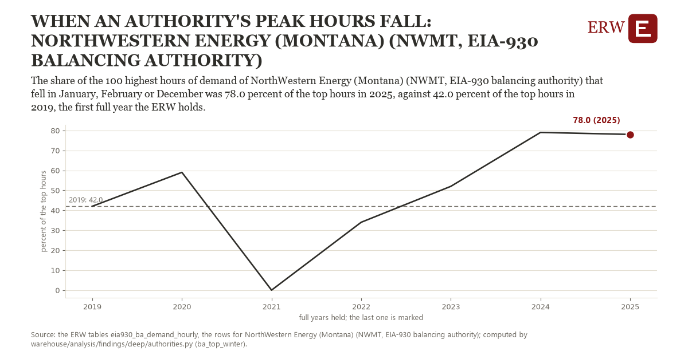

# When an authority's peak hours fall: NorthWestern Energy (Montana) (NWMT, EIA-930 balancing authority)

Draft `scan-deep-7025a58d53b5` of the findings hunt over the whole warehouse (chain 502), 2026-11-19. State: draft, not reviewed. Review at `/internal/findings`.

**The finding.** The share of the 100 highest hours of demand of NorthWestern Energy (Montana) (NWMT, EIA-930 balancing authority) that fell in January, February or December was 78.0 percent of the top hours in 2025, against 42.0 percent of the top hours in 2019, the first full year the ERW holds.

**The figure by full year** (percent of the top hours): 2019: 42.0, 2020: 59.0, 2021: 0.0, 2022: 34.0, 2023: 52.0, 2024: 79.0, 2025: 78.0.

**The tables and rows.** `eia930_ba_demand_hourly`; the rows for NorthWestern Energy (Montana) (NWMT, EIA-930 balancing authority), region key `ba_nwmt` (the card's `hunt.region`), years 2019 to 2025. The yearly values: `ba-top-winter-ba-nwmt.csv`.

**Its strength.** The change is 1.08 typical yearly moves (a typical move is 33.4 percent of the top hours, 1.4826 times the median absolute change between full years). Holds in more than one year: 4 of the 6 full years after 2019 lie above 2019's value. Survives a change of window: from 2020 to 2025 the change is 19.0, from 2019 to 2024 it is 37.0. Sample large enough: 2019 holds 8,685 and 2025 holds 8,754 observations; the floor is 8,000. Half the change remains without the first year: from 2020 to 2025 the change is 19.0, 52.8 percent of the change from 2019. At least one typical yearly move: the change is 1.08 typical yearly moves (33.4 percent of the top hours a year, the median move between full years); the floor is 1.

**Its limits.** EIA-930 as the authority filed it; an authority whose footprint changed (one that absorbed another) changes its figures with it; not adjusted for weather. Months are UTC months; a lone spike is dropped first.

**Reproduce.** `python ba-top-winter-ba-nwmt.reproduce.py <the table's CSV>` and `do ba-top-winter-ba-nwmt.reproduce.do` (Stata) recompute the figures by year from the tables as the public downloads hold them; each names the expected values at its top.
