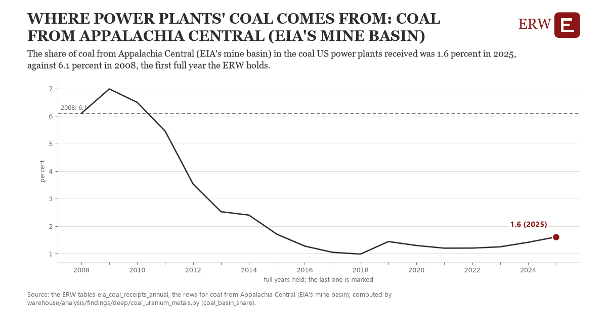

# Where power plants' coal comes from: coal from Appalachia Central (EIA's mine basin)

Draft `scan-deep-063e044dc0a5` of the findings hunt over the whole warehouse (chain 502), 2026-11-19. State: draft, not reviewed. Review at `/internal/findings`.

**The finding.** The share of coal from Appalachia Central (EIA's mine basin) in the coal US power plants received was 1.6 percent in 2025, against 6.1 percent in 2008, the first full year the ERW holds.

**The figure by full year** (percent): 2008: 6.1, 2009: 7.0, 2010: 6.5, 2011: 5.5, 2012: 3.5, 2013: 2.5, 2014: 2.4, 2015: 1.7, 2016: 1.3, 2017: 1.1, 2018: 1.0, 2019: 1.4, 2020: 1.3, 2021: 1.2, 2022: 1.2, 2023: 1.3, 2024: 1.4, 2025: 1.6.

**The tables and rows.** `eia_coal_receipts_annual`; the rows for coal from Appalachia Central (EIA's mine basin), region key `cb_appalachia_central` (the card's `hunt.region`), years 2008 to 2025. The yearly values: `coal-basin-share-cb-appalachia-central.csv`.

**Its strength.** The change is 13.34 typical yearly moves (a typical move is 0.3 percent, 1.4826 times the median absolute change between full years). Holds in more than one year: 15 of the 17 full years after 2008 lie below 2008's value. Survives a change of window: from 2009 to 2025 the change is -5.4, from 2008 to 2024 it is -4.7. Sample large enough: 2008 holds 1 and 2025 holds 1 observations; the floor is 1. Half the change remains without the first year: from 2009 to 2025 the change is -5.4, 119.7 percent of the change from 2008. At least one typical yearly move: the change is 13.34 typical yearly moves (0.3 percent a year, the median move between full years); the floor is 1.

**Its limits.** EIA's receipts of coal by power plants, mine to plant, as the table holds them; a share by tons, not by heat; shipments without a basin or mode are in the total only.

**Reproduce.** `python coal-basin-share-cb-appalachia-central.reproduce.py <the table's CSV>` and `do coal-basin-share-cb-appalachia-central.reproduce.do` (Stata) recompute the figures by year from the tables as the public downloads hold them; each names the expected values at its top.
