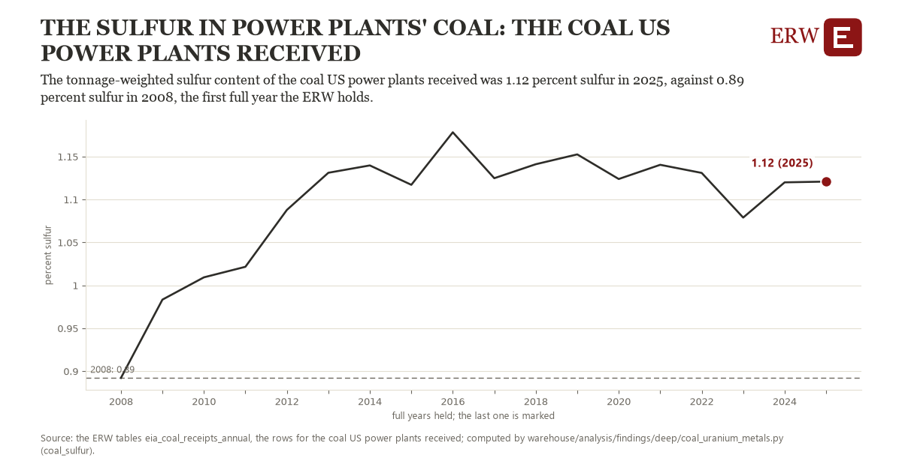

# The sulfur in power plants' coal: the coal US power plants received

Draft `scan-deep-1c62f8b48336` of the findings hunt over the whole warehouse (chain 502), 2026-11-19. State: draft, not reviewed. Review at `/internal/findings`.

**The finding.** The tonnage-weighted sulfur content of the coal US power plants received was 1.12 percent sulfur in 2025, against 0.89 percent sulfur in 2008, the first full year the ERW holds.

**The figure by full year** (percent sulfur): 2008: 0.89, 2009: 0.98, 2010: 1.01, 2011: 1.02, 2012: 1.09, 2013: 1.13, 2014: 1.14, 2015: 1.12, 2016: 1.18, 2017: 1.12, 2018: 1.14, 2019: 1.15, 2020: 1.12, 2021: 1.14, 2022: 1.13, 2023: 1.08, 2024: 1.12, 2025: 1.12.

**The tables and rows.** `eia_coal_receipts_annual`; the rows for the coal US power plants received, region key `cs_us` (the card's `hunt.region`), years 2008 to 2025. The yearly values: `coal-sulfur-cs-us.csv`.

**Its strength.** The change is 5.94 typical yearly moves (a typical move is 0.04 percent sulfur, 1.4826 times the median absolute change between full years). Holds in more than one year: 17 of the 17 full years after 2008 lie above 2008's value. Survives a change of window: from 2009 to 2025 the change is 0.14, from 2008 to 2024 it is 0.23. Sample large enough: 2008 holds 1 and 2025 holds 1 observations; the floor is 1. Half the change remains without the first year: from 2009 to 2025 the change is 0.14, 60.1 percent of the change from 2008. At least one typical yearly move: the change is 5.94 typical yearly moves (0.04 percent sulfur a year, the median move between full years); the floor is 1.

**Its limits.** EIA's receipts of coal by power plants, mine to plant, as the table holds them; a share by tons, not by heat; shipments without a basin or mode are in the total only.

**Reproduce.** `python coal-sulfur-cs-us.reproduce.py <the table's CSV>` and `do coal-sulfur-cs-us.reproduce.do` (Stata) recompute the figures by year from the tables as the public downloads hold them; each names the expected values at its top.
