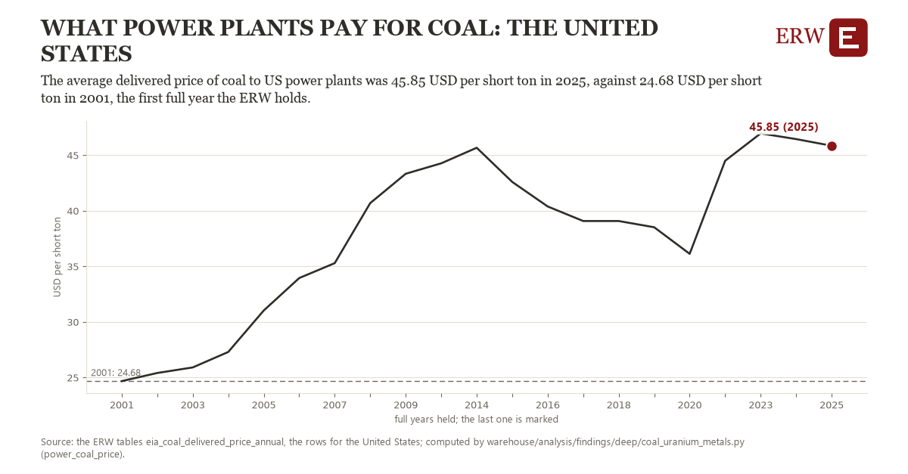

# What power plants pay for coal: the United States

Draft `scan-deep-71a55d721af9` of the findings hunt over the whole warehouse (chain 164), 2026-11-06. State: draft, not reviewed. Review at `/internal/findings`.

**The finding.** The average delivered price of coal to US power plants was 45.85 USD per short ton in 2025, against 24.68 USD per short ton in 2001, the first full year the ERW holds.

**The figure by full year** (USD per short ton): 2001: 24.68, 2002: 25.41, 2003: 25.91, 2004: 27.30, 2005: 31.03, 2006: 33.95, 2007: 35.29, 2008: 40.69, 2009: 43.33, 2010: 44.27, 2014: 45.67, 2015: 42.60, 2016: 40.39, 2017: 39.08, 2018: 39.08, 2019: 38.52, 2020: 36.13, 2022: 44.50, 2023: 46.96, 2024: 46.45, 2025: 45.85.

**The tables and rows.** `eia_coal_delivered_price_annual`; the rows for the United States, region key `us_power_coal` (the card's `hunt.region`), years 2001 to 2025. The yearly values: `power-coal-price-us-power-coal.csv`.

**Its strength.** The change is 10.24 typical yearly moves (a typical move is 2.07 USD per short ton, 1.4826 times the median absolute change between full years). Holds in more than one year: 20 of the 20 full years after 2001 lie above 2001's value. Survives a change of window: from 2002 to 2025 the change is 20.44, from 2001 to 2024 it is 21.77. Sample large enough: 2001 holds 1 and 2025 holds 1 observations; the floor is 1. Half the change remains without the first year: from 2002 to 2025 the change is 20.44, 96.6 percent of the change from 2001. At least one typical yearly move: the change is 10.24 typical yearly moves (2.07 USD per short ton a year, the median move between full years); the floor is 1.

**Its limits.** EIA's annual coal data as published, the latest year preliminary. Nominal dollars a short ton, not a Btu: a ton of Wyoming coal holds less heat than a ton of Appalachian.

**Reproduce.** `python power-coal-price-us-power-coal.reproduce.py <the table's CSV>` and `do power-coal-price-us-power-coal.reproduce.do` (Stata) recompute the figures by year from the tables as the public downloads hold them; each names the expected values at its top.
