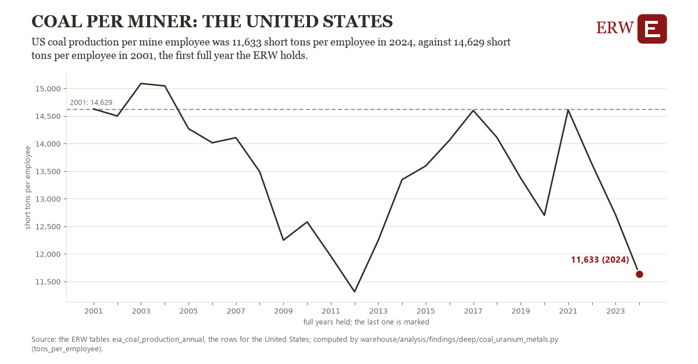

# Coal per miner: the United States

Draft `scan-deep-e2d04b7011cc` of the findings hunt over the whole warehouse (chain 164), 2026-11-06. State: draft, not reviewed. Review at `/internal/findings`.

**The finding.** US coal production per mine employee was 11,633 short tons per employee in 2024, against 14,629 short tons per employee in 2001, the first full year the ERW holds.

**The figure by full year** (short tons per employee): 2001: 14,629, 2002: 14,500, 2003: 15,090, 2004: 15,046, 2005: 14,272, 2006: 14,016, 2007: 14,108, 2008: 13,491, 2009: 12,249, 2010: 12,580, 2011: 11,960, 2012: 11,314, 2013: 12,250, 2014: 13,346, 2015: 13,596, 2016: 14,062, 2017: 14,601, 2018: 14,112, 2019: 13,376, 2020: 12,700, 2021: 14,612, 2022: 13,633, 2023: 12,709, 2024: 11,633.

**The tables and rows.** `eia_coal_production_annual`; the rows for the United States, region key `us_tons_employee` (the card's `hunt.region`), years 2001 to 2024. The yearly values: `tons-per-employee-us-tons-employee.csv`.

**Its strength.** The change is 3.25 typical yearly moves (a typical move is 920 short tons per employee, 1.4826 times the median absolute change between full years). Holds in more than one year: 21 of the 23 full years after 2001 lie below 2001's value. Survives a change of window: from 2002 to 2024 the change is -2,868, from 2001 to 2023 it is -1,920. Sample large enough: 2001 holds 1 and 2024 holds 1 observations; the floor is 1. Half the change remains without the first year: from 2002 to 2024 the change is -2,868, 95.7 percent of the change from 2001. At least one typical yearly move: the change is 3.25 typical yearly moves (920 short tons per employee a year, the median move between full years); the floor is 1.

**Its limits.** EIA's annual coal data as published, the latest year preliminary. EIA's average employees; the mix of surface and underground mines moves the figure.

**Reproduce.** `python tons-per-employee-us-tons-employee.reproduce.py <the table's CSV>` and `do tons-per-employee-us-tons-employee.reproduce.do` (Stata) recompute the figures by year from the tables as the public downloads hold them; each names the expected values at its top.
