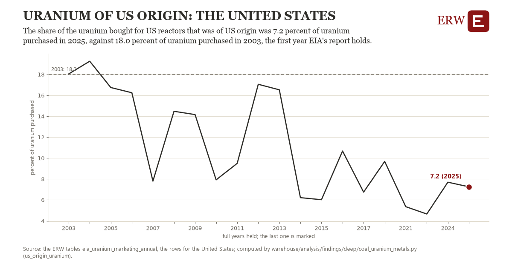

# Uranium of us origin: the United States

Draft `scan-deep-377b97f45425` of the findings hunt over the whole warehouse (chain 164), 2026-11-06. State: draft, not reviewed. Review at `/internal/findings`.

**The finding.** The share of the uranium bought for US reactors that was of US origin was 7.2 percent of uranium purchased in 2025, against 18.0 percent of uranium purchased in 2003, the first year EIA's report holds.

**The figure by full year** (percent of uranium purchased): 2003: 18.0, 2004: 19.3, 2005: 16.7, 2006: 16.2, 2007: 7.8, 2008: 14.5, 2009: 14.2, 2010: 7.9, 2011: 9.5, 2012: 17.0, 2013: 16.5, 2014: 6.2, 2015: 6.0, 2016: 10.7, 2017: 6.7, 2018: 9.7, 2021: 5.4, 2023: 4.7, 2024: 7.7, 2025: 7.2.

**The tables and rows.** `eia_uranium_marketing_annual`; the rows for the United States, region key `us_uranium_origin` (the card's `hunt.region`), years 2003 to 2025. The yearly values: `us-origin-uranium-us-uranium-origin.csv`.

**Its strength.** The change is 2.48 typical yearly moves (a typical move is 4.3 percent of uranium purchased, 1.4826 times the median absolute change between full years). Holds in more than one year: 18 of the 19 full years after 2003 lie below 2003's value. Survives a change of window: from 2004 to 2025 the change is -12.0, from 2003 to 2024 it is -10.3. Sample large enough: 2003 holds 1 and 2025 holds 1 observations; the floor is 1. Half the change remains without the first year: from 2004 to 2025 the change is -12.0, 111.3 percent of the change from 2003. At least one typical yearly move: the change is 2.48 typical yearly moves (4.3 percent of uranium purchased a year, the median move between full years); the floor is 1.

**Its limits.** EIA's Uranium Marketing Annual Report: what the owners and operators of US reactors bought, in pounds of U3O8 equivalent; EIA withholds some years' figures.

**Reproduce.** `python us-origin-uranium-us-uranium-origin.reproduce.py <the table's CSV>` and `do us-origin-uranium-us-uranium-origin.reproduce.do` (Stata) recompute the figures by year from the tables as the public downloads hold them; each names the expected values at its top.
