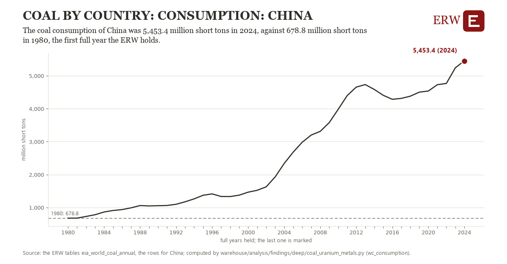

# Coal by country: consumption: China

Draft `scan-deep-4a7ff3a1ff65` of the findings hunt over the whole warehouse (chain 502), 2026-11-19. State: draft, not reviewed. Review at `/internal/findings`.

**The finding.** The coal consumption of China was 5,453.4 million short tons in 2024, against 678.8 million short tons in 1980, the first full year the ERW holds.

**The figure by full year** (million short tons): 1980: 678.8, 1981: 680.1, 1982: 729.8, 1983: 782.8, 1984: 865.1, 1985: 911.6, 1986: 938.6, 1987: 992.2, 1988: 1,061.4, 1989: 1,049.9, 1990: 1,056.6, 1991: 1,063.4, 1992: 1,100.2, 1993: 1,175.5, 1994: 1,264.0, 1995: 1,373.6, 1996: 1,415.5, 1997: 1,336.4, 1998: 1,334.5, 1999: 1,376.3, 2000: 1,467.5, 2001: 1,524.5, 2002: 1,629.0, 2003: 1,931.4, 2004: 2,338.7, 2005: 2,682.8, 2006: 2,983.3, 2007: 3,201.2, 2008: 3,313.6, 2009: 3,578.8, 2010: 3,985.0, 2011: 4,401.8, 2012: 4,657.0, 2013: 4,733.5, 2014: 4,585.5, 2015: 4,407.4, 2016: 4,286.0, 2017: 4,314.5, 2018: 4,381.2, 2019: 4,503.7, 2020: 4,537.7, 2021: 4,729.4, 2022: 4,767.9, 2023: 5,243.7, 2024: 5,453.4.

**The tables and rows.** `eia_world_coal_annual`; the rows for China, region key `wc_chn` (the card's `hunt.region`), years 1980 to 2024. The yearly values: `wc-consumption-wc-chn.csv`.

**Its strength.** The change is 39.93 typical yearly moves (a typical move is 119.6 million short tons, 1.4826 times the median absolute change between full years). Holds in more than one year: 44 of the 44 full years after 1980 lie above 1980's value. Survives a change of window: from 1981 to 2024 the change is 4,773.3, from 1980 to 2023 it is 4,564.8. Sample large enough: 1980 holds 1 and 2024 holds 1 observations; the floor is 1. Half the change remains without the first year: from 1981 to 2024 the change is 4,773.3, 100.0 percent of the change from 1980. At least one typical yearly move: the change is 39.93 typical yearly moves (119.6 million short tons a year, the median move between full years); the floor is 1.

**Its limits.** EIA's international energy data as the latest bulk file holds them; short tons of all coal, not its heat; a country's recent years are often EIA's estimates.

**Reproduce.** `python wc-consumption-wc-chn.reproduce.py <the table's CSV>` and `do wc-consumption-wc-chn.reproduce.do` (Stata) recompute the figures by year from the tables as the public downloads hold them; each names the expected values at its top.
