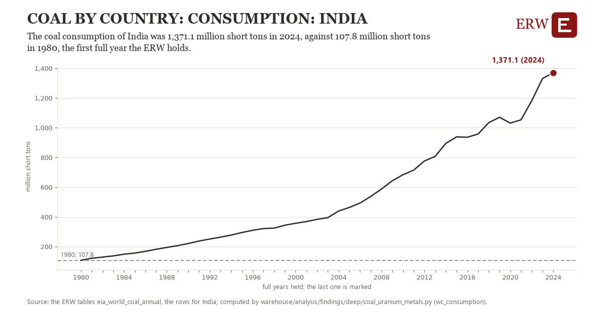

# Coal by country: consumption: India

Draft `scan-deep-073062bf3969` of the findings hunt over the whole warehouse (chain 502), 2026-11-19. State: draft, not reviewed. Review at `/internal/findings`.

**The finding.** The coal consumption of India was 1,371.1 million short tons in 2024, against 107.8 million short tons in 1980, the first full year the ERW holds.

**The figure by full year** (million short tons): 1980: 107.8, 1981: 121.4, 1982: 129.4, 1983: 137.4, 1984: 148.8, 1985: 156.2, 1986: 168.3, 1987: 182.0, 1988: 194.4, 1989: 206.4, 1990: 220.7, 1991: 237.5, 1992: 251.0, 1993: 263.4, 1994: 277.8, 1995: 294.9, 1996: 309.9, 1997: 321.4, 1998: 324.6, 1999: 344.1, 2000: 357.0, 2001: 368.4, 2002: 383.4, 2003: 395.2, 2004: 439.1, 2005: 463.5, 2006: 493.2, 2007: 537.5, 2008: 587.6, 2009: 642.7, 2010: 683.6, 2011: 714.7, 2012: 776.4, 2013: 807.2, 2014: 895.2, 2015: 938.6, 2016: 936.1, 2017: 957.9, 2018: 1,034.6, 2019: 1,070.5, 2020: 1,031.1, 2021: 1,053.5, 2022: 1,181.7, 2023: 1,330.7, 2024: 1,371.1.

**The tables and rows.** `eia_world_coal_annual`; the rows for India, region key `wc_ind` (the card's `hunt.region`), years 1980 to 2024. The yearly values: `wc-consumption-wc-ind.csv`.

**Its strength.** The change is 50.38 typical yearly moves (a typical move is 25.1 million short tons, 1.4826 times the median absolute change between full years). Holds in more than one year: 44 of the 44 full years after 1980 lie above 1980's value. Survives a change of window: from 1981 to 2024 the change is 1,249.7, from 1980 to 2023 it is 1,222.9. Sample large enough: 1980 holds 1 and 2024 holds 1 observations; the floor is 1. Half the change remains without the first year: from 1981 to 2024 the change is 1,249.7, 98.9 percent of the change from 1980. At least one typical yearly move: the change is 50.38 typical yearly moves (25.1 million short tons a year, the median move between full years); the floor is 1.

**Its limits.** EIA's international energy data as the latest bulk file holds them; short tons of all coal, not its heat; a country's recent years are often EIA's estimates.

**Reproduce.** `python wc-consumption-wc-ind.reproduce.py <the table's CSV>` and `do wc-consumption-wc-ind.reproduce.do` (Stata) recompute the figures by year from the tables as the public downloads hold them; each names the expected values at its top.
