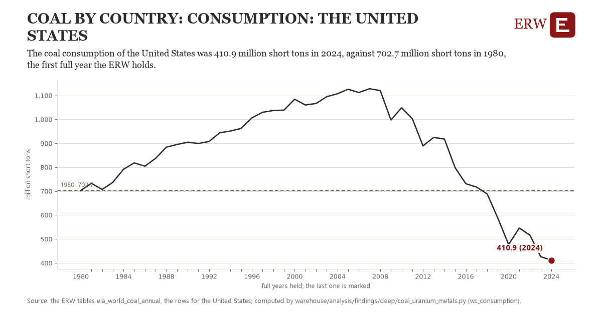

# Coal by country: consumption: the United States

Draft `scan-deep-7492cc1cffe3` of the findings hunt over the whole warehouse (chain 502), 2026-11-19. State: draft, not reviewed. Review at `/internal/findings`.

**The finding.** The coal consumption of the United States was 410.9 million short tons in 2024, against 702.7 million short tons in 1980, the first full year the ERW holds.

**The figure by full year** (million short tons): 1980: 702.7, 1981: 732.6, 1982: 706.9, 1983: 736.7, 1984: 791.3, 1985: 818.0, 1986: 804.2, 1987: 836.9, 1988: 883.6, 1989: 895.0, 1990: 904.5, 1991: 899.2, 1992: 907.7, 1993: 944.1, 1994: 951.3, 1995: 962.1, 1996: 1,006.3, 1997: 1,029.5, 1998: 1,037.1, 1999: 1,038.6, 2000: 1,084.1, 2001: 1,060.1, 2002: 1,066.4, 2003: 1,094.9, 2004: 1,107.3, 2005: 1,126.0, 2006: 1,112.3, 2007: 1,128.0, 2008: 1,120.5, 2009: 997.5, 2010: 1,048.5, 2011: 1,002.9, 2012: 889.2, 2013: 924.4, 2014: 917.7, 2015: 798.1, 2016: 731.1, 2017: 716.9, 2018: 688.1, 2019: 586.5, 2020: 476.7, 2021: 545.7, 2022: 515.5, 2023: 425.9, 2024: 410.9.

**The tables and rows.** `eia_world_coal_annual`; the rows for the United States, region key `wc_usa` (the card's `hunt.region`), years 1980 to 2024. The yearly values: `wc-consumption-wc-usa.csv`.

**Its strength.** The change is 7.12 typical yearly moves (a typical move is 41.0 million short tons, 1.4826 times the median absolute change between full years). Holds in more than one year: 7 of the 44 full years after 1980 lie below 1980's value. Survives a change of window: from 1981 to 2024 the change is -321.7, from 1980 to 2023 it is -276.8. Sample large enough: 1980 holds 1 and 2024 holds 1 observations; the floor is 1. Half the change remains without the first year: from 1981 to 2024 the change is -321.7, 110.2 percent of the change from 1980. At least one typical yearly move: the change is 7.12 typical yearly moves (41.0 million short tons a year, the median move between full years); the floor is 1.

**Its limits.** EIA's international energy data as the latest bulk file holds them; short tons of all coal, not its heat; a country's recent years are often EIA's estimates.

**Reproduce.** `python wc-consumption-wc-usa.reproduce.py <the table's CSV>` and `do wc-consumption-wc-usa.reproduce.do` (Stata) recompute the figures by year from the tables as the public downloads hold them; each names the expected values at its top.
