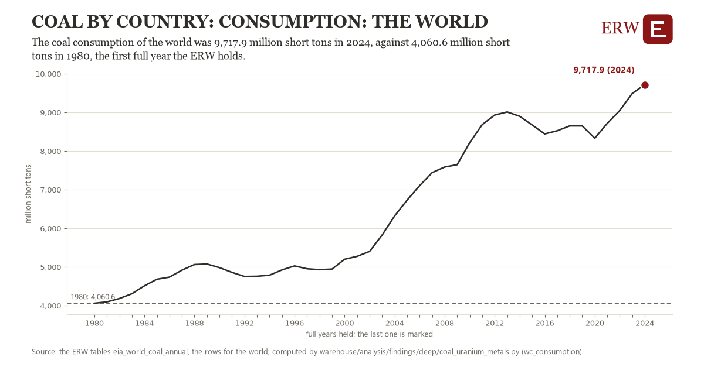

# Coal by country: consumption: the world

Draft `scan-deep-c1b1d0b5aefa` of the findings hunt over the whole warehouse (chain 502), 2026-11-19. State: draft, not reviewed. Review at `/internal/findings`.

**The finding.** The coal consumption of the world was 9,717.9 million short tons in 2024, against 4,060.6 million short tons in 1980, the first full year the ERW holds.

**The figure by full year** (million short tons): 1980: 4,060.6, 1981: 4,096.2, 1982: 4,183.5, 1983: 4,307.5, 1984: 4,511.6, 1985: 4,682.2, 1986: 4,736.5, 1987: 4,917.2, 1988: 5,062.6, 1989: 5,076.0, 1990: 4,982.3, 1991: 4,859.3, 1992: 4,753.7, 1993: 4,758.9, 1994: 4,786.7, 1995: 4,923.5, 1996: 5,026.7, 1997: 4,952.8, 1998: 4,929.0, 1999: 4,945.1, 2000: 5,198.8, 2001: 5,274.3, 2002: 5,402.0, 2003: 5,824.5, 2004: 6,320.7, 2005: 6,729.0, 2006: 7,103.8, 2007: 7,441.0, 2008: 7,585.4, 2009: 7,645.1, 2010: 8,214.1, 2011: 8,682.1, 2012: 8,930.4, 2013: 9,010.3, 2014: 8,898.1, 2015: 8,672.8, 2016: 8,441.9, 2017: 8,524.5, 2018: 8,650.3, 2019: 8,649.4, 2020: 8,331.1, 2021: 8,715.4, 2022: 9,047.3, 2023: 9,489.1, 2024: 9,717.9.

**The tables and rows.** `eia_world_coal_annual`; the rows for the world, region key `wc_worl` (the card's `hunt.region`), years 1980 to 2024. The yearly values: `wc-consumption-wc-worl.csv`.

**Its strength.** The change is 28.85 typical yearly moves (a typical move is 196.1 million short tons, 1.4826 times the median absolute change between full years). Holds in more than one year: 44 of the 44 full years after 1980 lie above 1980's value. Survives a change of window: from 1981 to 2024 the change is 5,621.7, from 1980 to 2023 it is 5,428.5. Sample large enough: 1980 holds 1 and 2024 holds 1 observations; the floor is 1. Half the change remains without the first year: from 1981 to 2024 the change is 5,621.7, 99.4 percent of the change from 1980. At least one typical yearly move: the change is 28.85 typical yearly moves (196.1 million short tons a year, the median move between full years); the floor is 1.

**Its limits.** EIA's international energy data as the latest bulk file holds them; short tons of all coal, not its heat; a country's recent years are often EIA's estimates.

**Reproduce.** `python wc-consumption-wc-worl.reproduce.py <the table's CSV>` and `do wc-consumption-wc-worl.reproduce.do` (Stata) recompute the figures by year from the tables as the public downloads hold them; each names the expected values at its top.
