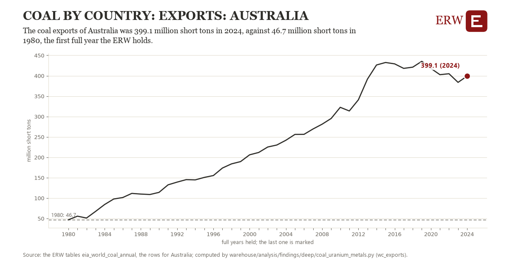

# Coal by country: exports: Australia

Draft `scan-deep-2beb8a1fa493` of the findings hunt over the whole warehouse (chain 502), 2026-11-19. State: draft, not reviewed. Review at `/internal/findings`.

**The finding.** The coal exports of Australia was 399.1 million short tons in 2024, against 46.7 million short tons in 1980, the first full year the ERW holds.

**The figure by full year** (million short tons): 1980: 46.7, 1981: 55.6, 1982: 51.1, 1983: 67.3, 1984: 84.2, 1985: 97.7, 1986: 101.3, 1987: 111.5, 1988: 109.8, 1989: 108.8, 1990: 114.0, 1991: 132.5, 1992: 139.2, 1993: 145.2, 1994: 144.6, 1995: 150.7, 1996: 155.3, 1997: 173.7, 1998: 183.9, 1999: 189.4, 2000: 206.1, 2001: 211.8, 2002: 225.2, 2003: 230.1, 2004: 241.8, 2005: 256.1, 2006: 256.2, 2007: 269.5, 2008: 281.2, 2009: 295.2, 2010: 322.6, 2011: 313.6, 2012: 340.9, 2013: 391.7, 2014: 426.3, 2015: 432.5, 2016: 429.1, 2017: 418.0, 2018: 421.0, 2019: 435.4, 2020: 418.0, 2021: 402.6, 2022: 404.9, 2023: 383.7, 2024: 399.1.

**The tables and rows.** `eia_world_coal_annual`; the rows for Australia, region key `wc_aus` (the card's `hunt.region`), years 1980 to 2024. The yearly values: `wc-exports-wc-aus.csv`.

**Its strength.** The change is 22.33 typical yearly moves (a typical move is 15.8 million short tons, 1.4826 times the median absolute change between full years). Holds in more than one year: 44 of the 44 full years after 1980 lie above 1980's value. Survives a change of window: from 1981 to 2024 the change is 343.4, from 1980 to 2023 it is 337.0. Sample large enough: 1980 holds 1 and 2024 holds 1 observations; the floor is 1. Half the change remains without the first year: from 1981 to 2024 the change is 343.4, 97.5 percent of the change from 1980. At least one typical yearly move: the change is 22.33 typical yearly moves (15.8 million short tons a year, the median move between full years); the floor is 1.

**Its limits.** EIA's international energy data as the latest bulk file holds them; short tons of all coal, not its heat; a country's recent years are often EIA's estimates.

**Reproduce.** `python wc-exports-wc-aus.reproduce.py <the table's CSV>` and `do wc-exports-wc-aus.reproduce.do` (Stata) recompute the figures by year from the tables as the public downloads hold them; each names the expected values at its top.
