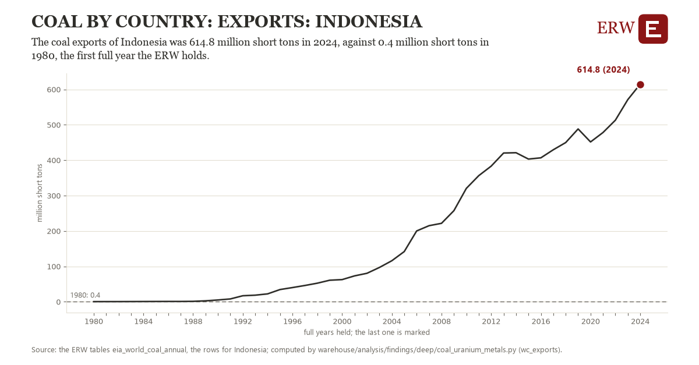

# Coal by country: exports: Indonesia

Draft `scan-deep-8fe6e7776fc5` of the findings hunt over the whole warehouse (chain 502), 2026-11-19. State: draft, not reviewed. Review at `/internal/findings`.

**The finding.** The coal exports of Indonesia was 614.8 million short tons in 2024, against 0.4 million short tons in 1980, the first full year the ERW holds.

**The figure by full year** (million short tons): 1980: 0.4, 1981: 0.5, 1982: 0.5, 1983: 0.6, 1984: 0.7, 1985: 0.8, 1986: 0.9, 1987: 0.9, 1988: 1.2, 1989: 2.6, 1990: 5.1, 1991: 8.0, 1992: 17.0, 1993: 18.6, 1994: 22.3, 1995: 34.5, 1996: 40.1, 1997: 46.0, 1998: 52.5, 1999: 60.9, 2000: 62.6, 2001: 73.1, 2002: 80.4, 2003: 96.9, 2004: 115.9, 2005: 141.8, 2006: 200.1, 2007: 215.0, 2008: 221.6, 2009: 257.4, 2010: 320.3, 2011: 356.3, 2012: 383.2, 2013: 420.2, 2014: 421.1, 2015: 403.1, 2016: 406.6, 2017: 429.4, 2018: 449.8, 2019: 488.2, 2020: 451.5, 2021: 478.0, 2022: 512.9, 2023: 571.0, 2024: 614.8.

**The tables and rows.** `eia_world_coal_annual`; the rows for Indonesia, region key `wc_idn` (the card's `hunt.region`), years 1980 to 2024. The yearly values: `wc-exports-wc-idn.csv`.

**Its strength.** The change is 47.66 typical yearly moves (a typical move is 12.9 million short tons, 1.4826 times the median absolute change between full years). Holds in more than one year: 44 of the 44 full years after 1980 lie above 1980's value. Survives a change of window: from 1981 to 2024 the change is 614.4, from 1980 to 2023 it is 570.6. Sample large enough: 1980 holds 1 and 2024 holds 1 observations; the floor is 1. Half the change remains without the first year: from 1981 to 2024 the change is 614.4, 100.0 percent of the change from 1980. At least one typical yearly move: the change is 47.66 typical yearly moves (12.9 million short tons a year, the median move between full years); the floor is 1.

**Its limits.** EIA's international energy data as the latest bulk file holds them; short tons of all coal, not its heat; a country's recent years are often EIA's estimates.

**Reproduce.** `python wc-exports-wc-idn.reproduce.py <the table's CSV>` and `do wc-exports-wc-idn.reproduce.do` (Stata) recompute the figures by year from the tables as the public downloads hold them; each names the expected values at its top.
