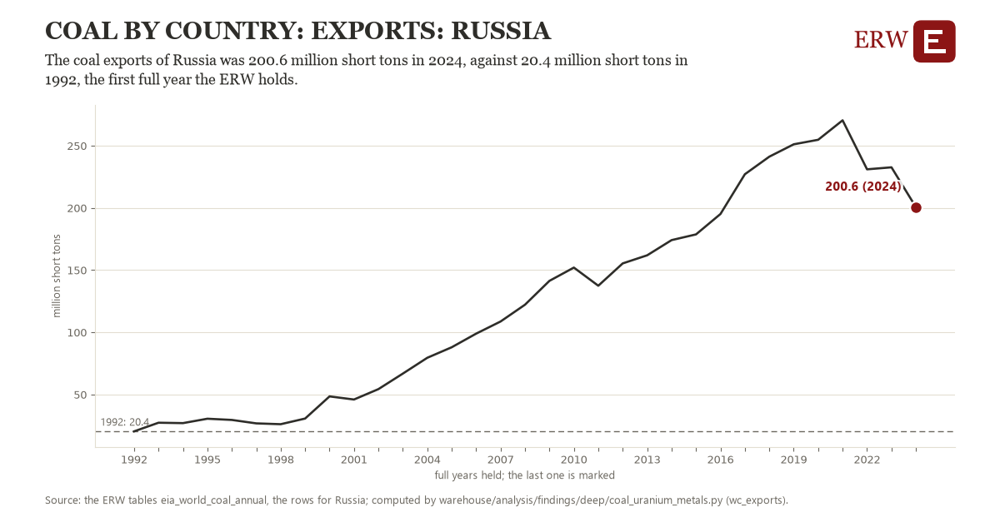

# Coal by country: exports: Russia

Draft `scan-deep-cba407a2d1b7` of the findings hunt over the whole warehouse (chain 502), 2026-11-19. State: draft, not reviewed. Review at `/internal/findings`.

**The finding.** The coal exports of Russia was 200.6 million short tons in 2024, against 20.4 million short tons in 1992, the first full year the ERW holds.

**The figure by full year** (million short tons): 1992: 20.4, 1993: 27.3, 1994: 27.0, 1995: 30.5, 1996: 29.5, 1997: 26.8, 1998: 26.1, 1999: 30.6, 2000: 48.4, 2001: 45.9, 2002: 54.3, 2003: 66.8, 2004: 79.5, 2005: 87.9, 2006: 98.9, 2007: 108.7, 2008: 122.2, 2009: 141.3, 2010: 152.0, 2011: 137.4, 2012: 155.4, 2013: 161.9, 2014: 174.1, 2015: 178.7, 2016: 195.1, 2017: 227.0, 2018: 241.2, 2019: 251.1, 2020: 254.7, 2021: 270.4, 2022: 231.0, 2023: 232.6, 2024: 200.6.

**The tables and rows.** `eia_world_coal_annual`; the rows for Russia, region key `wc_rus` (the card's `hunt.region`), years 1992 to 2024. The yearly values: `wc-exports-wc-rus.csv`.

**Its strength.** The change is 11.80 typical yearly moves (a typical move is 15.3 million short tons, 1.4826 times the median absolute change between full years). Holds in more than one year: 32 of the 32 full years after 1992 lie above 1992's value. Survives a change of window: from 1993 to 2024 the change is 173.3, from 1992 to 2023 it is 212.3. Sample large enough: 1992 holds 1 and 2024 holds 1 observations; the floor is 1. Half the change remains without the first year: from 1993 to 2024 the change is 173.3, 96.2 percent of the change from 1992. At least one typical yearly move: the change is 11.80 typical yearly moves (15.3 million short tons a year, the median move between full years); the floor is 1.

**Its limits.** EIA's international energy data as the latest bulk file holds them; short tons of all coal, not its heat; a country's recent years are often EIA's estimates.

**Reproduce.** `python wc-exports-wc-rus.reproduce.py <the table's CSV>` and `do wc-exports-wc-rus.reproduce.do` (Stata) recompute the figures by year from the tables as the public downloads hold them; each names the expected values at its top.
