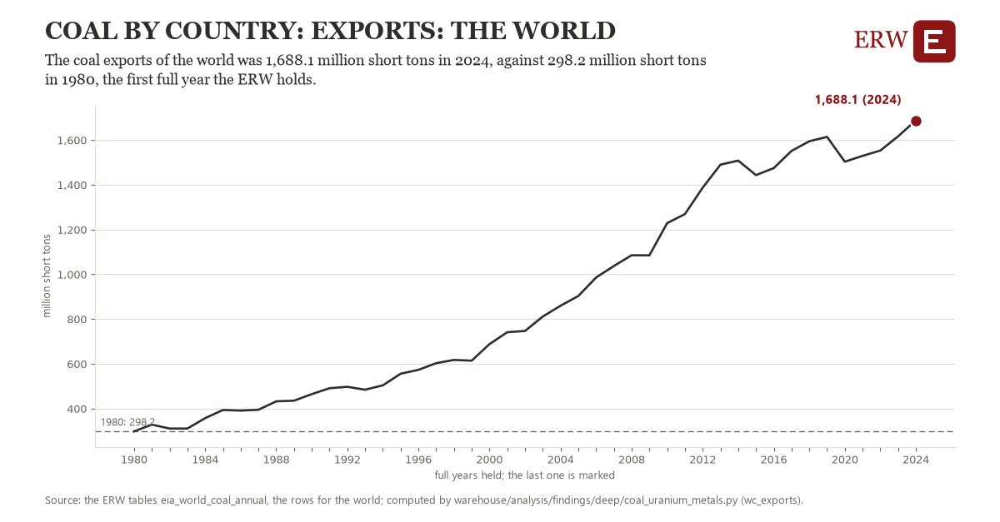

# Coal by country: exports: the world

Draft `scan-deep-3339c97be60c` of the findings hunt over the whole warehouse (chain 502), 2026-11-19. State: draft, not reviewed. Review at `/internal/findings`.

**The finding.** The coal exports of the world was 1,688.1 million short tons in 2024, against 298.2 million short tons in 1980, the first full year the ERW holds.

**The figure by full year** (million short tons): 1980: 298.2, 1981: 328.3, 1982: 310.7, 1983: 310.8, 1984: 357.2, 1985: 393.8, 1986: 390.9, 1987: 394.8, 1988: 432.4, 1989: 435.2, 1990: 464.5, 1991: 491.1, 1992: 497.3, 1993: 484.3, 1994: 503.8, 1995: 555.8, 1996: 573.0, 1997: 602.7, 1998: 617.4, 1999: 614.1, 2000: 687.9, 2001: 741.2, 2002: 746.8, 2003: 811.2, 2004: 859.5, 2005: 903.0, 2006: 985.7, 2007: 1,037.0, 2008: 1,085.2, 2009: 1,084.7, 2010: 1,228.8, 2011: 1,269.0, 2012: 1,387.1, 2013: 1,489.9, 2014: 1,508.1, 2015: 1,443.2, 2016: 1,474.6, 2017: 1,551.5, 2018: 1,594.6, 2019: 1,614.1, 2020: 1,503.1, 2021: 1,529.4, 2022: 1,553.1, 2023: 1,616.8, 2024: 1,688.1.

**The tables and rows.** `eia_world_coal_annual`; the rows for the world, region key `wc_worl` (the card's `hunt.region`), years 1980 to 2024. The yearly values: `wc-exports-wc-worl.csv`.

**Its strength.** The change is 27.58 typical yearly moves (a typical move is 50.4 million short tons, 1.4826 times the median absolute change between full years). Holds in more than one year: 44 of the 44 full years after 1980 lie above 1980's value. Survives a change of window: from 1981 to 2024 the change is 1,359.8, from 1980 to 2023 it is 1,318.6. Sample large enough: 1980 holds 1 and 2024 holds 1 observations; the floor is 1. Half the change remains without the first year: from 1981 to 2024 the change is 1,359.8, 97.8 percent of the change from 1980. At least one typical yearly move: the change is 27.58 typical yearly moves (50.4 million short tons a year, the median move between full years); the floor is 1.

**Its limits.** EIA's international energy data as the latest bulk file holds them; short tons of all coal, not its heat; a country's recent years are often EIA's estimates.

**Reproduce.** `python wc-exports-wc-worl.reproduce.py <the table's CSV>` and `do wc-exports-wc-worl.reproduce.do` (Stata) recompute the figures by year from the tables as the public downloads hold them; each names the expected values at its top.
