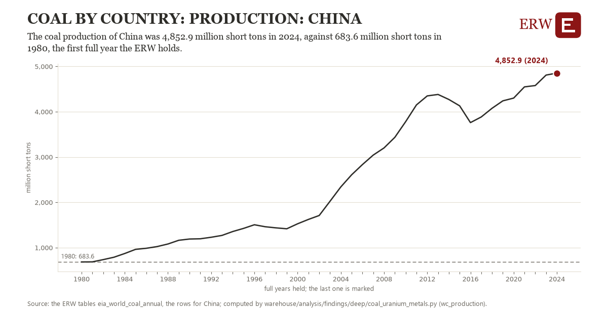

# Coal by country: production: China

Draft `scan-deep-b175c5885e51` of the findings hunt over the whole warehouse (chain 502), 2026-11-19. State: draft, not reviewed. Review at `/internal/findings`.

**The finding.** The coal production of China was 4,852.9 million short tons in 2024, against 683.6 million short tons in 1980, the first full year the ERW holds.

**The figure by full year** (million short tons): 1980: 683.6, 1981: 685.2, 1982: 734.5, 1983: 787.6, 1984: 870.0, 1985: 961.5, 1986: 985.5, 1987: 1,023.0, 1988: 1,080.1, 1989: 1,162.0, 1990: 1,189.7, 1991: 1,195.2, 1992: 1,228.6, 1993: 1,269.2, 1994: 1,355.3, 1995: 1,424.4, 1996: 1,504.6, 1997: 1,460.8, 1998: 1,436.1, 1999: 1,415.7, 2000: 1,525.8, 2001: 1,622.1, 2002: 1,709.0, 2003: 2,022.6, 2004: 2,339.8, 2005: 2,607.1, 2006: 2,832.6, 2007: 3,042.3, 2008: 3,200.5, 2009: 3,434.1, 2010: 3,779.2, 2011: 4,149.6, 2012: 4,348.8, 2013: 4,380.9, 2014: 4,270.3, 2015: 4,129.8, 2016: 3,759.5, 2017: 3,884.1, 2018: 4,076.1, 2019: 4,239.8, 2020: 4,300.7, 2021: 4,548.1, 2022: 4,577.5, 2023: 4,808.4, 2024: 4,852.9.

**The tables and rows.** `eia_world_coal_annual`; the rows for China, region key `wc_chn` (the card's `hunt.region`), years 1980 to 2024. The yearly values: `wc-production-wc-chn.csv`.

**Its strength.** The change is 32.50 typical yearly moves (a typical move is 128.3 million short tons, 1.4826 times the median absolute change between full years). Holds in more than one year: 44 of the 44 full years after 1980 lie above 1980's value. Survives a change of window: from 1981 to 2024 the change is 4,167.7, from 1980 to 2023 it is 4,124.8. Sample large enough: 1980 holds 1 and 2024 holds 1 observations; the floor is 1. Half the change remains without the first year: from 1981 to 2024 the change is 4,167.7, 100.0 percent of the change from 1980. At least one typical yearly move: the change is 32.50 typical yearly moves (128.3 million short tons a year, the median move between full years); the floor is 1.

**Its limits.** EIA's international energy data as the latest bulk file holds them; short tons of all coal, not its heat; a country's recent years are often EIA's estimates.

**Reproduce.** `python wc-production-wc-chn.reproduce.py <the table's CSV>` and `do wc-production-wc-chn.reproduce.do` (Stata) recompute the figures by year from the tables as the public downloads hold them; each names the expected values at its top.
