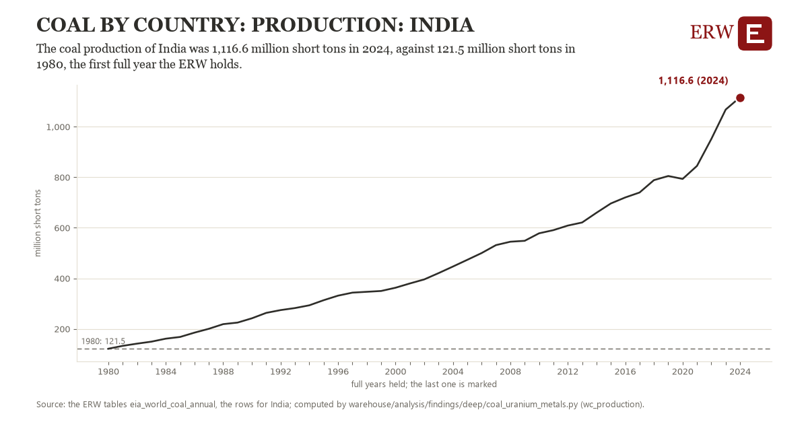

# Coal by country: production: India

Draft `scan-deep-8b122efeb8ff` of the findings hunt over the whole warehouse (chain 502), 2026-11-19. State: draft, not reviewed. Review at `/internal/findings`.

**The finding.** The coal production of India was 1,116.6 million short tons in 2024, against 121.5 million short tons in 1980, the first full year the ERW holds.

**The figure by full year** (million short tons): 1980: 121.5, 1981: 132.8, 1982: 141.6, 1983: 149.5, 1984: 161.2, 1985: 168.1, 1986: 185.1, 1987: 200.4, 1988: 218.8, 1989: 224.9, 1990: 241.9, 1991: 263.4, 1992: 274.4, 1993: 282.4, 1994: 293.3, 1995: 313.6, 1996: 331.5, 1997: 343.5, 1998: 346.7, 1999: 350.0, 2000: 362.8, 2001: 379.7, 2002: 395.7, 2003: 420.6, 2004: 446.7, 2005: 473.3, 2006: 500.1, 2007: 531.5, 2008: 544.9, 2009: 548.6, 2010: 578.2, 2011: 590.8, 2012: 608.8, 2013: 621.1, 2014: 659.5, 2015: 696.3, 2016: 720.0, 2017: 739.7, 2018: 788.6, 2019: 805.1, 2020: 793.4, 2021: 845.0, 2022: 951.5, 2023: 1,068.0, 2024: 1,116.6.

**The tables and rows.** `eia_world_coal_annual`; the rows for India, region key `wc_ind` (the card's `hunt.region`), years 1980 to 2024. The yearly values: `wc-production-wc-ind.csv`.

**Its strength.** The change is 39.59 typical yearly moves (a typical move is 25.1 million short tons, 1.4826 times the median absolute change between full years). Holds in more than one year: 44 of the 44 full years after 1980 lie above 1980's value. Survives a change of window: from 1981 to 2024 the change is 983.8, from 1980 to 2023 it is 946.4. Sample large enough: 1980 holds 1 and 2024 holds 1 observations; the floor is 1. Half the change remains without the first year: from 1981 to 2024 the change is 983.8, 98.9 percent of the change from 1980. At least one typical yearly move: the change is 39.59 typical yearly moves (25.1 million short tons a year, the median move between full years); the floor is 1.

**Its limits.** EIA's international energy data as the latest bulk file holds them; short tons of all coal, not its heat; a country's recent years are often EIA's estimates.

**Reproduce.** `python wc-production-wc-ind.reproduce.py <the table's CSV>` and `do wc-production-wc-ind.reproduce.do` (Stata) recompute the figures by year from the tables as the public downloads hold them; each names the expected values at its top.
