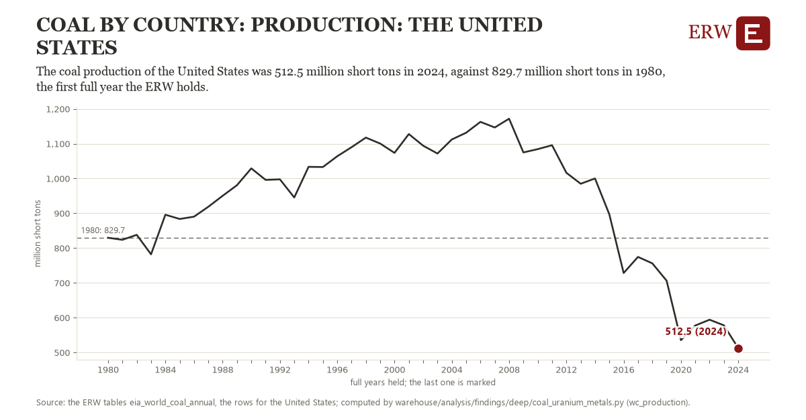

# Coal by country: production: the United States

Draft `scan-deep-bc00f466620a` of the findings hunt over the whole warehouse (chain 502), 2026-11-19. State: draft, not reviewed. Review at `/internal/findings`.

**The finding.** The coal production of the United States was 512.5 million short tons in 2024, against 829.7 million short tons in 1980, the first full year the ERW holds.

**The figure by full year** (million short tons): 1980: 829.7, 1981: 823.8, 1982: 838.1, 1983: 782.1, 1984: 895.9, 1985: 883.6, 1986: 890.3, 1987: 918.8, 1988: 950.3, 1989: 980.7, 1990: 1,029.1, 1991: 996.0, 1992: 997.5, 1993: 945.4, 1994: 1,033.5, 1995: 1,033.0, 1996: 1,063.9, 1997: 1,089.9, 1998: 1,117.5, 1999: 1,100.4, 2000: 1,073.6, 2001: 1,127.7, 2002: 1,094.3, 2003: 1,071.8, 2004: 1,112.1, 2005: 1,131.5, 2006: 1,162.7, 2007: 1,146.6, 2008: 1,171.8, 2009: 1,074.9, 2010: 1,084.4, 2011: 1,095.6, 2012: 1,016.5, 2013: 984.8, 2014: 1,000.0, 2015: 896.9, 2016: 728.4, 2017: 774.6, 2018: 756.2, 2019: 706.3, 2020: 535.4, 2021: 577.4, 2022: 594.2, 2023: 578.0, 2024: 512.5.

**The tables and rows.** `eia_world_coal_annual`; the rows for the United States, region key `wc_usa` (the card's `hunt.region`), years 1980 to 2024. The yearly values: `wc-production-wc-usa.csv`.

**Its strength.** The change is 6.97 typical yearly moves (a typical move is 45.5 million short tons, 1.4826 times the median absolute change between full years). Holds in more than one year: 11 of the 44 full years after 1980 lie below 1980's value. Survives a change of window: from 1981 to 2024 the change is -311.2, from 1980 to 2023 it is -251.7. Sample large enough: 1980 holds 1 and 2024 holds 1 observations; the floor is 1. Half the change remains without the first year: from 1981 to 2024 the change is -311.2, 98.1 percent of the change from 1980. At least one typical yearly move: the change is 6.97 typical yearly moves (45.5 million short tons a year, the median move between full years); the floor is 1.

**Its limits.** EIA's international energy data as the latest bulk file holds them; short tons of all coal, not its heat; a country's recent years are often EIA's estimates.

**Reproduce.** `python wc-production-wc-usa.reproduce.py <the table's CSV>` and `do wc-production-wc-usa.reproduce.do` (Stata) recompute the figures by year from the tables as the public downloads hold them; each names the expected values at its top.
