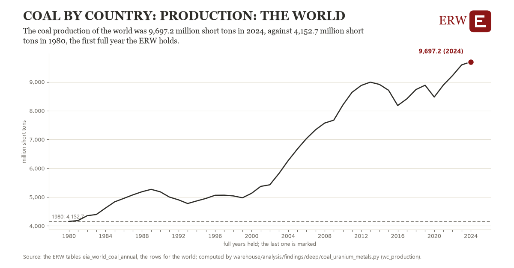

# Coal by country: production: the world

Draft `scan-deep-81b63e086cbb` of the findings hunt over the whole warehouse (chain 502), 2026-11-19. State: draft, not reviewed. Review at `/internal/findings`.

**The finding.** The coal production of the world was 9,697.2 million short tons in 2024, against 4,152.7 million short tons in 1980, the first full year the ERW holds.

**The figure by full year** (million short tons): 1980: 4,152.7, 1981: 4,184.6, 1982: 4,352.1, 1983: 4,395.3, 1984: 4,616.4, 1985: 4,832.9, 1986: 4,952.9, 1987: 5,075.8, 1988: 5,184.9, 1989: 5,267.4, 1990: 5,182.8, 1991: 4,999.9, 1992: 4,903.0, 1993: 4,775.1, 1994: 4,866.0, 1995: 4,952.2, 1996: 5,061.7, 1997: 5,065.3, 1998: 5,039.9, 1999: 4,974.1, 2000: 5,131.0, 2001: 5,370.2, 2002: 5,426.3, 2003: 5,820.4, 2004: 6,262.2, 2005: 6,662.3, 2006: 7,028.0, 2007: 7,335.5, 2008: 7,569.2, 2009: 7,670.5, 2010: 8,199.4, 2011: 8,637.2, 2012: 8,875.0, 2013: 8,989.8, 2014: 8,910.6, 2015: 8,707.7, 2016: 8,177.7, 2017: 8,409.3, 2018: 8,733.3, 2019: 8,883.6, 2020: 8,473.6, 2021: 8,890.6, 2022: 9,217.7, 2023: 9,588.6, 2024: 9,697.2.

**The tables and rows.** `eia_world_coal_annual`; the rows for the world, region key `wc_worl` (the card's `hunt.region`), years 1980 to 2024. The yearly values: `wc-production-wc-worl.csv`.

**Its strength.** The change is 23.06 typical yearly moves (a typical move is 240.4 million short tons, 1.4826 times the median absolute change between full years). Holds in more than one year: 44 of the 44 full years after 1980 lie above 1980's value. Survives a change of window: from 1981 to 2024 the change is 5,512.6, from 1980 to 2023 it is 5,435.9. Sample large enough: 1980 holds 1 and 2024 holds 1 observations; the floor is 1. Half the change remains without the first year: from 1981 to 2024 the change is 5,512.6, 99.4 percent of the change from 1980. At least one typical yearly move: the change is 23.06 typical yearly moves (240.4 million short tons a year, the median move between full years); the floor is 1.

**Its limits.** EIA's international energy data as the latest bulk file holds them; short tons of all coal, not its heat; a country's recent years are often EIA's estimates.

**Reproduce.** `python wc-production-wc-worl.reproduce.py <the table's CSV>` and `do wc-production-wc-worl.reproduce.do` (Stata) recompute the figures by year from the tables as the public downloads hold them; each names the expected values at its top.
