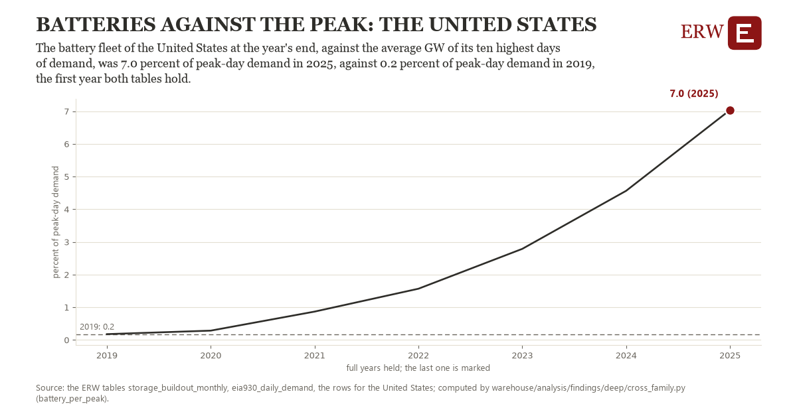

# Batteries against the peak: the United States

Draft `scan-deep-8a517c868c02` of the findings hunt over the whole warehouse (chain 164), 2026-11-06. State: draft, not reviewed. Review at `/internal/findings`.

**The finding.** The battery fleet of the United States at the year's end, against the average GW of its ten highest days of demand, was 7.0 percent of peak-day demand in 2025, against 0.2 percent of peak-day demand in 2019, the first year both tables hold.

**The figure by full year** (percent of peak-day demand): 2019: 0.2, 2020: 0.3, 2021: 0.9, 2022: 1.6, 2023: 2.8, 2024: 4.6, 2025: 7.0.

**The tables and rows.** `storage_buildout_monthly`, `eia930_daily_demand`; the rows for the United States, region key `us_bat_peak` (the card's `hunt.region`), years 2019 to 2025. The yearly values: `battery-per-peak-us-bat-peak.csv`.

**Its strength.** The change is 4.82 typical yearly moves (a typical move is 1.4 percent of peak-day demand, 1.4826 times the median absolute change between full years). Holds in more than one year: 6 of the 6 full years after 2019 lie above 2019's value. Survives a change of window: from 2020 to 2025 the change is 6.8, from 2019 to 2024 it is 4.4. Sample large enough: 2019 holds 365 and 2025 holds 365 observations; the floor is 330. Half the change remains without the first year: from 2020 to 2025 the change is 6.8, 98.4 percent of the change from 2019. At least one typical yearly move: the change is 4.82 typical yearly moves (1.4 percent of peak-day demand a year, the median move between full years); the floor is 1.

**Its limits.** Two families in one figure: EIA-860M's operating batteries (the ERW's monthly fleet) over EIA-930's daily demand; a battery's MW is its discharge rate, not its energy, and a peak day's average GW is below its peak hour.

**Reproduce.** `python battery-per-peak-us-bat-peak.reproduce.py <the table's CSV>` and `do battery-per-peak-us-bat-peak.reproduce.do` (Stata) recompute the figures by year from the tables as the public downloads hold them; each names the expected values at its top.
