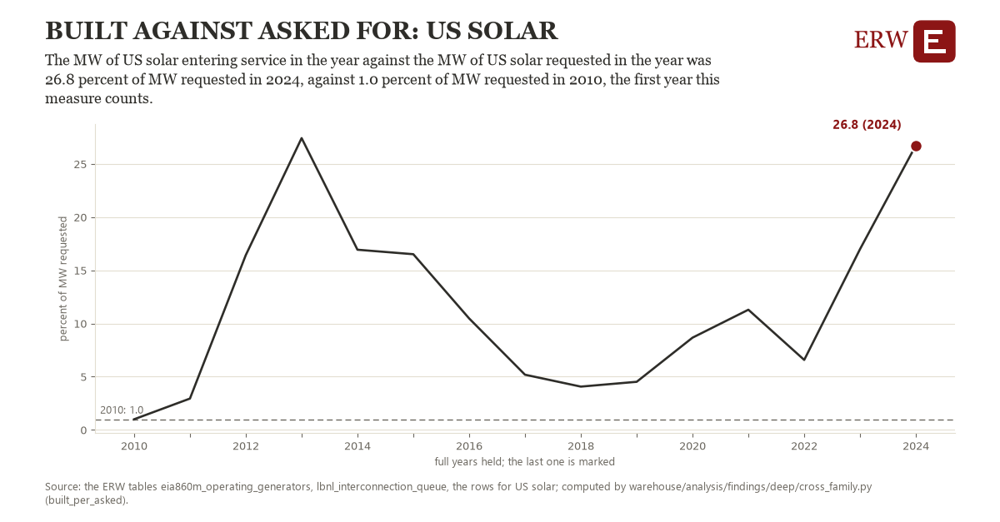

# Built against asked for: US solar

Draft `scan-deep-a1b3df8569b3` of the findings hunt over the whole warehouse (chain 164), 2026-11-06. State: draft, not reviewed. Review at `/internal/findings`.

**The finding.** The MW of US solar entering service in the year against the MW of US solar requested in the year was 26.8 percent of MW requested in 2024, against 1.0 percent of MW requested in 2010, the first year this measure counts.

**The figure by full year** (percent of MW requested): 2010: 1.0, 2011: 2.9, 2012: 16.4, 2013: 27.4, 2014: 16.9, 2015: 16.5, 2016: 10.5, 2017: 5.2, 2018: 4.1, 2019: 4.5, 2020: 8.7, 2021: 11.3, 2022: 6.6, 2023: 17.0, 2024: 26.8.

**The tables and rows.** `eia860m_operating_generators`, `lbnl_interconnection_queue`; the rows for US solar, region key `us_solar_built_asked` (the card's `hunt.region`), years 2010 to 2024. The yearly values: `built-per-asked-us-solar-built-asked.csv`.

**Its strength.** The change is 3.47 typical yearly moves (a typical move is 7.4 percent of MW requested, 1.4826 times the median absolute change between full years). Holds in more than one year: 14 of the 14 full years after 2010 lie above 2010's value. Survives a change of window: from 2011 to 2024 the change is 23.8, from 2010 to 2023 it is 16.0. Sample large enough: 2010 holds 1 and 2024 holds 1 observations; the floor is 1. Half the change remains without the first year: from 2011 to 2024 the change is 23.8, 92.4 percent of the change from 2010. At least one typical yearly move: the change is 3.47 typical yearly moves (7.4 percent of MW requested a year, the median move between full years); the floor is 1.

**Its limits.** Two families in one figure: a year's requests and a year's completions are different projects (a completion's request is years older), so the figure compares two flows, not a success rate.

**Reproduce.** `python built-per-asked-us-solar-built-asked.reproduce.py <the table's CSV>` and `do built-per-asked-us-solar-built-asked.reproduce.do` (Stata) recompute the figures by year from the tables as the public downloads hold them; each names the expected values at its top.
