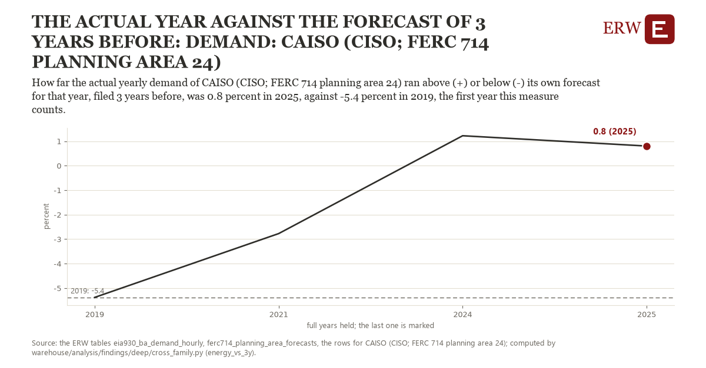

# The actual year against the forecast of 3 years before: demand: CAISO (CISO; FERC 714 planning area 24)

Draft `scan-deep-278b6c0e9bba` of the findings hunt over the whole warehouse (chain 502), 2026-11-19. State: draft, not reviewed. Review at `/internal/findings`.

**The finding.** How far the actual yearly demand of CAISO (CISO; FERC 714 planning area 24) ran above (+) or below (-) its own forecast for that year, filed 3 years before, was 0.8 percent in 2025, against -5.4 percent in 2019, the first year this measure counts.

**The figure by full year** (percent): 2019: -5.4, 2021: -2.8, 2024: 1.2, 2025: 0.8.

**The tables and rows.** `eia930_ba_demand_hourly`, `ferc714_planning_area_forecasts`; the rows for CAISO (CISO; FERC 714 planning area 24), region key `xe3_ciso` (the card's `hunt.region`), years 2019 to 2025. The yearly values: `energy-vs-3y-xe3-ciso.csv`.

**Its strength.** The change is 1.60 typical yearly moves (a typical move is 3.9 percent, 1.4826 times the median absolute change between full years). Holds in more than one year: 3 of the 3 full years after 2019 lie above 2019's value. Survives a change of window: from 2021 to 2025 the change is 3.6, from 2019 to 2024 it is 6.6. Sample large enough: 2019 holds 1 and 2025 holds 1 observations; the floor is 1. Half the change remains without the first year: from 2021 to 2025 the change is 3.6, 57.8 percent of the change from 2019. At least one typical yearly move: the change is 1.60 typical yearly moves (3.9 percent a year, the median move between full years); the floor is 1.

**Its limits.** FERC 714's forecast as the area filed it and EIA-930's demand as its balancing authority reported it; the two are not defined alike (losses, footprint), so the level of the gap means less than its move; a lone spike is dropped from the actual peak.

**Reproduce.** `python energy-vs-3y-xe3-ciso.reproduce.py <the table's CSV>` and `do energy-vs-3y-xe3-ciso.reproduce.do` (Stata) recompute the figures by year from the tables as the public downloads hold them; each names the expected values at its top.
