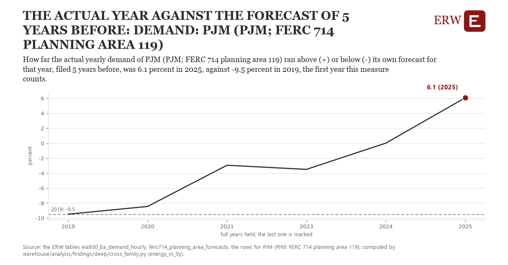

# The actual year against the forecast of 5 years before: demand: PJM (PJM; FERC 714 planning area 119)

Draft `scan-deep-f2ce1cfcab52` of the findings hunt over the whole warehouse (chain 502), 2026-11-19. State: draft, not reviewed. Review at `/internal/findings`.

**The finding.** How far the actual yearly demand of PJM (PJM; FERC 714 planning area 119) ran above (+) or below (-) its own forecast for that year, filed 5 years before, was 6.1 percent in 2025, against -9.5 percent in 2019, the first year this measure counts.

**The figure by full year** (percent): 2019: -9.5, 2020: -8.5, 2021: -2.9, 2023: -3.5, 2024: 0.0, 2025: 6.1.

**The tables and rows.** `eia930_ba_demand_hourly`, `ferc714_planning_area_forecasts`; the rows for PJM (PJM; FERC 714 planning area 119), region key `xe5_pjm` (the card's `hunt.region`), years 2019 to 2025. The yearly values: `energy-vs-5y-xe5-pjm.csv`.

**Its strength.** The change is 2.99 typical yearly moves (a typical move is 5.2 percent, 1.4826 times the median absolute change between full years). Holds in more than one year: 5 of the 5 full years after 2019 lie above 2019's value. Survives a change of window: from 2020 to 2025 the change is 14.5, from 2019 to 2024 it is 9.5. Sample large enough: 2019 holds 1 and 2025 holds 1 observations; the floor is 1. Half the change remains without the first year: from 2020 to 2025 the change is 14.5, 93.4 percent of the change from 2019. At least one typical yearly move: the change is 2.99 typical yearly moves (5.2 percent a year, the median move between full years); the floor is 1.

**Its limits.** FERC 714's forecast as the area filed it and EIA-930's demand as its balancing authority reported it; the two are not defined alike (losses, footprint), so the level of the gap means less than its move; a lone spike is dropped from the actual peak.

**Reproduce.** `python energy-vs-5y-xe5-pjm.reproduce.py <the table's CSV>` and `do energy-vs-5y-xe5-pjm.reproduce.do` (Stata) recompute the figures by year from the tables as the public downloads hold them; each names the expected values at its top.
