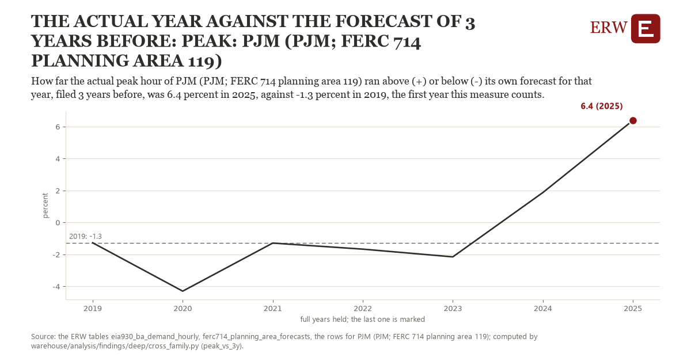

# The actual year against the forecast of 3 years before: peak: PJM (PJM; FERC 714 planning area 119)

Draft `scan-deep-b7b0aab3de39` of the findings hunt over the whole warehouse (chain 502), 2026-11-19. State: draft, not reviewed. Review at `/internal/findings`.

**The finding.** How far the actual peak hour of PJM (PJM; FERC 714 planning area 119) ran above (+) or below (-) its own forecast for that year, filed 3 years before, was 6.4 percent in 2025, against -1.3 percent in 2019, the first year this measure counts.

**The figure by full year** (percent): 2019: -1.3, 2020: -4.3, 2021: -1.3, 2022: -1.7, 2023: -2.2, 2024: 1.9, 2025: 6.4.

**The tables and rows.** `eia930_ba_demand_hourly`, `ferc714_planning_area_forecasts`; the rows for PJM (PJM; FERC 714 planning area 119), region key `xp3_pjm` (the card's `hunt.region`), years 2019 to 2025. The yearly values: `peak-vs-3y-xp3-pjm.csv`.

**Its strength.** The change is 1.71 typical yearly moves (a typical move is 4.5 percent, 1.4826 times the median absolute change between full years). Holds in more than one year: 2 of the 6 full years after 2019 lie above 2019's value. Survives a change of window: from 2020 to 2025 the change is 10.7, from 2019 to 2024 it is 3.1. Sample large enough: 2019 holds 1 and 2025 holds 1 observations; the floor is 1. Half the change remains without the first year: from 2020 to 2025 the change is 10.7, 139.5 percent of the change from 2019. At least one typical yearly move: the change is 1.71 typical yearly moves (4.5 percent a year, the median move between full years); the floor is 1.

**Its limits.** FERC 714's forecast as the area filed it and EIA-930's demand as its balancing authority reported it; the two are not defined alike (losses, footprint), so the level of the gap means less than its move; a lone spike is dropped from the actual peak.

**Reproduce.** `python peak-vs-3y-xp3-pjm.reproduce.py <the table's CSV>` and `do peak-vs-3y-xp3-pjm.reproduce.do` (Stata) recompute the figures by year from the tables as the public downloads hold them; each names the expected values at its top.
