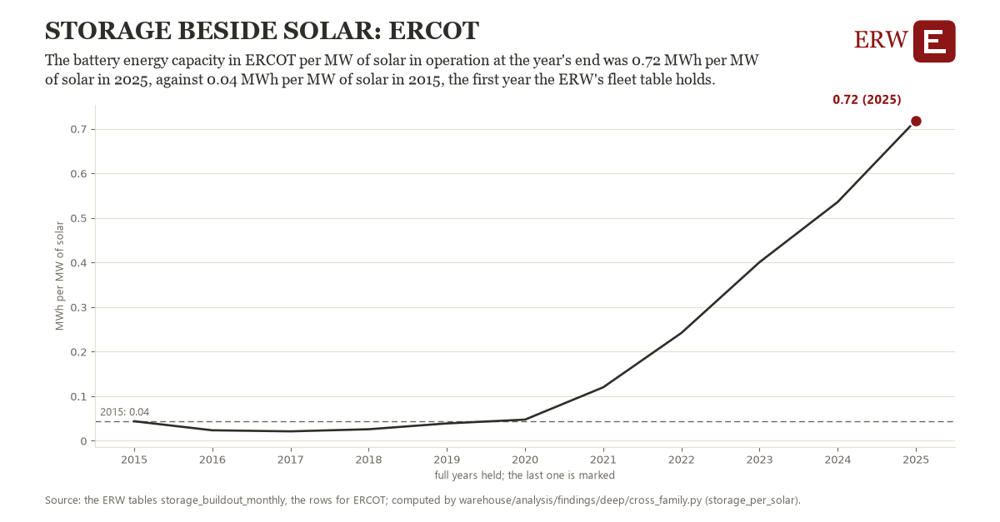

# Storage beside solar: ERCOT

Draft `scan-deep-f703dda8e911` of the findings hunt over the whole warehouse (chain 164), 2026-11-06. State: draft, not reviewed. Review at `/internal/findings`.

**The finding.** The battery energy capacity in ERCOT per MW of solar in operation at the year's end was 0.72 MWh per MW of solar in 2025, against 0.04 MWh per MW of solar in 2015, the first year the ERW's fleet table holds.

**The figure by full year** (MWh per MW of solar): 2015: 0.04, 2016: 0.02, 2017: 0.02, 2018: 0.03, 2019: 0.04, 2020: 0.05, 2021: 0.12, 2022: 0.24, 2023: 0.40, 2024: 0.54, 2025: 0.72.

**The tables and rows.** `storage_buildout_monthly`; the rows for ERCOT, region key `ercot_bat_solar` (the card's `hunt.region`), years 2015 to 2025. The yearly values: `storage-per-solar-ercot-bat-solar.csv`.

**Its strength.** The change is 9.81 typical yearly moves (a typical move is 0.07 MWh per MW of solar, 1.4826 times the median absolute change between full years). Holds in more than one year: 6 of the 10 full years after 2015 lie above 2015's value. Survives a change of window: from 2016 to 2025 the change is 0.70, from 2015 to 2024 it is 0.49. Sample large enough: 2015 holds 1 and 2025 holds 1 observations; the floor is 1. Half the change remains without the first year: from 2016 to 2025 the change is 0.70, 103.0 percent of the change from 2015. At least one typical yearly move: the change is 9.81 typical yearly moves (0.07 MWh per MW of solar a year, the median move between full years); the floor is 1.

**Its limits.** EIA-860M's operating batteries and solar as the ERW counts them each month; batteries that report no MWh are left out.

**Reproduce.** `python storage-per-solar-ercot-bat-solar.reproduce.py <the table's CSV>` and `do storage-per-solar-ercot-bat-solar.reproduce.do` (Stata) recompute the figures by year from the tables as the public downloads hold them; each names the expected values at its top.
