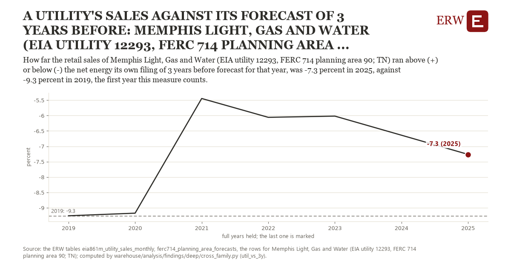

# A utility's sales against its forecast of 3 years before: Memphis Light, Gas and Water (EIA utility 12293, FERC 714 planning area 90; TN)

Draft `scan-deep-c37a60dac2cf` of the findings hunt over the whole warehouse (chain 502), 2026-11-19. State: draft, not reviewed. Review at `/internal/findings`.

**The finding.** How far the retail sales of Memphis Light, Gas and Water (EIA utility 12293, FERC 714 planning area 90; TN) ran above (+) or below (-) the net energy its own filing of 3 years before forecast for that year, was -7.3 percent in 2025, against -9.3 percent in 2019, the first year this measure counts.

**The figure by full year** (percent): 2019: -9.3, 2020: -9.2, 2021: -5.4, 2022: -6.1, 2023: -6.0, 2024: -6.6, 2025: -7.3.

**The tables and rows.** `eia861m_utility_sales_monthly`, `ferc714_planning_area_forecasts`; the rows for Memphis Light, Gas and Water (EIA utility 12293, FERC 714 planning area 90; TN), region key `xu3_12293` (the card's `hunt.region`), years 2019 to 2025. The yearly values: `util-vs-3y-xu3-12293.csv`.

**Its strength.** The change is 2.18 typical yearly moves (a typical move is 0.9 percent, 1.4826 times the median absolute change between full years). Holds in more than one year: 6 of the 6 full years after 2019 lie above 2019's value. Survives a change of window: from 2020 to 2025 the change is 1.9, from 2019 to 2024 it is 2.6. Sample large enough: 2019 holds 1 and 2025 holds 1 observations; the floor is 1. Half the change remains without the first year: from 2020 to 2025 the change is 1.9, 95.7 percent of the change from 2019. At least one typical yearly move: the change is 2.18 typical yearly moves (0.9 percent a year, the median move between full years); the floor is 1.

**Its limits.** EIA-861M's retail sales of the utility (every state it serves) against the net energy for load its FERC 714 filing forecast; net energy also holds losses and any wholesale load the area serves, so the level of the gap means less than its move; a year under half or over twice its forecast is left out.

**Reproduce.** `python util-vs-3y-xu3-12293.reproduce.py <the table's CSV>` and `do util-vs-3y-xu3-12293.reproduce.do` (Stata) recompute the figures by year from the tables as the public downloads hold them; each names the expected values at its top.
