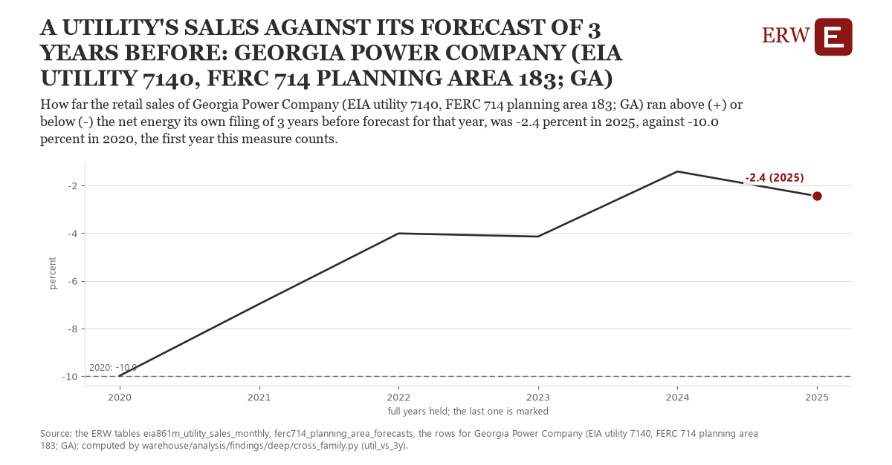

# A utility's sales against its forecast of 3 years before: Georgia Power Company (EIA utility 7140, FERC 714 planning area 183; GA)

Draft `scan-deep-097fdfb34ec3` of the findings hunt over the whole warehouse (chain 502), 2026-11-19. State: draft, not reviewed. Review at `/internal/findings`.

**The finding.** How far the retail sales of Georgia Power Company (EIA utility 7140, FERC 714 planning area 183; GA) ran above (+) or below (-) the net energy its own filing of 3 years before forecast for that year, was -2.4 percent in 2025, against -10.0 percent in 2020, the first year this measure counts.

**The figure by full year** (percent): 2020: -10.0, 2021: -7.0, 2022: -4.0, 2023: -4.1, 2024: -1.4, 2025: -2.4.

**The tables and rows.** `eia861m_utility_sales_monthly`, `ferc714_planning_area_forecasts`; the rows for Georgia Power Company (EIA utility 7140, FERC 714 planning area 183; GA), region key `xu3_7140` (the card's `hunt.region`), years 2020 to 2025. The yearly values: `util-vs-3y-xu3-7140.csv`.

**Its strength.** The change is 1.86 typical yearly moves (a typical move is 4.0 percent, 1.4826 times the median absolute change between full years). Holds in more than one year: 5 of the 5 full years after 2020 lie above 2020's value. Survives a change of window: from 2021 to 2025 the change is 4.5, from 2020 to 2024 it is 8.6. Sample large enough: 2020 holds 1 and 2025 holds 1 observations; the floor is 1. Half the change remains without the first year: from 2021 to 2025 the change is 4.5, 60.1 percent of the change from 2020. At least one typical yearly move: the change is 1.86 typical yearly moves (4.0 percent a year, the median move between full years); the floor is 1.

**Its limits.** EIA-861M's retail sales of the utility (every state it serves) against the net energy for load its FERC 714 filing forecast; net energy also holds losses and any wholesale load the area serves, so the level of the gap means less than its move; a year under half or over twice its forecast is left out.

**Reproduce.** `python util-vs-3y-xu3-7140.reproduce.py <the table's CSV>` and `do util-vs-3y-xu3-7140.reproduce.do` (Stata) recompute the figures by year from the tables as the public downloads hold them; each names the expected values at its top.
