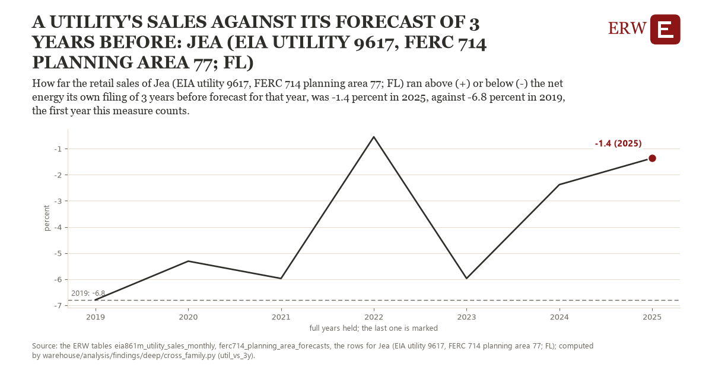

# A utility's sales against its forecast of 3 years before: Jea (EIA utility 9617, FERC 714 planning area 77; FL)

Draft `scan-deep-f9d3818c2a04` of the findings hunt over the whole warehouse (chain 502), 2026-11-19. State: draft, not reviewed. Review at `/internal/findings`.

**The finding.** How far the retail sales of Jea (EIA utility 9617, FERC 714 planning area 77; FL) ran above (+) or below (-) the net energy its own filing of 3 years before forecast for that year, was -1.4 percent in 2025, against -6.8 percent in 2019, the first year this measure counts.

**The figure by full year** (percent): 2019: -6.8, 2020: -5.3, 2021: -6.0, 2022: -0.5, 2023: -6.0, 2024: -2.4, 2025: -1.4.

**The tables and rows.** `eia861m_utility_sales_monthly`, `ferc714_planning_area_forecasts`; the rows for Jea (EIA utility 9617, FERC 714 planning area 77; FL), region key `xu3_9617` (the card's `hunt.region`), years 2019 to 2025. The yearly values: `util-vs-3y-xu3-9617.csv`.

**Its strength.** The change is 1.44 typical yearly moves (a typical move is 3.8 percent, 1.4826 times the median absolute change between full years). Holds in more than one year: 6 of the 6 full years after 2019 lie above 2019's value. Survives a change of window: from 2020 to 2025 the change is 3.9, from 2019 to 2024 it is 4.4. Sample large enough: 2019 holds 1 and 2025 holds 1 observations; the floor is 1. Half the change remains without the first year: from 2020 to 2025 the change is 3.9, 72.7 percent of the change from 2019. At least one typical yearly move: the change is 1.44 typical yearly moves (3.8 percent a year, the median move between full years); the floor is 1.

**Its limits.** EIA-861M's retail sales of the utility (every state it serves) against the net energy for load its FERC 714 filing forecast; net energy also holds losses and any wholesale load the area serves, so the level of the gap means less than its move; a year under half or over twice its forecast is left out.

**Reproduce.** `python util-vs-3y-xu3-9617.reproduce.py <the table's CSV>` and `do util-vs-3y-xu3-9617.reproduce.do` (Stata) recompute the figures by year from the tables as the public downloads hold them; each names the expected values at its top.
