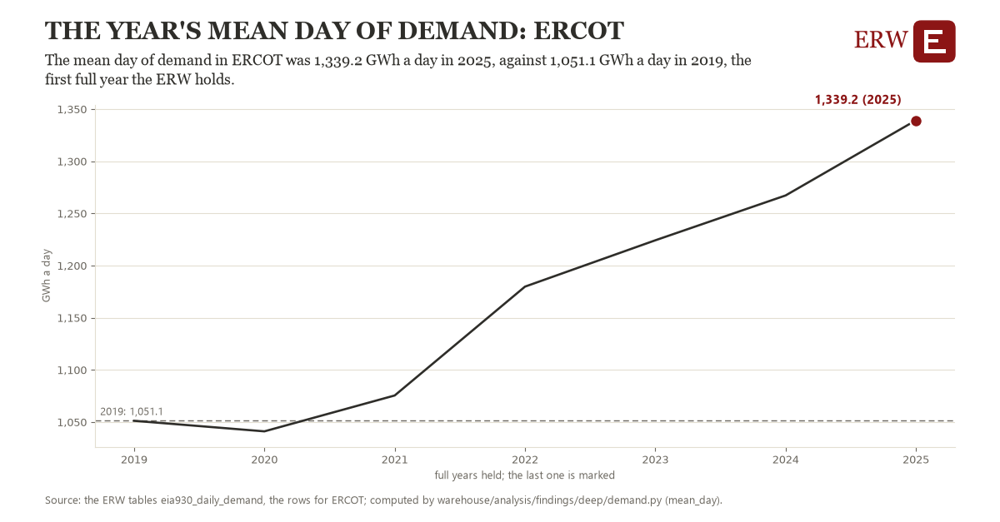

# The year's mean day of demand: ERCOT

Draft `scan-deep-f9e530bab496` of the findings hunt over the whole warehouse (chain 164), 2026-11-06. State: draft, not reviewed. Review at `/internal/findings`.

**The finding.** The mean day of demand in ERCOT was 1,339.2 GWh a day in 2025, against 1,051.1 GWh a day in 2019, the first full year the ERW holds.

**The figure by full year** (GWh a day): 2019: 1,051.1, 2020: 1,041.0, 2021: 1,075.4, 2022: 1,179.8, 2023: 1,224.2, 2024: 1,267.2, 2025: 1,339.2.

**The tables and rows.** `eia930_daily_demand`; the rows for ERCOT, region key `ercot_ba` (the card's `hunt.region`), years 2019 to 2025. The yearly values: `mean-day-ercot-ba.csv`.

**Its strength.** The change is 4.45 typical yearly moves (a typical move is 64.8 GWh a day, 1.4826 times the median absolute change between full years). Holds in more than one year: 5 of the 6 full years after 2019 lie above 2019's value. Survives a change of window: from 2020 to 2025 the change is 298.2, from 2019 to 2024 it is 216.0. Sample large enough: 2019 holds 365 and 2025 holds 365 observations; the floor is 330. Half the change remains without the first year: from 2020 to 2025 the change is 298.2, 103.5 percent of the change from 2019. At least one typical yearly move: the change is 4.45 typical yearly moves (64.8 GWh a day a year, the median move between full years); the floor is 1.

**Its limits.** Not adjusted for weather; EIA-930 as reported, and a respondent that changed its footprint changes its demand.

**Reproduce.** `python mean-day-ercot-ba.reproduce.py <the table's CSV>` and `do mean-day-ercot-ba.reproduce.do` (Stata) recompute the figures by year from the tables as the public downloads hold them; each names the expected values at its top.
