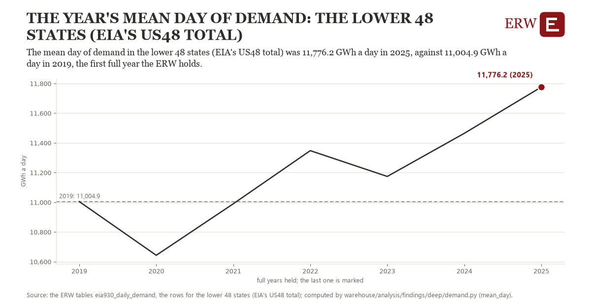

# The year's mean day of demand: the lower 48 states (EIA's US48 total)

Draft `scan-deep-ae89247e0230` of the findings hunt over the whole warehouse (chain 164), 2026-11-06. State: draft, not reviewed. Review at `/internal/findings`.

**The finding.** The mean day of demand in the lower 48 states (EIA's US48 total) was 11,776.2 GWh a day in 2025, against 11,004.9 GWh a day in 2019, the first full year the ERW holds.

**The figure by full year** (GWh a day): 2019: 11,004.9, 2020: 10,643.3, 2021: 10,990.0, 2022: 11,347.9, 2023: 11,174.2, 2024: 11,464.5, 2025: 11,776.2.

**The tables and rows.** `eia930_daily_demand`; the rows for the lower 48 states (EIA's US48 total), region key `us48` (the card's `hunt.region`), years 2019 to 2025. The yearly values: `mean-day-us48.csv`.

**Its strength.** The change is 1.58 typical yearly moves (a typical move is 488.0 GWh a day, 1.4826 times the median absolute change between full years). Holds in more than one year: 4 of the 6 full years after 2019 lie above 2019's value. Survives a change of window: from 2020 to 2025 the change is 1,132.9, from 2019 to 2024 it is 459.6. Sample large enough: 2019 holds 365 and 2025 holds 365 observations; the floor is 330. Half the change remains without the first year: from 2020 to 2025 the change is 1,132.9, 146.9 percent of the change from 2019. At least one typical yearly move: the change is 1.58 typical yearly moves (488.0 GWh a day a year, the median move between full years); the floor is 1.

**Its limits.** Not adjusted for weather; EIA-930 as reported, and a respondent that changed its footprint changes its demand.

**Reproduce.** `python mean-day-us48.reproduce.py <the table's CSV>` and `do mean-day-us48.reproduce.do` (Stata) recompute the figures by year from the tables as the public downloads hold them; each names the expected values at its top.
