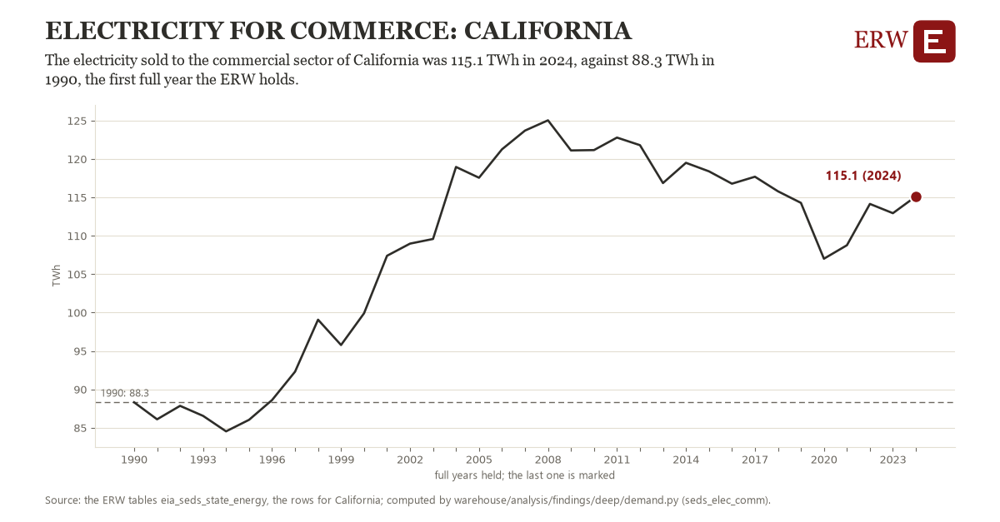

# Electricity for commerce: California

Draft `scan-deep-55524ecf63ef` of the findings hunt over the whole warehouse (chain 502), 2026-11-19. State: draft, not reviewed. Review at `/internal/findings`.

**The finding.** The electricity sold to the commercial sector of California was 115.1 TWh in 2024, against 88.3 TWh in 1990, the first full year the ERW holds.

**The figure by full year** (TWh): 1990: 88.3, 1991: 86.1, 1992: 87.8, 1993: 86.5, 1994: 84.5, 1995: 86.0, 1996: 88.6, 1997: 92.3, 1998: 99.1, 1999: 95.8, 2000: 99.9, 2001: 107.4, 2002: 109.0, 2003: 109.6, 2004: 119.0, 2005: 117.6, 2006: 121.3, 2007: 123.7, 2008: 125.0, 2009: 121.1, 2010: 121.2, 2011: 122.8, 2012: 121.8, 2013: 116.9, 2014: 119.5, 2015: 118.4, 2016: 116.8, 2017: 117.7, 2018: 115.8, 2019: 114.3, 2020: 107.0, 2021: 108.8, 2022: 114.1, 2023: 112.9, 2024: 115.1.

**The tables and rows.** `eia_seds_state_energy`; the rows for California, region key `sd_ca` (the card's `hunt.region`), years 1990 to 2024. The yearly values: `seds-elec-comm-sd-ca.csv`.

**Its strength.** The change is 9.25 typical yearly moves (a typical move is 2.9 TWh, 1.4826 times the median absolute change between full years). Holds in more than one year: 29 of the 34 full years after 1990 lie above 1990's value. Survives a change of window: from 1991 to 2024 the change is 29.0, from 1990 to 2023 it is 24.6. Sample large enough: 1990 holds 1 and 2024 holds 1 observations; the floor is 1. Half the change remains without the first year: from 1991 to 2024 the change is 29.0, 108.3 percent of the change from 1990. At least one typical yearly move: the change is 9.25 typical yearly moves (2.9 TWh a year, the median move between full years); the floor is 1.

**Its limits.** EIA's State Energy Data System, the latest release; the newest year is revised with each release; a state's consumption, wherever the energy was produced. TBtu over 3.412 gives TWh.

**Reproduce.** `python seds-elec-comm-sd-ca.reproduce.py <the table's CSV>` and `do seds-elec-comm-sd-ca.reproduce.do` (Stata) recompute the figures by year from the tables as the public downloads hold them; each names the expected values at its top.
