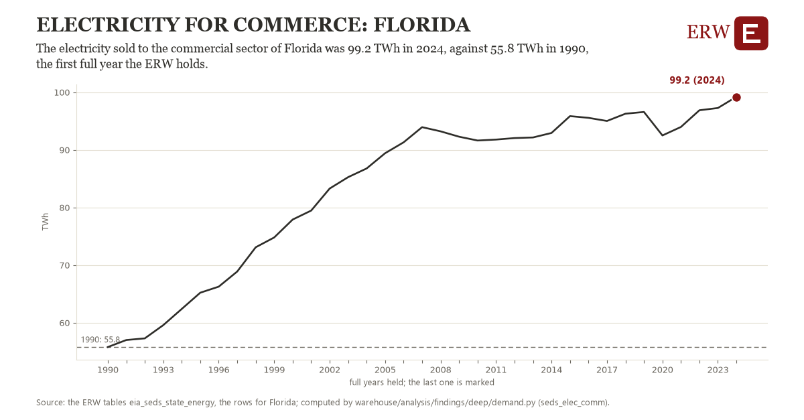

# Electricity for commerce: Florida

Draft `scan-deep-376b8866aa52` of the findings hunt over the whole warehouse (chain 502), 2026-11-19. State: draft, not reviewed. Review at `/internal/findings`.

**The finding.** The electricity sold to the commercial sector of Florida was 99.2 TWh in 2024, against 55.8 TWh in 1990, the first full year the ERW holds.

**The figure by full year** (TWh): 1990: 55.8, 1991: 57.0, 1992: 57.3, 1993: 59.6, 1994: 62.4, 1995: 65.2, 1996: 66.3, 1997: 68.9, 1998: 73.1, 1999: 74.8, 2000: 77.9, 2001: 79.5, 2002: 83.3, 2003: 85.3, 2004: 86.8, 2005: 89.4, 2006: 91.3, 2007: 93.9, 2008: 93.2, 2009: 92.3, 2010: 91.6, 2011: 91.8, 2012: 92.0, 2013: 92.1, 2014: 92.9, 2015: 95.8, 2016: 95.5, 2017: 95.0, 2018: 96.3, 2019: 96.6, 2020: 92.5, 2021: 94.0, 2022: 96.9, 2023: 97.3, 2024: 99.2.

**The tables and rows.** `eia_seds_state_energy`; the rows for Florida, region key `sd_fl` (the card's `hunt.region`), years 1990 to 2024. The yearly values: `seds-elec-comm-sd-fl.csv`.

**Its strength.** The change is 19.12 typical yearly moves (a typical move is 2.3 TWh, 1.4826 times the median absolute change between full years). Holds in more than one year: 34 of the 34 full years after 1990 lie above 1990's value. Survives a change of window: from 1991 to 2024 the change is 42.2, from 1990 to 2023 it is 41.5. Sample large enough: 1990 holds 1 and 2024 holds 1 observations; the floor is 1. Half the change remains without the first year: from 1991 to 2024 the change is 42.2, 97.2 percent of the change from 1990. At least one typical yearly move: the change is 19.12 typical yearly moves (2.3 TWh a year, the median move between full years); the floor is 1.

**Its limits.** EIA's State Energy Data System, the latest release; the newest year is revised with each release; a state's consumption, wherever the energy was produced. TBtu over 3.412 gives TWh.

**Reproduce.** `python seds-elec-comm-sd-fl.reproduce.py <the table's CSV>` and `do seds-elec-comm-sd-fl.reproduce.do` (Stata) recompute the figures by year from the tables as the public downloads hold them; each names the expected values at its top.
