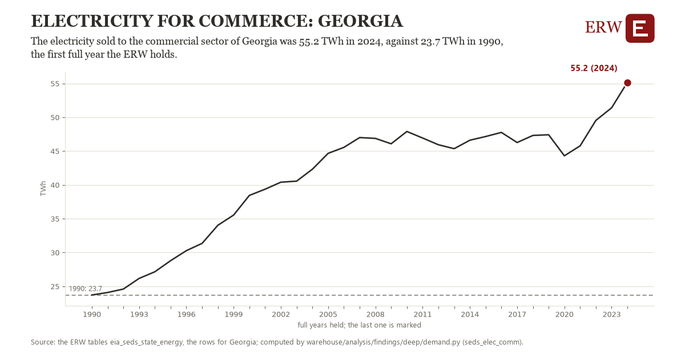

# Electricity for commerce: Georgia

Draft `scan-deep-55167cb67c7c` of the findings hunt over the whole warehouse (chain 502), 2026-11-19. State: draft, not reviewed. Review at `/internal/findings`.

**The finding.** The electricity sold to the commercial sector of Georgia was 55.2 TWh in 2024, against 23.7 TWh in 1990, the first full year the ERW holds.

**The figure by full year** (TWh): 1990: 23.7, 1991: 24.1, 1992: 24.6, 1993: 26.2, 1994: 27.1, 1995: 28.8, 1996: 30.3, 1997: 31.4, 1998: 34.0, 1999: 35.5, 2000: 38.4, 2001: 39.4, 2002: 40.4, 2003: 40.6, 2004: 42.3, 2005: 44.7, 2006: 45.5, 2007: 47.0, 2008: 46.9, 2009: 46.1, 2010: 47.9, 2011: 46.9, 2012: 45.9, 2013: 45.4, 2014: 46.6, 2015: 47.2, 2016: 47.8, 2017: 46.3, 2018: 47.3, 2019: 47.4, 2020: 44.3, 2021: 45.8, 2022: 49.5, 2023: 51.4, 2024: 55.2.

**The tables and rows.** `eia_seds_state_energy`; the rows for Georgia, region key `sd_ga` (the card's `hunt.region`), years 1990 to 2024. The yearly values: `seds-elec-comm-sd-ga.csv`.

**Its strength.** The change is 18.18 typical yearly moves (a typical move is 1.7 TWh, 1.4826 times the median absolute change between full years). Holds in more than one year: 34 of the 34 full years after 1990 lie above 1990's value. Survives a change of window: from 1991 to 2024 the change is 31.1, from 1990 to 2023 it is 27.7. Sample large enough: 1990 holds 1 and 2024 holds 1 observations; the floor is 1. Half the change remains without the first year: from 1991 to 2024 the change is 31.1, 98.8 percent of the change from 1990. At least one typical yearly move: the change is 18.18 typical yearly moves (1.7 TWh a year, the median move between full years); the floor is 1.

**Its limits.** EIA's State Energy Data System, the latest release; the newest year is revised with each release; a state's consumption, wherever the energy was produced. TBtu over 3.412 gives TWh.

**Reproduce.** `python seds-elec-comm-sd-ga.reproduce.py <the table's CSV>` and `do seds-elec-comm-sd-ga.reproduce.do` (Stata) recompute the figures by year from the tables as the public downloads hold them; each names the expected values at its top.
