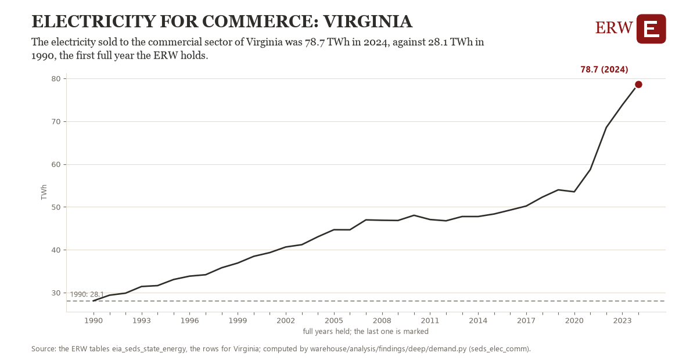

# Electricity for commerce: Virginia

Draft `scan-deep-53cfe409febd` of the findings hunt over the whole warehouse (chain 502), 2026-11-19. State: draft, not reviewed. Review at `/internal/findings`.

**The finding.** The electricity sold to the commercial sector of Virginia was 78.7 TWh in 2024, against 28.1 TWh in 1990, the first full year the ERW holds.

**The figure by full year** (TWh): 1990: 28.1, 1991: 29.4, 1992: 29.9, 1993: 31.4, 1994: 31.6, 1995: 33.1, 1996: 33.8, 1997: 34.2, 1998: 35.8, 1999: 36.9, 2000: 38.5, 2001: 39.3, 2002: 40.6, 2003: 41.2, 2004: 43.0, 2005: 44.7, 2006: 44.7, 2007: 47.0, 2008: 46.9, 2009: 46.8, 2010: 48.0, 2011: 47.1, 2012: 46.8, 2013: 47.8, 2014: 47.8, 2015: 48.3, 2016: 49.3, 2017: 50.2, 2018: 52.3, 2019: 54.0, 2020: 53.5, 2021: 58.7, 2022: 68.6, 2023: 73.8, 2024: 78.7.

**The tables and rows.** `eia_seds_state_energy`; the rows for Virginia, region key `sd_va` (the card's `hunt.region`), years 1990 to 2024. The yearly values: `seds-elec-comm-sd-va.csv`.

**Its strength.** The change is 32.62 typical yearly moves (a typical move is 1.6 TWh, 1.4826 times the median absolute change between full years). Holds in more than one year: 34 of the 34 full years after 1990 lie above 1990's value. Survives a change of window: from 1991 to 2024 the change is 49.3, from 1990 to 2023 it is 45.7. Sample large enough: 1990 holds 1 and 2024 holds 1 observations; the floor is 1. Half the change remains without the first year: from 1991 to 2024 the change is 49.3, 97.4 percent of the change from 1990. At least one typical yearly move: the change is 32.62 typical yearly moves (1.6 TWh a year, the median move between full years); the floor is 1.

**Its limits.** EIA's State Energy Data System, the latest release; the newest year is revised with each release; a state's consumption, wherever the energy was produced. TBtu over 3.412 gives TWh.

**Reproduce.** `python seds-elec-comm-sd-va.reproduce.py <the table's CSV>` and `do seds-elec-comm-sd-va.reproduce.do` (Stata) recompute the figures by year from the tables as the public downloads hold them; each names the expected values at its top.
